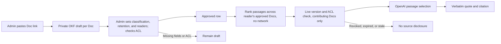

# BSB OKF Integration Optimization Record

## Relevant Code Map

| Area | Code and tests |
| --- | --- |
| Draft ingestion and publication | [Approval API](../../../apps/web/src/app/api/bsb/sources/route.ts), [Drive reader](../../../apps/web/src/lib/bsb/drive.ts), [OKF parser](../../../apps/web/src/lib/bsb/okf.ts), [private schema](../../../supabase/migrations/20261124000001_bsb_okf.sql), [release gate](../../../supabase/migrations/20261124000004_bsb_owner_release.sql), [approval route tests](../../../tests/api/bsb-sources-route.test.ts) |
| Chat authorization and citation | [BSB chat API](../../../apps/web/src/app/api/bsb/chat/route.ts), [chat hook](../../../apps/web/src/hooks/useAIChat.ts), [chatbot](../../../packages/ui/src/components/AIChatbot.tsx), [chat route tests](../../../tests/api/bsb-chat-route.test.ts), [browser spec](../../../e2e/bsb-okf.spec.ts) |
| Register disclosure and retention | [Register UI](../../../apps/web/src/components/admin/BsbApprovalRegister.tsx), [Approval API](../../../apps/web/src/app/api/bsb/sources/route.ts), [publication predicate](../../../apps/web/src/lib/bsb/okf.ts), [private schema](../../../supabase/migrations/20261124000001_bsb_okf.sql) |

## Visual Guide

## Decisions

| Status | Problem and evidence | Solution and code paths | Validation or resume condition |
| --- | --- | --- | --- |
| Implemented | Ordinary AI Knowledge indexing and semantic caching do not carry source-specific Drive ACLs or approval state. | Keep BSB OKF in a private table and separate chat route; recheck source version, direct principal ACL, expiry, and revocation for candidate passages. See Approval API and chat API above. | Local and production migrations were applied. Local authorized and denial paths passed; the first source was approved in production on November 25, with a cited answer shown in a user-supplied screenshot. |
| Implemented | Generating prose from an untrusted meeting note could introduce unsupported claims or follow instructions embedded in the note. | Store the full raw source snapshot verbatim, derive passages that must occur in it, and let the model select one passage ID; the server emits only that exact quote and citation. See OKF parser and chat API. | Parser and route tests passed; an adversarial live model prompt and production authorized browser matrix remain unverified. |
| Audited | A Viewer service account could export the Doc but Google returned 403 for `permissions.list`; publication had to fail closed. | The user granted Editor on only the exact Doc. The service account can now read a complete ACL while the API token still has `drive.readonly` scope. See Drive reader. | Read-only metadata check succeeded November 24. Recheck after any permission or credential change. |
| Implemented | Authorized chat had never run; a `Z` vs `+00:00` string comparison on the source version made every approval and every authorized chat fail. | `isSameInstant` in the OKF module, used by the Approval API and chat API. | 2026-11-24 live local cycle as Cef: cited verbatim answer, abstention, stale-version 404, revoke 404; route and unit tests. |
| Implemented | With many Docs, rechecking every approved Doc on every question would multiply Google calls, and the full-text export was only used for its version. | Rank passages from stored snapshots first; live-check (metadata-only `readDocVersion` + `permissions.list`) only Docs that contributed passages, in parallel; drop failing Docs. See chat API and Drive reader. | Route tests assert only contributing Docs are checked and none for no-match questions. |
| Deferred | Latency of the BSB chat path (multi-Doc fan-out, removal of the per-question export) is unmeasured. `pnpm performance:latency` only measures read-only GET routes; BSB chat is a POST that consumes rate-limit quota and calls OpenAI. | Add phase timing with `apps/web/src/lib/observability/timing.ts` (rank, live check, model) and measure with an authorized local reader. | Resume when a POST-capable measurement target or timing-log capture is added; record p50/p95 before claiming any speed change. |

## Audit — 2026-11-26

This was a read-only code and configuration review. The local BSB parser and route tests passed (19/19). The production Cef journey is supported by the November 25 user-supplied screenshot, not by an independent signed-in browser run in this audit.

| Priority / status | Problem and evidence | Proposed solution and code paths | Validation or resume condition |
| --- | --- | --- | --- |
| High / Implemented | The register previously returned `okf.sourceText` to every active app admin, and import did not check the importing admin's direct Doc permission. [Approval API](../../../apps/web/src/app/api/bsb/sources/route.ts), [register UI](../../../apps/web/src/components/admin/BsbApprovalRegister.tsx). | The list now returns metadata only. A separate draft-detail request returns passages, never `sourceText`, only after live direct-email and version checks. Import checks the caller's direct permission before export; approval checks it again. Admins can still see register metadata. | 2026-11-26: web type check; 24 focused parser/route tests; focused Playwright passed for protected review at desktop/mobile and denied review; screenshots inspected. Production deployment and signed-in production verification remain to be completed. |
| High / Audited | Live read-only ACL check of the known Doc found one `anyone` Viewer permission (`allowFileDiscovery=false`), plus direct Cef and service-account permissions. BSB chat ignores link sharing, but the Google Doc itself remains open to anyone with its link. | If the intended audience is limited to named people, set Google Drive General access to Restricted. This is a file-owner decision, not an app migration. [Google Drive's sharing guidance](https://support.google.com/drive/answer/7166529?hl=en) describes the difference. | Re-read the complete ACL and confirm no `anyone` permission after the owner changes sharing. |
| High / Audited | `retention_until` and access expiry only make `isPublishable` false. Revoke also leaves the verbatim snapshot in `okf`, and no BSB purge route or scheduled deletion exists. This affects future `until` sources; the current source uses `Never`. [Publication predicate](../../../apps/web/src/lib/bsb/okf.ts), [approval API](../../../apps/web/src/app/api/bsb/sources/route.ts). | Define whether an `until` date means end of chat access or deletion of retained text. If deletion, add a server-owned purge job and explicit delete workflow with an audit record, accounting for backups. | Local expiry/revoke/delete tests show the stored text is removed at the defined time; document backup retention. |
| Medium / Audited | Approval reads a draft, checks Google, then updates by `id` and `decision='draft'` only. A concurrent re-import can replace that draft between read and update; the approval can overwrite the fresh snapshot with the earlier row. [Approval API](../../../apps/web/src/app/api/bsb/sources/route.ts). | Use an optimistic version predicate (`updated_at` or source version) or a database transaction so approval fails and retries when the draft changes. | Concurrency test interleaves re-import and approval and confirms the newer draft is never overwritten. |
| Medium / Audited | Chat scans at most 50 approved rows without a stable order and ranks only the top 12 keyword matches before live ACL checks. Stale high-ranked passages can crowd out a live answer; short terms such as `AI` and non-ASCII words are not indexed. A no-match question abstains without a live ACL check. [Chat API](../../../apps/web/src/app/api/bsb/chat/route.ts). | Make source enumeration deterministic and paginated, then expand live-checked candidates until a usable set is found. Improve tokenization and decide whether no-match answers must also verify current access. | Tests with 51+ sources, stale top-ranked Docs, short terms, and lost ACL on a no-match question. Measure latency before claiming improvement. |
| Medium / Audited | The register offers one-click Re-import for approved and revoked sources, which immediately returns an approved source to draft. Chat citations show the stored title and quote but no direct path to the Google Doc for a permitted reader. [Register UI](../../../apps/web/src/components/admin/BsbApprovalRegister.tsx), [citation panel](../../../packages/ui/src/components/ai-chat/CitationPanel.tsx). | Confirm the re-import impact before the mutation and show current source health. Add a Google Doc link to citations only after authorization; [Microsoft's Copilot source review](https://support.microsoft.com/en-us/microsoft-365-copilot/control-review-sources-copilot-chat) shows a useful source-opening pattern. | Browser test covers confirmation, failure, mobile layout, and authorized source opening. |
| Medium / Deferred | A signed-in production desktop/mobile journey as Cef and latency measurements remain unverified by this audit. The existing browser spec mocks the source API. [Browser spec](../../../e2e/bsb-okf.spec.ts), [chat API](../../../apps/web/src/app/api/bsb/chat/route.ts). | Run a permissioned production browser pass without logging note text; add local phase timing and a POST-capable benchmark before optimizing. | Screenshots and console/network results for Cef at ~1440px and ~390px; local p50/p95 before and after any latency change. |

## Change Log

- 2026-11-24: Implemented private draft, approval, revocation, and cited chat path. Audited Drive ACL access before and after the single-file Editor grant, then confirmed Cef's direct Viewer access. Type check, two unit tests, two focused browser tests, and a review-form non-overlap rerun passed. No latency claim or measurement was made; latency optimization is outside this task.
- 2026-11-24: Stored the full raw note snapshot in OKF after user clarified “verbatim copy.” Applied the migration and imported one private real draft to local Supabase. Verified table RLS denial and generic unapproved-chat denial. No model call was made with note content.
- 2026-11-24: Added required evidence references for source-owner authority, indefinite retention, and OpenAI processing. Applied the second migration locally. Type check, two unit tests, and the review-form browser test passed; inspected the updated screenshot.
- 2026-11-24: Fixed the source-version comparison and verified authorized chat live as a local Cef account. Moved from one env-configured Doc to any number of admin-imported Docs with per-Doc approval; chat ranks locally then live-checks only contributing Docs using metadata only. 13 unit/route tests, web type check, and 3 browser tests passed. No latency measurement was possible with the GET-only harness; no speed claim is made.
- 2026-11-26: Audited the released BSB flow without changing runtime code. Read the source, chat, Drive, UI, migrations, tests, and tracker; 19 focused tests passed. A live read-only ACL check confirmed direct Cef/service access and an `anyone` Viewer permission. Recorded access-scope, retention, concurrency, retrieval, browser-verification, and UX follow-ups above. No production account or note-content browser session was used.
- 2026-11-26: Implemented the source-management disclosure fix in the Approval API and register UI. The list is metadata-only; a protected draft-detail read checks the admin's live direct permission and source version; import and approval require that permission. Web type check, 24 focused parser/route tests, and focused Playwright desktop/mobile review plus denied-state runs passed. The local server was stopped. The known Doc's general sharing was not changed.
