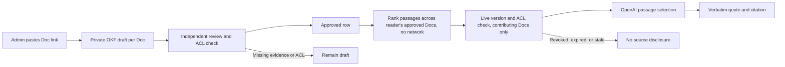

# BSB OKF Integration Optimization Record

## Relevant Code Map

| Area | Code and tests |
| --- | --- |
| Draft ingestion and publication | [Approval API](../../../apps/web/src/app/api/bsb/sources/route.ts), [Drive reader](../../../apps/web/src/lib/bsb/drive.ts), [OKF parser](../../../apps/web/src/lib/bsb/okf.ts), [private schema](../../../supabase/migrations/20261124000001_bsb_okf.sql), [evidence gate](../../../supabase/migrations/20261124000002_bsb_approval_evidence.sql), [unit test](../../../tests/lib/bsb-okf.test.ts) |
| Chat authorization and citation | [BSB chat API](../../../apps/web/src/app/api/bsb/chat/route.ts), [chat hook](../../../apps/web/src/hooks/useAIChat.ts), [chatbot](../../../packages/ui/src/components/AIChatbot.tsx), [browser spec](../../../e2e/bsb-okf.spec.ts) |

## Visual Guide

## Decisions

| Status | Problem and evidence | Solution and code paths | Validation or resume condition |
| --- | --- | --- | --- |
| Implemented | Ordinary AI Knowledge indexing and semantic caching do not carry source-specific Drive ACLs or approval state. | Keep BSB OKF in a private table and separate chat route; recheck source version, direct principal ACL, expiry, and revocation on each question. See Approval API and chat API above. | Local migration and real private import passed; anon/authenticated direct table reads were denied and unapproved chat returned generic 404. Approved chat awaits independent evidence. |
| Implemented | Generating prose from an untrusted meeting note could introduce unsupported claims or follow instructions embedded in the note. | Store the full raw source snapshot verbatim, derive passages that must occur in it, and let the model select one passage ID; the server emits only that exact quote and citation. See OKF parser and chat API. | Parser and publication-gate tests passed; adversarial live model cases remain for November 26. |
| Audited | A Viewer service account could export the Doc but Google returned 403 for `permissions.list`; publication had to fail closed. | The user granted Editor on only the exact Doc. The service account can now read a complete ACL while the API token still has `drive.readonly` scope. See Drive reader. | Read-only metadata check succeeded November 24. Recheck after any permission or credential change. |
| Implemented | Authorized chat had never run; a `Z` vs `+00:00` string comparison on the source version made every approval and every authorized chat fail. | `isSameInstant` in the OKF module, used by the Approval API and chat API. | 2026-11-24 live local cycle as Cef: cited verbatim answer, abstention, stale-version 404, revoke 404; route and unit tests. |
| Implemented | With many Docs, rechecking every approved Doc on every question would multiply Google calls, and the full-text export was only used for its version. | Rank passages from stored snapshots first; live-check (metadata-only `readDocVersion` + `permissions.list`) only Docs that contributed passages, in parallel; drop failing Docs. See chat API and Drive reader. | Route tests assert only contributing Docs are checked and none for no-match questions. |
| Deferred | Latency of the BSB chat path (multi-Doc fan-out, removal of the per-question export) is unmeasured. `pnpm performance:latency` only measures read-only GET routes; BSB chat is a POST that consumes rate-limit quota and calls OpenAI. | Add phase timing with `apps/web/src/lib/observability/timing.ts` (rank, live check, model) and measure with an authorized local reader. | Resume when a POST-capable measurement target or timing-log capture is added; record p50/p95 before claiming any speed change. |

## Change Log

- 2026-11-24: Implemented private draft, approval, revocation, and cited chat path. Audited Drive ACL access before and after the single-file Editor grant, then confirmed Cef's direct Viewer access. Type check, two unit tests, two focused browser tests, and a review-form non-overlap rerun passed. No latency claim or measurement was made; latency optimization is outside this task.
- 2026-11-24: Stored the full raw note snapshot in OKF after user clarified “verbatim copy.” Applied the migration and imported one private real draft to local Supabase. Verified table RLS denial and generic unapproved-chat denial. No model call was made with note content.
- 2026-11-24: Added required evidence references for source-owner authority, indefinite retention, and OpenAI processing. Applied the second migration locally. Type check, two unit tests, and the review-form browser test passed; inspected the updated screenshot.
- 2026-11-24: Fixed the source-version comparison and verified authorized chat live as a local Cef account. Moved from one env-configured Doc to any number of admin-imported Docs with per-Doc approval; chat ranks locally then live-checks only contributing Docs using metadata only. 13 unit/route tests, web type check, and 3 browser tests passed. No latency measurement was possible with the GET-only harness; no speed claim is made.
