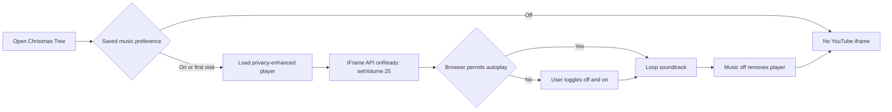

# Christmas Tree Optimization Record

## Current Status

Christmas wish persistence respects the soft-delete uniqueness model, all wish categories are available through a compact tabbed editor, and the soundtrack has an explicit user control with a remembered opt-out. Admins can place multiple independent Garland and Lights strands directly on the tree; saved strands now remain visibly at their dropped position while a move is saved. Browser autoplay policy and the cost of loading a third-party player remain external constraints.

## Relevant Code Map

- [Christmas Tree page](../../../apps/web/src/app/(app)/(employee)/christmas-tree/page.tsx) - soundtrack preference, YouTube player, and visible control.
- [Strand interaction](../../../apps/web/src/app/(app)/(employee)/christmas-tree/ChristmasTreeStrand.tsx) - fixed-size bulbs, sagging wire, independent drag and endpoint resize controls.
- [Christmas Tree client mutations](../../../apps/web/src/hooks/useChristmasTree.ts) - optimistic saved-strand geometry, ordered writes, rollback, and server reconciliation.
- [Christmas Tree API helpers](../../../apps/web/src/app/api/christmas-tree/_lib.ts) - active-wish update/insert persistence and concurrent-save recovery.
- [Christmas Tree schema](../../../apps/web/src/lib/schemas/christmas-tree.schema.ts) - wish-category limits and personal-only link normalization.
- [Christmas Tree Playwright coverage](../../../e2e/christmas-tree-layout.spec.ts) - enable/disable, persistence, responsive, and error-state coverage.
- [Christmas Tree API tests](../../../tests/api/christmas-tree-wish-write.test.ts) - first-save and edit persistence coverage.
- [Admin API tests](../../../tests/api/christmas-tree-admin-controls.test.ts) - strand create/update and admin authorization coverage.
- [Strand migration](../../../supabase/migrations/20261022000002_add_christmas_tree_strand_geometry.sql) - independent rows per Garland or Lights strand.
- [Always-available wish migration](../../../supabase/migrations/20261021000001_remove_christmas_wish_windows.sql) - removes month-based write and visibility restrictions while retaining event safeguards.
- [Christmas Tree schema tests](../../../tests/schemas/christmas-tree.test.ts) - link policy and wish payload validation.
- [Task tracker](./task-tracker.md) - delivery status and validation history.

## Optimizations

### Immediate strand release response

- **Status:** Implemented
- **Problem/evidence:** Releasing a moved strand cleared its local drag geometry before the PATCH returned, briefly snapping it back to the old position. With a controlled 250 ms save delay, 30 browser samples measured release-to-stable visual p50 295.3 ms and p95 307.3 ms.
- **Solution:** Keep the dropped geometry visible until the shared snapshot reflects it. For existing strands, update the Christmas Tree cache optimistically, serialize writes per strand to preserve drag order, and roll back to the last confirmed geometry on failure. New strand creation remains server-confirmed.
- **Code paths:** `apps/web/src/app/(app)/(employee)/christmas-tree/ChristmasTreeStrand.tsx`, `apps/web/src/app/(app)/(employee)/christmas-tree/page.tsx`, `apps/web/src/hooks/useChristmasTree.ts`, `e2e/christmas-tree-layout.spec.ts`, `docs/apps/web/architecture/optimistic-ui.md`.
- **Validation:** Web type-check passed. Final focused Playwright with an intercepted 250 ms PATCH measured 30 after samples at p50 28.4 ms and p95 41.5 ms, verified rollback after a 500 response, and checked mobile overflow. The admin/super-admin placement regression passed in the same 3/3 browser run.

### Direct, repeatable tree decoration placement

- **Status:** Implemented
- **Problem/evidence:** A one-click decoration could only appear at a fixed location; a single geometry slot would also overwrite an earlier strand, preventing admins from building a fuller tree. Scaling one graphic to make it longer would distort bulbs or Garland thickness.
- **Solution:** Store each Garland and Lights strand as a separate row. Admins drag across the tree to add any number, drag a saved wire to move it, or pull either endpoint to resize it. A quadratic curve adds bounded sag as the span grows; the line uses non-scaling stroke width, and bulbs keep fixed pixel dimensions with count varying by span. Shared edits are server-confirmed because authorization and other viewers' state must be reconciled.
- **Code paths:** `apps/web/src/app/(app)/(employee)/christmas-tree/page.tsx`, `apps/web/src/app/(app)/(employee)/christmas-tree/ChristmasTreeStrand.tsx`, `apps/web/src/app/api/christmas-tree/_lib.ts`, `apps/web/src/hooks/useChristmasTree.ts`, `supabase/migrations/20261022000002_add_christmas_tree_strand_geometry.sql`, `e2e/christmas-tree-layout.spec.ts`.
- **Validation:** Local migration applied; web type-check passed; focused API tests passed 7/7; focused Playwright passed 2/2 for admin and super-admin, with two strands of each type, endpoint resize, wire drag, reload persistence, desktop/mobile screenshots, no feature request failures, no console errors, and no horizontal overflow. No latency improvement is claimed or measured.

### User-controlled seasonal music

- **Status:** Implemented
- **Problem/evidence:** Background audio can be festive but also disruptive, inaccessible, or blocked by browser autoplay rules. Loading a YouTube embed also initiates a third-party request.
- **Solution:** Default the soundtrack preference on for a first visit, expose a labelled and pressed-state-aware toggle, persist opt-out in local storage, remove the iframe entirely while disabled, and use `youtube-nocookie.com`. If autoplay is blocked, an off/on click supplies the user gesture needed by common browser policies.
- **Code paths:** `apps/web/src/app/(app)/(employee)/christmas-tree/page.tsx`, `e2e/christmas-tree-layout.spec.ts`.
- **Validation:** TypeScript passed. `pnpm exec playwright test --config playwright.local.config.ts e2e/christmas-tree-layout.spec.ts` passed 3/3 tests and verifies the default state, iframe source, disable/enable behavior, saved opt-out restoration on a new visit, and desktop/mobile presentation with no feature request failures or console errors. The cross-origin player is mocked during automated tests, so actual audible playback remains dependent on YouTube availability and the user's browser autoplay policy.
- **Volume (2026-10-14):** The embed URL has no volume parameter, so the iframe now enables `enablejsapi=1` and the page attaches a `YT.Player` from the YouTube IFrame Player API, calling `setVolume(25)` then `playVideo()` on ready. The API script loads once per page lifetime (shared promise) and only while music is on; if it fails to load, playback falls back to the embed's default volume and the toggle keeps working. The player is destroyed when music is turned off. Playwright stubs `https://www.youtube.com/iframe_api` and asserts the player receives exactly `25` and `playVideo` is called.

### Relevant wish fields by category

- **Status:** Implemented
- **Problem/evidence:** The optional URL field appeared for November and December wishes even though the client only wants product links attached to the three Personal Wishes. This added an irrelevant input and allowed non-personal link data to reach the ornament dialog.
- **Solution:** Render and display links only for `personal` wishes, label the three category regions for assistive technology, and normalize every non-personal wish payload to `linkUrl: null` at the shared schema boundary.
- **Code paths:** `apps/web/src/app/(app)/(employee)/christmas-tree/page.tsx`, `apps/web/src/lib/schemas/christmas-tree.schema.ts`, `tests/schemas/christmas-tree.test.ts`, `e2e/christmas-tree-layout.spec.ts`.
- **Validation:** TypeScript passed; the focused schema suite passed 7/7 tests; Playwright asserts exactly three URL fields and none in the “Wish for Others” or “Wish for SN” regions.

### Reliable wish persistence with soft deletes

- **Status:** Implemented
- **Problem/evidence:** Active wishes are protected by a partial unique index on ornament, category, and item number with `WHERE deleted_at IS NULL`. The API supplied only those columns to `ON CONFLICT`, so PostgreSQL could not infer the partial index and both one-wish and three-wish saves returned the generic failure banner.
- **Solution:** Update the matching active row first and insert only when it does not exist. If concurrent first saves cause a unique violation, retry the update. This retains historical soft-deleted rows without weakening database constraints.
- **Code paths:** `apps/web/src/app/api/christmas-tree/_lib.ts`, `tests/api/christmas-tree-wish-write.test.ts`, `e2e/christmas-tree-layout.spec.ts`.
- **Validation:** Web type-check passed; the focused API suite passed 2/2 tests for first-save and edit paths; the focused Playwright suite passed 3/3 and saved all three Personal Wishes without displaying the save-error banner. No migration or latency claim was involved.

### Always-available tabbed wish entry

- **Status:** Implemented
- **Problem/evidence:** Separate monthly windows prevented users from returning to earlier wish categories and left the wish card dominated by sequential sections or lock messages. The restriction existed in API category state, the database write trigger, and the wish visibility policy.
- **Solution:** Keep every category editable while the Christmas Tree event is active, remove month predicates from the database write and read rules, and show Personal, Others, and SN as accessible tabs. Personal remains the only category with optional link fields.
- **Code paths:** `apps/web/src/app/(app)/(employee)/christmas-tree/page.tsx`, `apps/web/src/app/api/christmas-tree/_lib.ts`, `supabase/migrations/20261021000001_remove_christmas_wish_windows.sql`, `tests/api/christmas-tree-wish-write.test.ts`, `e2e/christmas-tree-layout.spec.ts`.
- **Validation:** The migration applied to local Supabase; web type-check passed; focused API/schema tests passed 9/9; focused Playwright passed 3/3 after saving three Personal wishes, one Others wish, and one SN wish, with desktop/mobile screenshots reviewed. Database lint surfaced only a pre-existing unrelated knowledge-source function error.

## Measurements

### Strand drag release, 2026-10-22

- **Status:** Implemented
- **Environment:** Commit `62e59369`, dirty worktree before and after; Windows local machine, Next dev and local Supabase. Browser journey used an admin with mocked auth on port 3002 and a controlled 250 ms PATCH. Read-only GET sampler used the local sample admin on port 3001. No production or staging traffic.
- **Samples:** 30 measured browser drags with 3 warmups before and after; 30 GET samples per route with 3 warmups. All sampled GETs returned 200.

| Metric | Before p50 | After p50 | Δ p50 | Before p95 | After p95 | Δ p95 |
| --- | ---: | ---: | ---: | ---: | ---: | ---: |
| Drag release → stable strand position | 295.3 ms | 28.4 ms | -266.9 ms | 307.3 ms | 41.5 ms | -265.8 ms |
| GET `/christmas-tree` total | 250.2 ms | 255.5 ms | +5.4 ms | 343.2 ms | 312.7 ms | -30.6 ms |
| GET `/api/christmas-tree/current` total | 153.2 ms | 143.1 ms | -10.1 ms | 224.6 ms | 189.2 ms | -35.4 ms |
| Control GET `/dashboard` total | 302.1 ms | 311.1 ms | +9.0 ms | 503.9 ms | 374.2 ms | -129.7 ms |

The measured improvement is the local visual response after release, not server or network speed. GET deltas are within or confounded by control-route drift and are not claimed as an API speedup. Raw runs: `perf-results/christmas-tree/2026-10-22T04-47-42-549Z-before.json` and `2026-10-22T04-57-18-450Z-after.json` (gitignored).

### Third-party player page-load cost

- **Status:** Deferred
- **Date:** 2026-10-14
- **Reason:** No pre-change browser resource-timing baseline was captured before implementation. The repository's `pnpm performance:latency` sampler measures application route totals and TTFB, not the asynchronous cross-origin YouTube iframe, so running it now would not produce a valid before/after comparison for this change.
- **Resume condition:** Create a separate pre-change worktree, run the same local employee journey with a Playwright resource-timing harness for at least 30 samples and 3 warmups, repeat against the current worktree, and record iframe/page-load p50 and p95 here. The closest server-route control command is `pnpm performance:latency --feature christmas-tree --targets "/christmas-tree,/api/christmas-tree/current" --label before` (and the identical command with `--label after`), but browser resource timing is additionally required for the media request and, since the volume change, the `youtube.com/iframe_api` script request.

## Visual Guide

## Change Log

- 2026-10-22: Removed the snap-back after a saved strand is released. Added optimistic geometry with rollback and ordered per-strand saves, then measured 30 browser drags before and after and read-only local GET controls. The final visual p50/p95 changed from 295.3/307.3 ms to 28.4/41.5 ms; no API speedup is claimed.

- 2026-10-22: Replaced one-position Garland/Lights editing with repeatable, directly placed strands. Applied the new table to local Supabase, verified admin and super-admin interactions in Playwright, and retained fixed bulb and cable thickness while lengthening.

- 2026-10-14: Implemented the persistent soundtrack control, documented browser autoplay and third-party-load tradeoffs, and deferred numeric browser-load comparison until a valid pre-change baseline can be captured.
- 2026-10-14: Removed irrelevant link fields from November and December wishes and enforced the same personal-only rule at the schema boundary.
- 2026-10-14: Set soundtrack volume to 25% via the YouTube IFrame Player API; added the `iframe_api` script to the deferred third-party load measurement.
- 2026-10-16: Replaced the wish upsert that was incompatible with the active-row partial unique index, added first-save/edit regression coverage, and verified all three Personal Wish submissions in Playwright.
- 2026-10-21: Removed monthly wish restrictions across the API, database trigger, and visibility policy, and replaced the stacked editor with three accessible category tabs. Local migration and focused browser validation completed; production migration `20261021000001` was dry-run, applied to project `tccdupkjmwwxcvpqnpeb`, and verified in the linked migration history.
