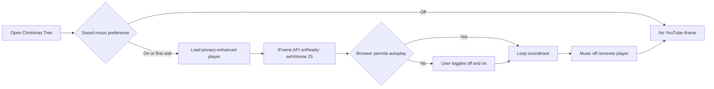

# Christmas Tree Optimization Record

## Current Status

Christmas wish persistence now respects the soft-delete uniqueness model, and the soundtrack is implemented with an explicit user control and a remembered opt-out. Browser autoplay policy and the cost of loading a third-party player remain external constraints.

## Relevant Code Map

- [Christmas Tree page](../../../apps/web/src/app/(app)/(employee)/christmas-tree/page.tsx) - soundtrack preference, YouTube player, and visible control.
- [Christmas Tree API helpers](../../../apps/web/src/app/api/christmas-tree/_lib.ts) - active-wish update/insert persistence and concurrent-save recovery.
- [Christmas Tree schema](../../../apps/web/src/lib/schemas/christmas-tree.schema.ts) - wish-category limits and personal-only link normalization.
- [Christmas Tree Playwright coverage](../../../e2e/christmas-tree-layout.spec.ts) - enable/disable, persistence, responsive, and error-state coverage.
- [Christmas Tree API tests](../../../tests/api/christmas-tree-wish-write.test.ts) - first-save and edit persistence coverage.
- [Christmas Tree schema tests](../../../tests/schemas/christmas-tree.test.ts) - link policy and wish payload validation.
- [Task tracker](./task-tracker.md) - delivery status and validation history.

## Optimizations

### User-controlled seasonal music

- **Status:** Implemented
- **Problem/evidence:** Background audio can be festive but also disruptive, inaccessible, or blocked by browser autoplay rules. Loading a YouTube embed also initiates a third-party request.
- **Solution:** Default the soundtrack preference on for a first visit, expose a labelled and pressed-state-aware toggle, persist opt-out in local storage, remove the iframe entirely while disabled, and use `youtube-nocookie.com`. If autoplay is blocked, an off/on click supplies the user gesture needed by common browser policies.
- **Code paths:** `apps/web/src/app/(app)/(employee)/christmas-tree/page.tsx`, `e2e/christmas-tree-layout.spec.ts`.
- **Validation:** TypeScript passed. `pnpm exec playwright test --config playwright.local.config.ts e2e/christmas-tree-layout.spec.ts` passed 3/3 tests and verifies the default state, iframe source, disable/enable behavior, saved opt-out restoration on a new visit, and desktop/mobile presentation with no feature request failures or console errors. The cross-origin player is mocked during automated tests, so actual audible playback remains dependent on YouTube availability and the user's browser autoplay policy.
- **Volume (2026-10-14):** The embed URL has no volume parameter, so the iframe now enables `enablejsapi=1` and the page attaches a `YT.Player` from the YouTube IFrame Player API, calling `setVolume(25)` then `playVideo()` on ready. The API script loads once per page lifetime (shared promise) and only while music is on; if it fails to load, playback falls back to the embed's default volume and the toggle keeps working. The player is destroyed when music is turned off. Playwright stubs `https://www.youtube.com/iframe_api` and asserts the player receives exactly `25` and `playVideo` is called.

### Relevant wish fields by category

- **Status:** Implemented
- **Problem/evidence:** The optional URL field appeared for November and December wishes even though the client only wants product links attached to the three Personal Wishes. This added an irrelevant input and allowed non-personal link data to reach the ornament dialog.
- **Solution:** Render and display links only for `personal` wishes, label the three category regions for assistive technology, and normalize every non-personal wish payload to `linkUrl: null` at the shared schema boundary.
- **Code paths:** `apps/web/src/app/(app)/(employee)/christmas-tree/page.tsx`, `apps/web/src/lib/schemas/christmas-tree.schema.ts`, `tests/schemas/christmas-tree.test.ts`, `e2e/christmas-tree-layout.spec.ts`.
- **Validation:** TypeScript passed; the focused schema suite passed 7/7 tests; Playwright asserts exactly three URL fields and none in the “Wish for Others” or “Wish for SN” regions.

### Reliable wish persistence with soft deletes

- **Status:** Implemented
- **Problem/evidence:** Active wishes are protected by a partial unique index on ornament, category, and item number with `WHERE deleted_at IS NULL`. The API supplied only those columns to `ON CONFLICT`, so PostgreSQL could not infer the partial index and both one-wish and three-wish saves returned the generic failure banner.
- **Solution:** Update the matching active row first and insert only when it does not exist. If concurrent first saves cause a unique violation, retry the update. This retains historical soft-deleted rows without weakening database constraints.
- **Code paths:** `apps/web/src/app/api/christmas-tree/_lib.ts`, `tests/api/christmas-tree-wish-write.test.ts`, `e2e/christmas-tree-layout.spec.ts`.
- **Validation:** Web type-check passed; the focused API suite passed 2/2 tests for first-save and edit paths; the focused Playwright suite passed 3/3 and saved all three Personal Wishes without displaying the save-error banner. No migration or latency claim was involved.

## Measurements

### Third-party player page-load cost

- **Status:** Deferred
- **Date:** 2026-10-14
- **Reason:** No pre-change browser resource-timing baseline was captured before implementation. The repository's `pnpm performance:latency` sampler measures application route totals and TTFB, not the asynchronous cross-origin YouTube iframe, so running it now would not produce a valid before/after comparison for this change.
- **Resume condition:** Create a separate pre-change worktree, run the same local employee journey with a Playwright resource-timing harness for at least 30 samples and 3 warmups, repeat against the current worktree, and record iframe/page-load p50 and p95 here. The closest server-route control command is `pnpm performance:latency --feature christmas-tree --targets "/christmas-tree,/api/christmas-tree/current" --label before` (and the identical command with `--label after`), but browser resource timing is additionally required for the media request and, since the volume change, the `youtube.com/iframe_api` script request.

## Visual Guide

## Change Log

- 2026-10-14: Implemented the persistent soundtrack control, documented browser autoplay and third-party-load tradeoffs, and deferred numeric browser-load comparison until a valid pre-change baseline can be captured.
- 2026-10-14: Removed irrelevant link fields from November and December wishes and enforced the same personal-only rule at the schema boundary.
- 2026-10-14: Set soundtrack volume to 25% via the YouTube IFrame Player API; added the `iframe_api` script to the deferred third-party load measurement.
- 2026-10-16: Replaced the wish upsert that was incompatible with the active-row partial unique index, added first-save/edit regression coverage, and verified all three Personal Wish submissions in Playwright.
