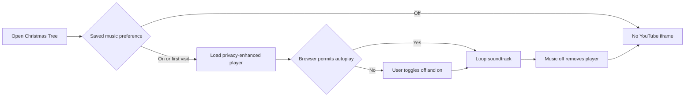

# Christmas Tree Optimization Record

## Current Status

The Christmas Tree soundtrack is implemented with an explicit user control and a remembered opt-out. Browser autoplay policy and the cost of loading a third-party player remain external constraints.

## Relevant Code Map

- [Christmas Tree page](../../../apps/web/src/app/(app)/(employee)/christmas-tree/page.tsx) - soundtrack preference, YouTube player, and visible control.
- [Christmas Tree Playwright coverage](../../../e2e/christmas-tree-layout.spec.ts) - enable/disable, persistence, responsive, and error-state coverage.
- [Task tracker](./task-tracker.md) - delivery status and validation history.

## Optimizations

### User-controlled seasonal music

- **Status:** Implemented
- **Problem/evidence:** Background audio can be festive but also disruptive, inaccessible, or blocked by browser autoplay rules. Loading a YouTube embed also initiates a third-party request.
- **Solution:** Default the soundtrack preference on for a first visit, expose a labelled and pressed-state-aware toggle, persist opt-out in local storage, remove the iframe entirely while disabled, and use `youtube-nocookie.com`. If autoplay is blocked, an off/on click supplies the user gesture needed by common browser policies.
- **Code paths:** `apps/web/src/app/(app)/(employee)/christmas-tree/page.tsx`, `e2e/christmas-tree-layout.spec.ts`.
- **Validation:** TypeScript passed. `pnpm exec playwright test --config playwright.local.config.ts e2e/christmas-tree-layout.spec.ts` passed 3/3 tests and verifies the default state, iframe source, disable/enable behavior, saved opt-out restoration on a new visit, and desktop/mobile presentation with no feature request failures or console errors. The cross-origin player is mocked during automated tests, so actual audible playback remains dependent on YouTube availability and the user's browser autoplay policy.

## Measurements

### Third-party player page-load cost

- **Status:** Deferred
- **Date:** 2026-10-14
- **Reason:** No pre-change browser resource-timing baseline was captured before implementation. The repository's `pnpm performance:latency` sampler measures application route totals and TTFB, not the asynchronous cross-origin YouTube iframe, so running it now would not produce a valid before/after comparison for this change.
- **Resume condition:** Create a separate pre-change worktree, run the same local employee journey with a Playwright resource-timing harness for at least 30 samples and 3 warmups, repeat against the current worktree, and record iframe/page-load p50 and p95 here. The closest server-route control command is `pnpm performance:latency --feature christmas-tree --targets "/christmas-tree,/api/christmas-tree/current" --label before` (and the identical command with `--label after`), but browser resource timing is additionally required for the media request.

## Visual Guide

## Change Log

- 2026-10-14: Implemented the persistent soundtrack control, documented browser autoplay and third-party-load tradeoffs, and deferred numeric browser-load comparison until a valid pre-change baseline can be captured.
