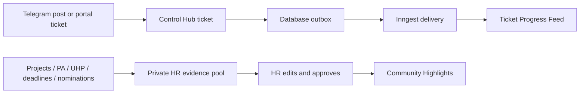

# Control Hub Telegram Community Optimization Record

## Current Status

The v1 design prioritizes delivery reliability, privacy, and auditable decisions. This is a reliability and workflow-friction record; no latency improvement is claimed or measured.

## Relevant Code Map

- [Telegram webhook](../../../apps/web/src/app/api/webhooks/telegram/route.ts) — identity linking, topic diagnostics, and `/ticket` conversion.
- [Ticket delivery](../../../apps/web/src/lib/telegram-community.ts) — privacy-safe formatting and outbox dispatch.
- [Recognition service](../../../apps/web/src/lib/recognition.ts) — Manila periods, positive evidence adapters, and publication.
- [Recognition workspace](../../../apps/web/src/components/recognition/RecognitionAdminPage.tsx) — HR evidence review, editing, approval, and explicit publishing.
- [Database migration](../../../supabase/migrations/20261024000001_control_hub_telegram_community.sql) — uniqueness, outbox, audit state, and transactional conversion.

- [Telegram link endpoint](../../../apps/web/src/app/api/users/[id]/notification-preferences/telegram-link/route.ts) - owner-only connect and disconnect operations.
- [Telegram disconnect transaction](../../../supabase/migrations/20261102000001_disconnect_telegram_account.sql) - atomic link cleanup, delivery disablement, token invalidation, and audit evidence.
- [Settings workspace](../../../apps/web/src/components/settings/SettingsPage.tsx) - confirmed self-service disconnect and connection status.

## Reliability and Workflow Entries

### Implemented — Durable ticket delivery

- Problem/evidence: Telegram can fail after a ticket database mutation succeeds.
- Solution: the ticket trigger writes an idempotent outbox event in the ticket transaction; immediate Inngest dispatch and a ten-minute sweep retry failed/pending rows.
- Validation: local migrations applied; new integration functions are clean under schema lint; duplicate-safe claims are enforced before ticket and recognition delivery.

### Implemented — Recognition privacy boundary

- Problem/evidence: performance answers, client details, and negative employee data must not be published or exposed as ranking inputs.
- Solution: adapters return generic positive completion facts only; HR edits the public reason; publication reads only approved selections and public copy.
- Validation: Manila period tests passed 4/4; web typecheck and focused browser flows passed. Live Telegram content inspection remains part of the production pilot.

### Implemented — Server-confirmed governance

- Problem/evidence: nominations, approvals, and Telegram posts are auditable or externally visible actions.
- Solution: all remain server-confirmed with disabled pending controls and explicit errors; no optimistic cache mutation is used.
- Validation: employee mobile and HR desktop Playwright flows passed 2/2; screenshots were inspected.

### Implemented - Atomic self-service Telegram disconnect

- Problem/evidence: one Telegram identity can map to only one Control Hub account, but there was no safe way for an owner to release an existing link before connecting another account.
- Solution: an owner-only, server-confirmed mutation runs a single database transaction that deletes the normalized link, disables Telegram delivery, clears legacy chat fields and pending tokens, and records a privacy-safe audit event. Admins cannot disconnect another user's identity through this endpoint.
- Validation: migration `20261102000001` applied to local Supabase; a rollback-only database transaction confirmed link removal, delivery disablement, pending-token clearing, unrelated preference preservation, and audit creation. Route tests passed 4/4; desktop and mobile Playwright flows passed 2/2 and screenshots were inspected. Schema lint reported only the pre-existing `get_knowledge_source_versions` error.

### Implemented - Default General topic persistence

- Problem/evidence: Telegram omits `message_thread_id` for the forum's default General topic, while `ticket_telegram_origins.topic_id` required a value. The live webhook classified General & Ideas correctly but the database transaction failed at origin insertion.
- Solution: allow `ticket_telegram_origins.topic_id` to be null, using null only for the default General topic while retaining numeric IDs for separately created topics. Duplicate protection continues to use the forum chat ID and source message ID.
- Validation: migration `20261105000001` applied locally; a rollback-only call to `create_ticket_from_telegram` created a feature-request ticket, stored a null topic ID, and queued a pending Created event before rollback.

### Implemented - Daily recognition review period resolution

- Problem/evidence: the admin recognition endpoint passed the current Manila date into a Monday-only period constructor, so the Recognition Review workspace returned HTTP 500 from Tuesday through Sunday.
- Solution: resolve the current Manila week's Monday before ensuring the recognition period. Monday remains the boundary for creating a new period and the scheduled publication workflow; HR can review the current period on every day.
- Validation: recognition period tests passed 7/7, including Monday, Tuesday, and Sunday resolution; portal typecheck passed; the admin desktop Playwright scenario passed and its screenshot was inspected. The full recognition spec was not green because the separate employee-nomination scenario still uses `selectOption` against the newer custom combobox.

## Visual Guide

## Change Log

- 2026-11-10: Removed the accidental Monday-only access restriction from the Recognition Review workspace while retaining Monday generation and publication scheduling. No latency improvement is claimed.

- 2026-11-05: Corrected default General topic persistence after live smoke testing exposed the obsolete non-null topic constraint. No latency improvement is claimed.

- 2026-11-02: Added and locally database-validated the atomic, owner-only Telegram disconnect flow to remove account-transfer friction without weakening one-to-one identity uniqueness. No latency improvement is claimed.

- 2026-10-24: Added v1 reliability, privacy, and server-confirmed interaction decisions. No performance measurement was required or claimed.
- 2026-10-24: Added atomic delivery claims, immutable submission timestamps, local schema validation, and focused browser verification.
