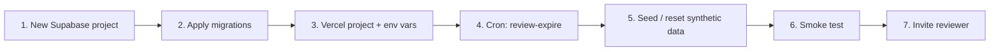

# Controlled Reviewer Access Deployment Runbook

Resume condition for the deferred "Provision the isolated Demo/Review deployment" task in [task-tracker.md](task-tracker.md). Nothing here has been executed; every step needs owner-controlled Vercel/Supabase access.

**Hard rule:** the review environment is a separate Vercel project and a separate Supabase project. Never point it at the production Supabase project (`tccdupkjmwwxcvpqnpeb`) or staging, and never copy production data into it.



## 1. Create the review Supabase project

- Create a new, empty Supabase project dedicated to review. Record its project ref as `REVIEW_PROJECT_REF`.
- Enable email auth with invitations. Add the review site URL to the allowed redirect URLs (the invite redirects to `<site>/auth/callback?next=/review`).
- Create exactly one sponsor: a `super_admin` workforce account. Only an active, non-deleted `super_admin` with `account_kind = 'workforce'` can send invitations.

## 2. Apply migrations to the review project only

Run every Supabase command through `pnpm exec supabase`, and state the target before each command. Link to the **review** ref, not production:

```powershell
pnpm exec supabase link --project-ref $env:REVIEW_PROJECT_REF
pnpm exec supabase db push --linked --dry-run   # expect the full migration history
pnpm exec supabase db push --linked
pnpm exec supabase migration list --linked
```

If `link` prompts for the database password, type it directly into the terminal. Afterwards re-link to production before any later production work (the repo's delivery skill checks `supabase/.temp/project-ref`).

## 3. Create the Vercel project and environment variables

Deploy `apps/web` as its own Vercel project (same root, build and install commands as `apps/web/vercel.json`). Set:

| Variable | Value |
| --- | --- |
| `CONTROL_HUB_ENV` | `review` (this is what enables reviewer access; any other value denies reviewers) |
| `NEXT_PUBLIC_SUPABASE_URL` / `NEXT_PUBLIC_SUPABASE_ANON_KEY` | Review project values |
| `SUPABASE_SERVICE_ROLE_KEY` | Review project value |
| `NEXT_PUBLIC_SITE_URL` | The review deployment's custom URL |
| `CRON_SECRET` | New random secret, unique to this project |

Do not set `NEXT_PUBLIC_ENABLE_MOCK_AUTH`. Do not copy production secrets (Google, Anthropic, finance, payroll integrations); the review hub uses only synthetic data and needs none.

## 4. Schedule expiry

`/api/cron/review-expire` marks engagements past `expires_at` as `expired` and bans the reviewer. It returns 404 unless `CONTROL_HUB_ENV=review`, and 401 without `Authorization: Bearer $CRON_SECRET` (Vercel sends this automatically when `CRON_SECRET` is set).

Add the cron to the **review project's** configuration, not the production `apps/web/vercel.json` (where it would only ever return 404):

```json
{ "crons": [{ "path": "/api/cron/review-expire", "schedule": "0 * * * *" }] }
```

Hourly is recommended. Expiry is also enforced live on each request, so the cron is the cleanup that bans the auth user.

## 5. Seed the synthetic workspace

Create `apps/web/.env.review` (gitignored) with `CONTROL_HUB_ENV=review`, the review Supabase URL and service-role key, and `REVIEW_PROJECT_REF`. The script refuses to run otherwise.

```powershell
pnpm review:reset                                         # dry run; confirm the printed URL is the review project
pnpm review:reset -- --env-file apps/web/.env.review --apply
```

The reset revokes active engagements, deletes and re-seeds the four fictional items, and preserves submitted feedback. Run it between reviewers.

## 6. Smoke test before inviting anyone

1. Sponsor signs in, opens `/super-admin/account-inventory`, and confirms the review project lists no unexpected accounts.
2. Confirm `GET /api/cron/review-expire` returns 401 without the secret and `{ "expired": 0 }` with it.
3. Confirm the same build with `CONTROL_HUB_ENV` unset or `production` denies a reviewer session (middleware test coverage exists in `tests/middleware-auth.test.ts`).
4. Run `pnpm test:e2e:local` against local Supabase to re-verify `e2e/controlled-reviewer-access.spec.ts` and `e2e/account-inventory.spec.ts` before a release.

## 7. Invite a reviewer

As the sponsor, `POST /api/review/invitations` with `{ email, displayName, purpose }`. Only one engagement can be active at a time (409 otherwise) and it lasts seven days. Revoke early with the reset script or by expiring the engagement.

## Rollback

- Revoke access: `pnpm review:reset -- --env-file apps/web/.env.review --apply`.
- Take the site offline: unset `CONTROL_HUB_ENV` on the review Vercel project; reviewers are denied everywhere.
- The review stack is disposable: delete the Vercel and Supabase projects. Production is unaffected.

## Production rollout is separate

The migration `20261015000002_controlled_reviewer_access.sql` was applied to production on 2026-10-15 (see the tracker). The remaining production items (disabling the Accounting tester and latency accounts, and the reclassification report from `scripts/accounts/report-account-classification.mjs`) are still deferred and need an explicit production request.
