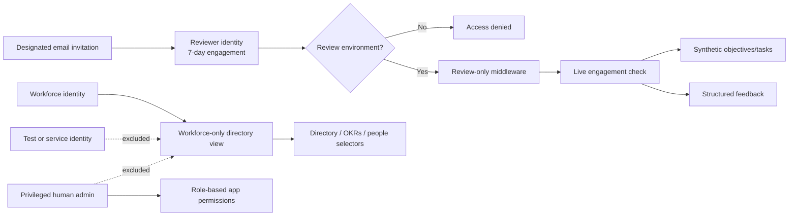

# Controlled Reviewer Access Optimization Record

## Current Status

The implementation centralizes population filtering in the database view and rejects reviewer traffic at middleware and again at every review endpoint. Local measurements show modest p50 drift alongside the control and noisy p95 outliers; no speed claim is made.

## Relevant Code Map

- [Identity schema and workforce views](../../../supabase/migrations/20261015000002_controlled_reviewer_access.sql)
- [Reviewer middleware boundary](../../../apps/web/middleware.ts)
- [Live review authorization](../../../apps/web/src/lib/review-access.ts)
- [Review Hub](../../../apps/web/src/app/review/page.tsx)
- [Account Inventory](../../../apps/web/src/app/(app)/(admin)/super-admin/account-inventory/page.tsx)
- [Privileged account migration](../../../supabase/migrations/20261016000002_add_privileged_account_kind.sql)
- [Leadership invite](../../../apps/web/src/components/admin/InviteUserModal.tsx)
- [Invitation API](../../../apps/web/src/app/api/users/invite/route.ts)
- [Guarded reset](../../../scripts/review/reset-review-environment.mjs)

## Optimization Entries

### Audited — Identity filtering and query cost

- **Problem/evidence:** Non-workforce auth rows previously entered the left-joined `employee_directory`, creating incorrect directory and performance populations.
- **Solution:** Add indexed `account_kind` and enforce `account_kind = 'workforce'` in the shared directory view. Preserve quarter eligibility through account creation time, lifecycle overlap, or saved OKR/KPI evidence.
- **Validation:** Local migration and SQL assertions passed; focused Directory and Performance tests passed. Post-change latency is pending.

### Implemented — Layered reviewer denial

- **Problem/evidence:** A normal employee/admin identity exposes broad navigation and APIs unsuitable for an external applicant.
- **Solution:** Use a distinct reviewer role and account kind, allow it only when `CONTROL_HUB_ENV=review`, redirect it to a dedicated shell, and revalidate the live engagement in each review API.
- **Validation:** Middleware tests cover non-review environments, ordinary API denial, and allowed review paths. Auth bootstrap tests cover active and expired reviewers.

### Implemented — Resettable synthetic workflow

- **Problem/evidence:** Product exploration needs realistic writes without production data or effects.
- **Solution:** Isolated `review_demo_items`, structured feedback, one active engagement, seven-day expiry, and a dry-run-first reset script guarded by the explicit review environment.
- **Validation:** Local schema objects and synthetic seed records exist. External review deployment remains deferred.

### Implemented — Privileged human identity classification

- **Problem/evidence:** A leadership role and workforce membership were implicitly coupled, forcing operational verification accounts into Directory and OKR/KPI populations.
- **Solution:** Add a distinct `privileged` account kind for human admin/super-admin identities. Creation and reclassification require an explicit selection and recorded purpose; authorization remains role-based, while the workforce-only view excludes the identity from people-derived surfaces. Classification writes are server-confirmed and audited.
- **Validation:** Local migration and rollback-only SQL exclusion assertion passed; web TypeScript passed; 9 focused API/auth tests and 7 Playwright checks passed. Desktop and mobile screenshots were inspected. No production data changed.

## Visual Guide

## Measurements

### Before

- **Date/environment:** 2026-10-15; dirty worktree; `next dev`; local Supabase; admin role; 30 samples and 3 warmups.
- **Targets:** `/admin/directory`, `/admin/performance`; `/dashboard` control.
- **Result file:** `perf-results/controlled-reviewer-access/2026-10-15T08-17-31-551Z-before.json` (gitignored).

| Metric | p50 ms | p95 ms |
| --- | ---: | ---: |
| Directory total | 378.3 | 470.5 |
| Performance total | 325.1 | 399.4 |
| Dashboard control total | 302.6 | 362.0 |

### After

- **Date/environment:** 2026-10-15; same dirty worktree, `next dev`, local Supabase, admin role, targets, 30 samples, and 3 warmups.
- **Result file:** `perf-results/controlled-reviewer-access/2026-10-15T08-27-42-543Z-after.json` (gitignored).

| Metric | Before p50 | After p50 | Δ p50 | Before p95 | After p95 | Δ p95 |
| --- | ---: | ---: | ---: | ---: | ---: | ---: |
| Directory total | 378.3 | 403.0 | +24.7 ms | 470.5 | 1095.8 | +625.3 ms |
| Directory TTFB | 366.2 | 382.0 | +15.8 ms | 449.3 | 480.0 | +30.7 ms |
| Performance total | 325.1 | 343.4 | +18.3 ms | 399.4 | 767.8 | +368.4 ms |
| Dashboard control total | 302.6 | 315.9 | +13.3 ms | 362.0 | 533.2 | +171.2 ms |

The control route also regressed and all routes showed intermittent p95 outliers. Directory p50 drift beyond the control was approximately +11.4 ms; Performance was approximately +5.0 ms. These development-server results are inconclusive rather than evidence of a material regression or improvement.

## Change Log

- 2026-10-16: Reclassified Cef Admin as `privileged` in production and verified database/Auth agreement, workforce-directory exclusion, audit evidence, and unchanged May/Steven classifications. Added a project-ref-guarded operations script and made Account Inventory synchronize Auth metadata with database rollback on failure.
- 2026-10-16: Added explicit privileged non-workforce leadership creation and audited reclassification. Kept the mutation server-confirmed.
- 2026-10-15: Applied the migration to local and production. No post-migration production latency was captured. The `employee_directory` view gained one column and one indexed filter (`idx_users_account_kind`), so a production latency check is worthwhile before any speed claim.
- 2026-10-15: Corrected the expiry cron to answer Vercel's `GET` (it was `POST`-only), added route tests, and published the [deployment runbook](deployment-runbook.md). No latency-relevant code path changed.
- 2026-10-15: Audited identity leakage, implemented centralized classification and layered reviewer access, captured the local baseline, and deferred external environment provisioning and production remediation.
