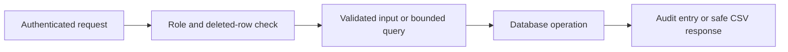

# Web DRY Consolidation Optimization Record

## Scope

The [2026-10-12 dry audit](../../apps/web/dry-audit-2026-10-12.md) found duplicated authorization, API parsing, CSV formatting, attachment signing, cache handling, and UI flows. This record tracks reliability, security, complexity, and latency implications of remediation.

## Relevant Code Map

| Area | Code and validation |
| --- | --- |
| Authorization and audit | [active role resolver](../../../apps/web/src/lib/auth/active-role.ts), [employee API](../../../apps/web/src/app/api/employees/route.ts), [directory API](../../../apps/web/src/app/api/directory/route.ts), [reports API](../../../apps/web/src/app/api/reports/route.ts), [self-service metadata API](../../../apps/web/src/app/api/users/[id]/metadata/route.ts), [storage API](../../../apps/web/src/app/api/reports/content-images/route.ts), [audit helper](../../../apps/web/src/lib/audit.ts), [inline route tests](../../../tests/api/inline-active-role.test.ts), [active role tests](../../../tests/api/active-role-resolution.test.ts), [approval route tests](../../../tests/api/deleted-admin-approval.test.ts) |
| CSV exports | [shared CSV](../../../apps/web/src/lib/csv.ts), [finance CSV](../../../apps/web/src/lib/finance/csv.ts), [directory export](../../../apps/web/src/app/api/directory/export/route.ts), [expense export](../../../apps/web/src/app/api/expenses/export/route.ts), [tests](../../../tests/lib/dry-audit-regressions.test.ts) |
| Pagination | [parser](../../../apps/web/src/lib/api/pagination.ts), [tasks API](../../../apps/web/src/app/api/tasks/route.ts), [employees API](../../../apps/web/src/app/api/employees/route.ts), [tests](../../../tests/lib/dry-audit-regressions.test.ts) |
| Attachments | [shared signer](../../../apps/web/src/app/api/internships/[id]/logs/_lib.ts), [internship detail API](../../../apps/web/src/app/api/internships/[id]/route.ts), [tests](../../../tests/lib/dry-audit-regressions.test.ts) |
| Employee creation | [input schema](../../../apps/web/src/lib/schemas/employee.schema.ts), [create API](../../../apps/web/src/app/api/employees/route.ts), [tests](../../../tests/lib/dry-audit-regressions.test.ts) |
| Password reset audit | [reset route](../../../apps/web/src/app/api/auth/forgot-password/route.ts), [opaque audit key](../../../apps/web/src/lib/auth/password-reset-audit.ts), [helper tests](../../../tests/app/api/auth/forgot-password.test.ts), [route tests](../../../tests/app/api/auth/forgot-password-rate-limit.test.ts) |
| Role policy | [role normalizer](../../../apps/web/src/lib/auth/role.ts), [standup gate](../../../apps/web/src/app/api/standups/_lib.ts), [resource targeting schema](../../../packages/database/src/schemas/resourceTargetingSchema.ts), [targeting selector](../../../packages/ui/src/components/resources/TargetingSelector.tsx), [resource form](../../../apps/web/src/app/(app)/(employee)/information-hub/resources/new/page.tsx), [focused regression](../../../tests/lib/dry-audit-regressions.test.ts), [browser spec](../../../e2e/resource-target-roles.spec.ts) |
| CRM role probe | [access route](../../../apps/web/src/app/api/crm/access/route.ts), [domain resolver](../../../apps/web/src/app/api/crm/_lib.ts), [route tests](../../../tests/api/crm-access-role.test.ts) |
| Failure feedback | [offboarding dialog](../../../apps/web/src/components/admin/OffboardingChecklistDialog.tsx), [employee notifications](../../../apps/web/src/app/(app)/(employee)/notifications/page.tsx), [offboarding browser spec](../../../e2e/offboarding-create-error-toast.spec.ts), [notification browser spec](../../../e2e/notification-error-toasts.spec.ts) |
| Database types | [generation script](../../../packages/database/package.json), [exported types](../../../packages/database/src/database.types.ts) |

## Entries

### Direct API correctness and security

**Status: Implemented.** Evidence: B1, B8, B9, and B12 in the audit. Added `super_admin` to standup authorization, centralized guarded CSV escaping in affected exports, validated employee create input with an allowlist, and reused the link-aware daily-log signer. Paths are in the code map. Validation: focused Vitest suite, fourteen assertions passed on 2026-10-12; full web typecheck passed.

### Bounded pagination

**Status: Implemented.** Evidence: B10 in the audit. Seven GET routes now use a shared parser with a 100-item maximum and invalid-query 400 response, validated by focused tests. The historical checkout and current checkout were sampled against local Supabase; all 180 target requests returned 200. The numbers below show no supported speed gain and include other concurrent authorization changes, so they do not isolate pagination cost.

### Audit log inserts and deleted account authorization

**Status: Implemented.** Evidence: B2 and B4 in the audit. Specific malformed inserts were corrected and checked against the explicit local `audit_logs` schema and insert RLS policy; a representative three-row insert succeeded in a rolled-back transaction. The password-reset route uses a stable keyed audit UUID and stops before generating a link if audit lookup or insertion fails. Twenty originally flagged current-user role lookups filter deleted rows, 20 domain role helpers read active database rows, and 32 inline API route files now use the shared active-role resolver rather than trusting metadata. The resolver rejects absent or soft-deleted rows and normalizes the current database role. This also covers self-service settings and content-image storage paths. Validation: 18 focused assertions passed, including deleted self-access, deleted approval routes, and a stale super-admin claim after demotion; full web typecheck and `git diff --check` passed. The latency measurement below is inconclusive because the unchanged control drifted substantially at p95.

### Broader duplicate families

**Status: Audited.** Evidence: sections 2.1-2.12 of the report. The proposed solution is to consolidate shared auth, API, access grant, cache, type generation, UI, and storage modules in the report's phase order. Relevant paths are listed in the report. Resume each area with focused tests; any rendered UI change needs local Playwright verification.

### Current administrative role policy

**Status: Implemented.** Evidence: the local generated `user_role` enum has `employee`, `associate`, `admin`, and `super_admin`; the audit found obsolete `hr`/`cos`/`ceo` grants. The user chose only `admin` and `super_admin` for administrative access. Removed obsolete values from the normalizer, resource targeting, and API permission lists, while retaining `hr` as a ticket team. The browser audit exposed a low-contrast dark hover state on the resource form; its style was corrected. Paths are in the role-policy code map. Validation: 57 focused Vitest assertions, web/database/UI TypeScript checks, and local Playwright resource-form checks at 1440px light and 390px dark passed; empty and filled input screenshots reviewed in `test-results/`.

### Local database type generation

**Status: Implemented.** Evidence: B13 showed the generator wrote an empty unused path, while the package exported stale root types. Changed the script to use `supabase gen types typescript --local --workdir ../..` and write the exported file; removed the unused empty file. Validation: local type generation completed, and database and web TypeScript checks passed. Typed Supabase clients remain planned as a separate phase.

### CRM role-probe consistency

**Status: Implemented.** Evidence: B6 found raw metadata role claims across domain helpers and a mismatched CRM access probe. Twenty domain helpers and the probe now use normalized roles from active database rows; a deleted or stale admin claim cannot authorize those paths. Focused deleted-row and stale-claim cases passed in `tests/api/active-role-resolution.test.ts` and `tests/api/crm-access-role.test.ts`, with 23 focused authorization/API assertions and the full web typecheck passing. Inline API role resolution remains in the B4 scope.

### Failure feedback for optimistic actions

**Status: Implemented.** Evidence: B11 found that offboarding task creation rolled back silently on failure and employee notification mark-all/delete omitted the error callbacks used by the admin screen. The existing mutations are optimistic under `docs/apps/web/architecture/optimistic-ui.md`. The admin browser test exposed a further cache bug: the offboarding list updater matched the template query, whose `data` is an object, and threw before returning the rollback snapshot. The updater, cancellations, and snapshots now target list queries only. The dark mobile offboarding form controls now use the theme background. Validation: four local Chromium failure-path cases passed at 1440px light and 390px dark for admin and employee roles; screenshots reviewed, toasts asserted, and optimistic rows restored. Paths are in the failure-feedback code map. No latency improvement is claimed.

## Measurements

On 2026-10-12, B10 was sampled on a local `next dev` server at port 3001 against local Supabase, using the sample admin, 30 samples and 3 warmups per read-only target. Before used an isolated checkout of commit `4bbee970`; after used the dirty current checkout (also based on `4bbee970`). Both ran `pnpm performance:latency --feature dry-consolidation --targets "/api/employees,/api/tasks,/api/directory?page=1&pageSize=100"` with `--label before` or `--label after`. All 180 target requests returned 200. Raw files: `perf-results/dry-consolidation/2026-10-12T05-56-52-312Z-before.json` and `perf-results/dry-consolidation/2026-10-12T05-58-07-185Z-after.json`.

| Total response time | Before p50/p95 ms | After p50/p95 ms | Delta p50/p95 ms |
| --- | ---: | ---: | ---: |
| `/api/employees` | 183.4 / 307.0 | 190.6 / 319.4 | +7.2 / +12.5 |
| `/api/tasks` | 169.0 / 272.8 | 194.2 / 303.9 | +25.2 / +31.2 |
| `/api/directory?page=1&pageSize=100` control | 178.9 / 385.7 | 195.4 / 288.5 | +16.5 / -97.2 |

The tasks route also received an active-role database check, while the control route shows environmental drift; the samples cannot isolate the pagination change. No latency improvement is claimed. A separate same-checkout before/after run for the role-helper change showed control drift of -91.0/-375.9 ms (p50/p95), so its lower target times are likewise inconclusive.

For pending B5 candidate-query work, a local baseline was captured on 2026-10-12 at dirty commit `4bbee970`, admin role, 30 samples and 3 warmups: `/api/directory?page=1&pageSize=100` total p50 298.8 ms, p95 473.0 ms; `/api/notifications?limit=1` control p50 247.9 ms, p95 580.3 ms. File: `perf-results/dry-consolidation/2026-10-12T03-57-21-936Z-before.json`. The candidate-query change has not been made, so no after result or delta exists yet.

On 2026-10-12, B4 used the same dirty checkout, sample admin role, local Supabase, and `next dev` at port 3001 before and after the inline authorization edits. Each read-only target had 30 samples and 3 warmups; all 240 target responses returned 200. The command was `pnpm performance:latency --feature dry-consolidation --targets "/api/employees,/api/directory?page=1&pageSize=100,/api/reports,/api/tasks" --label before` and the identical command with `--label after`. Raw files: `perf-results/dry-consolidation/2026-10-12T06-45-38-576Z-before.json` and `perf-results/dry-consolidation/2026-10-12T06-51-47-939Z-after.json`; comparison used `pnpm performance:latency --compare` with those files.

| B4 total response time | Before p50/p95 ms | After p50/p95 ms | Delta p50/p95 ms |
| --- | ---: | ---: | ---: |
| `/api/employees` | 151.4 / 258.0 | 148.8 / 279.0 | -2.6 / +21.0 |
| `/api/directory?page=1&pageSize=100` | 145.9 / 218.8 | 146.7 / 225.1 | +0.8 / +6.3 |
| `/api/reports` | 134.4 / 204.3 | 147.9 / 279.3 | +13.5 / +75.0 |
| `/api/tasks` control | 134.1 / 224.3 | 141.0 / 301.6 | +7.0 / +77.3 |

The report p50 increase is 6.5 ms above control drift, while its p95 change is within control drift. Local dev-server variation prevents attributing an overall latency change to B4; no speed claim is made.

## Visual Guide

## Change Log

- 2026-10-12: Completed B4 inline API role migration across 32 route files, verified deleted-account and stale-claim denial with 18 focused assertions and a web typecheck, and measured local p50/p95 before and after against a tasks control. The control drift makes the latency effect inconclusive.
- 2026-10-12: Reviewed the audit, implemented focused defects, ran fourteen regression assertions and the full web typecheck, and recorded the local measurement gap and remaining verification.
- 2026-10-12: Generated current local database types, audited the role enum, removed obsolete administrative grants, and passed 57 focused role/audit tests plus web/database/UI typechecks and desktop/mobile Playwright checks. Captured a B5 local latency baseline before any candidate-query edit; that work remains pending. Rechecked the candidate-list claim against the current directory API, which already excludes terminated rows by default.
- 2026-10-12: Completed B11 error feedback and repaired offboarding list rollback after a browser test exposed a template-cache collision. Four Chromium failure-path cases passed at desktop light and mobile dark for admin and employee roles. Reviewed screenshots and corrected offboarding form control colors in dark mode. No latency change or improvement is claimed.
- 2026-10-12: Validated B2 audit insert shapes against local schema and rollback-only inserts; migrated 20 domain role helpers and the CRM probe to active database roles, with focused authorization cases passing. Measured B10 using an isolated historical checkout and current local dev server; recorded p50/p95 and control drift without claiming a speed gain. The isolated checkout's Windows junction cleanup removed shared package files; source was restored and edited package files reconstructed, with package typecheck and focused tests rerun. Inline authorization remains pending.
