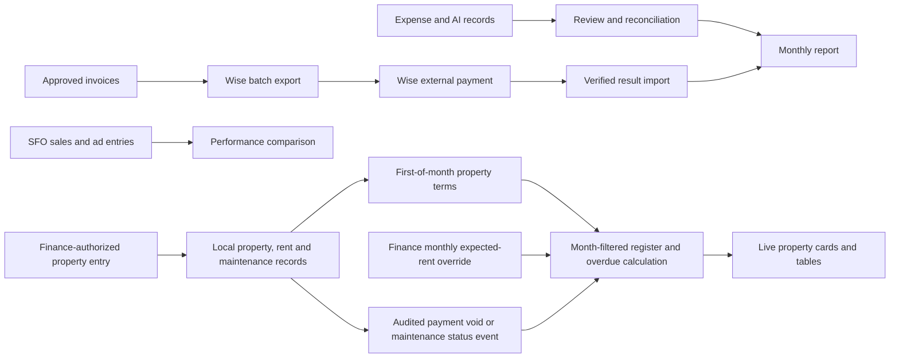

# Finance Redesign Optimization

## Current Status

The 2026-10-07 and 2026-10-12 Finance migrations are applied to local and production Supabase; the 2026-10-13 property-term migration is local only. Properties belongs to Property Development and supports first-of-month historical terms plus monthly expected-rent overrides. Optional budgets stay hidden when unset while spend and subscription monitoring remain visible. The redesign routes use the Control Hub font tokens and one AppShell spacing layer; an automated browser geometry check guards against the prototype's prior nested max-width and padding. Admin, super-admin, and temporary Accounting-role Finance/Properties routes pass local desktop/mobile Playwright, including long, error, and dark states; the temporary Accounting assignment was restored. A valid 30-sample local before/after comparison is recorded below. The control route moved in the same direction, so no general speed claim is made. Real Wise artifacts, populated-record visual review, pending Finance policies, and production deployment of the new migration remain deferred in the [task tracker](task-tracker.md) and [pending decisions](pending-decisions.md).

## Relevant Code Map

- [Expense pages](../../../apps/web/src/app/(app)/(admin)/admin/expenses/page.tsx), [expense API](../../../apps/web/src/app/api/expenses/route.ts), [expense schema](../../../apps/web/src/lib/schemas/expense.schema.ts)
- [AI spending](../../../apps/web/src/app/(app)/(employee)/ai-spending/page.tsx), [invoice approval](../../../apps/web/src/app/api/invoices/[id]/approve/route.ts), [Wise execution](../../../apps/web/src/app/actions/execute-payroll.ts)
- [Expense report](../../../apps/web/src/lib/expenses/monthly-report.ts), [ad spend](../../../apps/web/src/app/(app)/(admin)/admin/marketing/ad-spend/page.tsx), [forecast](../../../apps/web/src/lib/revenue-forecast.ts)
- [Expense report tests](../../../tests/lib/expenses-monthly-report.test.ts), [expense verification tests](../../../tests/api/expenses-verify-route.test.ts)
- [Finance routes](../../../apps/web/src/app/(app)/finance/page.tsx), [Wise result import](../../../apps/web/src/app/api/finance/wise-batches/[id]/results/route.ts), [Finance migration](../../../supabase/migrations/20261007000003_finance_redesign_foundation.sql), [local SQL checks](../../../tests/sql/finance-redesign-local.sql), [populated AI reconciliation fixture](../../../tests/sql/finance-ai-reconciliation-local.sql)
- [SFO view](../../../apps/web/src/app/(app)/sfo/performance/page.tsx), [forecast test](../../../tests/lib/revenue-forecast-finance.test.ts), [Wise result test](../../../tests/api/finance-wise-results-route.test.ts)
- [Shared Marketing dashboard](../../../apps/web/src/components/marketing/MarketingAdSpendDashboard.tsx), [admin route wrapper](../../../apps/web/src/app/(app)/(admin)/admin/marketing/ad-spend/page.tsx), [SFO CRM access test](../../../tests/pages/sfo-performance-crm.test.tsx)
- [Finance overview](../../../apps/web/src/app/(app)/finance/page.tsx), [overview calculations](../../../apps/web/src/lib/finance/overview.ts), [overview tests](../../../tests/lib/finance-overview.test.ts), [month-aware budget editor](../../../apps/web/src/components/finance/FinanceCatalogPanel.tsx)
- [Overview source and renewal RPC](../../../supabase/migrations/20261012000004_finance_overview_sources_renewals.sql), [subscription review helper](../../../apps/web/src/lib/finance/subscription-checks.ts), [local SQL fixture](../../../tests/sql/finance-overview-sources-local.sql), [helper tests](../../../tests/lib/finance-subscription-checks.test.ts)
- [Filtered expense ledger](../../../apps/web/src/app/(app)/finance/expenses/page.tsx), [CSV export API](../../../apps/web/src/app/api/finance/expenses/export/route.ts), [export tests](../../../tests/api/finance-expense-export-route.test.ts), [page tests](../../../tests/pages/finance-redesign-pages.test.tsx)
- [Invoice register](../../../apps/web/src/components/finance/FinanceInvoiceRegister.tsx), [invoice UI tests](../../../tests/components/FinanceInvoiceRegister.test.tsx), [staff payments](../../../apps/web/src/app/(app)/finance/staff-payments/page.tsx), [Wise batches](../../../apps/web/src/components/finance/FinanceWiseBatches.tsx), [report controls](../../../apps/web/src/components/finance/FinanceReportControls.tsx)
- [Shared payment privacy](../../../apps/web/src/components/finance/FinancePaymentWorkspace.tsx), [privacy test](../../../tests/components/FinancePaymentWorkspace.test.tsx)
- [Property page](../../../apps/web/src/app/(app)/property/properties/page.tsx), [property panel](../../../apps/web/src/components/finance/FinancePropertiesPanel.tsx), [property API](../../../apps/web/src/app/api/finance/properties/route.ts), [property calculations](../../../apps/web/src/lib/finance/properties.ts), [local migration](../../../supabase/migrations/20261007000009_finance_properties.sql), [API tests](../../../tests/api/finance-properties-route.test.ts), [calculation tests](../../../tests/lib/finance-properties.test.ts), [page tests](../../../tests/pages/finance-redesign-pages.test.tsx)
- [Historical property terms migration](../../../supabase/migrations/20261013000001_finance_property_terms.sql), [generated database types](../../../packages/database/src/database.types.ts), [rollback-only terms fixture](../../../tests/sql/finance-property-terms-local.sql), [rent workflow browser test](../../../e2e/finance-redesign.spec.ts)
- [Subscription last-charge view](../../../supabase/migrations/20261012000002_finance_subscription_last_charges.sql), [catalog API](../../../apps/web/src/app/api/finance/catalog/route.ts), [catalog API tests](../../../tests/api/finance-catalog-route.test.ts), [local SQL fixture](../../../tests/sql/finance-subscription-last-charge-local.sql)
- [Wise month-end gate](../../../supabase/migrations/20261012000003_finance_wise_month_end_gate.sql), [resolution API](../../../apps/web/src/app/api/finance/wise-batches/import-exceptions/[id]/route.ts), [report builder](../../../apps/web/src/lib/expenses/monthly-report.ts), [report controls](../../../apps/web/src/components/finance/FinanceReportControls.tsx), [local gate fixture](../../../tests/sql/finance-wise-report-gate-local.sql)
- [Report periods](../../../supabase/migrations/20261012000005_finance_spend_trend.sql), [Reports page](../../../apps/web/src/app/(app)/finance/reports/page.tsx), [local trend fixture](../../../tests/sql/finance-spend-trend-local.sql), [page test](../../../tests/pages/finance-redesign-pages.test.tsx)
- [Saved report supplement](../../../apps/web/src/lib/finance/report-pack.ts), [report API](../../../apps/web/src/app/api/finance/reports/route.ts), [snapshot export](../../../apps/web/src/app/api/finance/reports/export/route.ts), [pack tests](../../../tests/lib/finance-report-pack.test.ts)
- [Lazy Finance detail panels](../../../apps/web/src/components/finance/FinanceDetailDisclosure.tsx), [invoice API](../../../apps/web/src/app/api/invoices/route.ts), [department API](../../../apps/web/src/app/api/departments/route.ts), [SFO revenue access](../../../apps/web/src/app/(app)/sfo/performance/page.tsx), [SFO dashboard](../../../apps/web/src/components/marketing/MarketingAdSpendDashboard.tsx), [disclosure test](../../../tests/components/FinanceDetailDisclosure.test.tsx)
- [Property corrections API](../../../apps/web/src/app/api/finance/properties/corrections/route.ts), [correction migration](../../../supabase/migrations/20261007000010_finance_property_corrections.sql), [correction SQL checks](../../../tests/sql/finance-property-corrections-local.sql), [correction API tests](../../../tests/api/finance-property-corrections-route.test.ts), [property UI tests](../../../tests/components/FinancePropertiesPanel.test.tsx), [navigation tests](../../../tests/components/finance-properties-navigation.test.tsx)
- [Wise eligibility tests](../../../tests/api/finance-wise-batch-eligibility-route.test.ts), [Wise batch API](../../../apps/web/src/app/api/finance/wise-batches/route.ts), [Wise template export](../../../apps/web/src/app/api/finance/wise-batches/[id]/export/route.ts)
- [SFO CRM signpost](../../../apps/web/src/app/(app)/sfo/performance/page.tsx), [access tests](../../../tests/pages/sfo-performance-crm.test.tsx), [Finance sidebar](../../../packages/ui/src/layout/Sidebar.tsx), [mutation classification](../../apps/web/architecture/optimistic-ui.md)
- [Prototype HTML](../../../SN%20Control%20Hub%20-%20Finance%20Redesign%20(Faye%20Domingo_Accounting%20Intern).html.html), [subscriptions](../../../apps/web/src/components/finance/FinanceCatalogPanel.tsx), [staff payments](../../../apps/web/src/app/(app)/finance/staff-payments/page.tsx), [report pack](../../../apps/web/src/components/finance/FinanceReportControls.tsx), [SFO charts](../../../apps/web/src/components/marketing/MarketingAdSpendDashboard.tsx)
- [Subscription catalog API](../../../apps/web/src/app/api/finance/catalog/route.ts), [catalog tests](../../../tests/api/finance-catalog-route.test.ts), [saved report CSV](../../../apps/web/src/app/api/finance/reports/export/route.ts), [CSV tests](../../../tests/api/finance-report-export-route.test.ts), [SFO chart tests](../../../tests/pages/sfo-performance-dashboard.test.tsx)
- [Finance and SFO browser audit](../../../e2e/finance-redesign.spec.ts)
- [Control Hub AppShell](../../../apps/web/src/components/layout/AppShell.tsx), [global typography tokens](../../../apps/web/src/app/globals.css), [shared PageHeader](../../../packages/ui/src/layout/PageHeader.tsx), [Finance spacing regression](../../../e2e/finance-redesign.spec.ts)

## Entries

### Property Development navigation recovery

**Status: Implemented.** The delivered navigation places Properties at `/property/properties` in the Property Development workspace and keeps its accounting capability gate. Admin, super-admin, and a temporary local Accounting assignment loaded the route at 1440px and 390px in real-auth Playwright; the temporary assignment was restored. Relevant paths are [Sidebar](../../../packages/ui/src/layout/Sidebar.tsx), [navigation tests](../../../tests/components/finance-properties-navigation.test.tsx), and [browser spec](../../../e2e/finance-redesign.spec.ts).

| Status | Problem and evidence | Solution | Code paths | Validation or resume condition |
| --- | --- | --- | --- | --- |
| Implemented | Prototype-derived routes added a centered `max-w-7xl`, another 16/32px padding layer, and an inset background inside AppShell's existing padding, producing visibly oversized gutters. | Use the full AppShell content box, its responsive 16/24px edge spacing, global Aspekta body/heading tokens, and the shared header size, tracking, divider, and six-step section rhythm. | Finance routes, Properties, SFO route, shared Marketing dashboard, browser spec | Seven focused tests and web typecheck passed. Admin Playwright passed six routes at 1440px/390px; geometry assertions confirmed exact content-edge alignment and full available width, screenshots were inspected, and no console/network errors or mobile overflow occurred. This is a layout consistency change, so no latency claim applies. |
| Implemented | Current property terms recalculated earlier months, and Finance needed a hand-entered total for a rent-change month without daily proration. | Store first-of-month terms and a separate expected-rent override for each property/month; use the latest term at or before the selected month and retain prior terms. | Property-term migration, property API/helper/panel, SQL/API/helper/browser tests | Local migration and rollback-only SQL passed; focused tests and server-confirmed Playwright workflow passed. The migration remains local only. |
| Implemented | Budget UI implied a limit was required even though Finance monitors without caps. | Treat only positive stored amounts as limits, hide alerts/meters and editors when none exist, allow limits to be opened or cleared, and retain category/month/subscription monitoring. | Finance Overview, overview helper, catalog API/panel | Focused tests and desktop/mobile browser states passed. Xero/QuickBooks references support separating actuals monitoring from optional budget setup. |
| Deferred | Finance has not confirmed the complete Final blockers, Wise fixture, personal-expense sign-off, or variance thresholds. | Pause final snapshots and show compact pending placeholders while retaining current review and Wise safeguards; keep drafts available. | Report API/controls, Wise queue, approver settings, pending decisions | Focused finalization tests and leadership browser states passed; resume each policy only when Finance supplies its rule or approved fixtures. |
| Implemented | A historical linked-charge scan could truncate and grow with every charge. | Use an indexed latest-charge view and paginate subscriptions with a 10,000-row guard. | Catalog API, migration 20261012000002, catalog API/SQL tests | Local SQL and API tests passed; 30 local samples were all HTTP 200. Catalog p50 198.5 to 200.9 ms and p95 359.8 to 420.8 ms, so no speedup claim. |
| Implemented | Overview omitted converted source split and dated renewals, while unlinked charges could not prove payment. | Sum converted AUD direct payments by source, list stored renewal dates, and phrase review prompts without asserting an unverified charge. | Overview RPC migration 00004, Overview page, subscription helper/catalog panel | Local SQL, helper/page tests, and admin/super-admin desktop/mobile browser audit passed. |
| Implemented | Monthly reports could truncate direct payments at 1,000 rows and mix unconverted foreign amounts into AUD totals. | Paginate up to 10,000, fail on excess rows, and retain unknown payment confirmations outside finalization blockers. | Report builder, supplement, controls/export | Focused API/pack tests, local SQL, and browser report states passed; report endpoint p50 228.3 to 209.9 ms and p95 759.4 to 489.2 ms in one local 30-sample comparison. |
| Implemented | The live report lacked the prototype's alternate time scales. | Add week, quarter, and year converted-AUD spend buckets while keeping saved final snapshots monthly. | Trend migration 00005, Reports page | Local rollback-only SQL, page tests, and quarterly browser state passed; no unconverted amount enters AUD buckets. |
| Implemented | Snapshots omitted available subscription and Wise status; the queue only showed exceptions in the newest 30 batches. | Retain bounded subscription/import-month source rows with snapshots and list all unresolved Wise exceptions. | Report supplement, reports/export APIs, Wise queue API/UI | Pack/export/API tests and leadership browser exception/unknown-payment states passed. A real saved snapshot CSV awaits approved populated local records. |
| Implemented | Collapsed legacy Finance detail panels issued invalid invoice/department requests, and SFO marketing admin requested Revenue Forecast without access. | Mount legacy panels on expansion, align endpoint pagination bounds, and skip the known-forbidden SFO request. | FinanceDetailDisclosure, invoice/department APIs, SFO route/dashboard | Seven focused tests, final full web typecheck, and admin/super-admin Playwright network audit passed; expanded requests returned HTTP 200. |
| Implemented | Final reports could omit failed Wise result imports from the month-end gate. | Block on unresolved Wise import rows in their imported month and require leadership resolution note/actor; list unknown direct-payment confirmations without blocking. | Migration 00003, resolution API/UI, report builder/export | Local gate SQL, focused API tests, and mocked leadership browser resolution/unknown-payment state passed. |
| Implemented | Saved report CSV omitted prior breakdowns and source-status detail. | Include prior/current category and department comparisons, direct-payment statuses, subscription register as of snapshot, and Wise imports from the report month. | Report builder, supplement, reports/export APIs | Focused export/pack tests passed; real saved CSV visual review remains deferred until approved populated local records exist. |
| Audited | SFO prior-year sales and ad-spend charts add data reads; no comparable before measurement was captured before the prior partial edit. | Keep missing data distinct from zero, show access-aware states, and measure before any later SFO load optimization. | MarketingAdSpendDashboard, SFO route and dashboard tests | Admin/super-admin desktop/mobile and dark empty-state browser checks passed; populated charts await real local data. No latency delta is claimed for SFO. |
| Implemented | Hard-coded light page-shell colors made Finance, Properties, and SFO dark mode unreadable. | Add dark page-shell colors and a readable SFO CRM link accent. | Finance/Properties/SFO page routes, browser audit | Loaded dark Reports/Properties/SFO screenshots were inspected; Playwright dark-mode scenario passed on the optimized preview and final SFO link passed on local dev. |
| Implemented | The supplied HTML prototype exposed gaps in Finance and SFO hierarchy, source detail, statuses, and time scales. | Implement available live-data sections without importing illustrative figures or demo payment behavior; defer only the unsupported gross-margin assumption. | Prototype HTML; Finance pages/panels, report pack, SFO dashboard | Full prototype review, focused tests, local SQL fixtures, and admin/super-admin desktop/mobile Playwright passed. Populated real-record visuals and the gross-margin rule remain deferred. |
| Implemented | Separate AI spending and expense stores risk duplicate counts. | Copy and sync AI rows by immutable source ID; enforce uniqueness and show them in the expense ledger. | Finance migration, AI trigger, expense UI, populated AI SQL fixture | Local rollback-only fixture passed for three populated rows; read-only production reconciliation found one AUD source for 50.00 and one matching active ledger row, with no duplicate, missing, mismatched or orphan IDs. |
| Implemented | Invoice approval previously triggered Wise execution. | Approval now stops before payment; stored batch export and verified result import update Paid only for Wise `outgoing_payment_sent`. | Invoice approval, Wise batch API/UI and migration | Focused partial/duplicate result test passed; real Wise template and in-flight local fixtures remain pending. |
| Implemented | Month-end reports lacked retained final state. | Store dated drafts and immutable final snapshots; block pending approvals, unmatched requests, variances, and unresolved Wise imports; list unknown direct-payment confirmations. | Monthly report builder, Finance report API, migrations | Local SQL gate/finalization fixtures, focused API tests, and browser exception/unknown-payment state passed. |
| Implemented | SFO sales and spend could imply missing months were zero or mix noncomparable periods. | Use separate charts, missing-month messages, comparable sales/spend ratio, actual-versus-forecast progress, and corrected record-month labels. | Ad spend UI/API, forecast library | Focused forecast/dashboard tests and admin/super-admin desktop/mobile plus dark empty-state browser checks passed; populated real-record review is deferred. |
| Implemented | The Finance overview scaffold omitted the prototype action strip, ranked categories, budget alerts, month picker, and comparison. | Render from current/preceding live RPCs, guard missing baselines and zero budgets, and carry the selected month into budget editing. | Overview page/calculations/tests, Expenses page, catalog panel | Focused tests, local Overview SQL, and admin/super-admin desktop/mobile browser review passed. |
| Implemented | Initial routes had a bare ledger and limited review/payment/report hierarchy. | Add expense tabs and filters, subscription KPIs, staff invoice and Wise stages, report trend and snapshot pack, and an SFO-specific heading while keeping advanced views behind disclosures. | Expense/staff/report/SFO pages and components | Focused tests and admin/super-admin desktop/mobile Playwright passed, including expanded details and dark states. Verified Wise result import remains server-confirmed. |
| Implemented | A Finance expense CSV button needed complete, filtered results without spreadsheet formula execution or a silently partial download. | Export through a finance-authorized API using paginated reads and shared CSV escaping; surface oversized/incomplete export errors, and retain the selected ledger filters. | Finance expense export API, export control, CSV helper, export test | Three export route tests and web typecheck passed; no populated local ledger available for manual download. |
| Implemented | The Properties prototype contained illustrative names, balances and overdue claims, and there was no property data store or route. | Keep the register empty by default; authorize server-side reads/writes, capture real property/rent/maintenance records, compute monthly equivalents and overdue only from the selected period's recorded balances and due dates, and refuse truncated reads. Keep new entries server-confirmed and audit identifiers without financial/tenant details. | Property page/panel/API, calculation helper, local migration, property tests, Finance navigation | Local migration applied, three tables empty and RLS/grants verified by SQL; 17 focused Finance tests across seven files and web/UI typechecks passed. Authenticated empty-state/mobile-width inspection passed; actual populated-data browser write not exercised. |
| Implemented | CRM already existed behind independent access control; a redesign duplicate would fragment records and authorization. | Leave CRM untouched and provide an access-aware signpost from SFO Performance for users with existing CRM rights. | SFO view and CRM access tests | Two focused tests and web typecheck passed; CRM itself was not changed. |
| Implemented | Current property occupancy and weekly rent previously recalculated earlier months. | Apply Option A with first-of-month terms and an independent monthly expected-rent override; no daily proration. | Property-term migration, calculation helper, panel | Rollback-only SQL proves a July term leaves June at its prior rate; browser workflow saved a 2,700 override and a later term through server-confirmed mutations. |
| Implemented | Mistaken rent entries inflated received amounts; maintenance status updates lacked an audit trail. | Retain voided rent rows with a required reason and actor, exclude them from received rent, and progress maintenance status atomically with expected-state checks and retained history. Actions are Finance-authorized and server-confirmed. | Correction migration/API, property register/calculations, local SQL/API/UI tests | Rollback-only local SQL, focused correction/API/UI tests and web/UI typechecks passed; correction migration applied to production. No sample property records were imported. |
| Implemented | Approved invoices may already have Wise payments or batches, while duplicate selections and ambiguous recipient rows could produce incorrect exports. | Align queue eligibility with the creation RPC, reject duplicate selections and missing/duplicated saved-recipient rows. | Wise batch API/export, eligibility tests | Eight focused Wise tests and web typecheck passed; a real Wise file/result remains unavailable. |
| Implemented | Finance migrations and populated production AI records needed explicit verification. | Apply the reviewed pending migrations including separately authorized UHP prerequisite, inspect production migration history, and reconcile production source/ledger records read-only. | Finance migrations 00003/00005/00006/00007/00009/00010, UHP 00002, AI fixture | Production dry-run reports up to date; one source and one matching active AUD 50.00 ledger entry, zero duplicates/missing/mismatched/orphans, four property-related tables empty. No manual backfill or Wise transfer. |

## Measurements

- 2026-10-13 property/catalog feedback: commit `cdc0f21e` (dirty before and after), local Supabase, Next dev port 3001, admin role, 30 samples and 3 warmups, all 120 target responses HTTP 200 in each run. Identical command targets: `/property/properties?month=2026-10`, `/api/finance/properties?month=2026-10`, `/api/finance/catalog?month=2026-10-01`, and `/api/dashboard/stats`. Artifacts: `2026-10-13T13-11-38-416Z-before.json` and `2026-10-13T14-12-13-578Z-after.json` (ignored). Property page total p50/p95 438.2/591.8 → 419.7/533.8 ms (−18.5/−58.0); property API 208.1/302.8 → 199.2/267.3 ms (−8.9/−35.5); catalog API 221.8/293.2 → 199.3/244.0 ms (−22.6/−49.2); dashboard control 215.6/279.5 → 195.3/243.8 ms (−20.3/−35.7). Because the unaffected control improved by a similar magnitude, these local deltas are treated as environmental drift and no speed improvement is claimed.

- 2026-10-12 baseline: commit `4bbee970` (dirty), local Supabase and Next dev at `localhost:3017`, admin account, 30 samples and 3 warmups, all HTTP 200. `pnpm performance:latency --feature finance-redesign --base-url http://localhost:3017 --targets "/api/finance/catalog?month=2026-10-01,/api/finance/reports?month=2026-10,/dashboard" --label before --samples 30 --warmup 3`: catalog p50/p95 198.5/359.8 ms; report 228.3/759.4 ms; dashboard control 589.0/814.7 ms. Artifact: `perf-results/finance-redesign/2026-10-12T03-42-55-678Z-before.json` (ignored).
- 2026-10-12 valid after: commit `4bbee970` (dirty), same local Supabase, Next dev port 3017, admin account, exact targets, 30 samples and 3 warmups; all 90 target responses HTTP 200. Artifact: `perf-results/finance-redesign/2026-10-12T05-53-19-357Z-after.json` (ignored). `pnpm performance:latency --compare ../../perf-results/finance-redesign/2026-10-12T03-42-55-678Z-before.json ../../perf-results/finance-redesign/2026-10-12T05-53-19-357Z-after.json` passed. Catalog p50 198.5 → 200.9 ms (Δ +2.4), p95 359.8 → 420.8 ms (Δ +61.0); Reports p50 228.3 → 209.9 ms (Δ −18.4), p95 759.4 → 489.2 ms (Δ −270.1); dashboard control p50 589.0 → 519.7 ms (Δ −69.3), p95 814.7 → 609.6 ms (Δ −205.1). These are observed local deltas, with no general speed claim. An earlier after artifact, `2026-10-12T03-55-35-321Z-after.json`, contained only HTTP 500 generated-file errors and was excluded from comparison.
- 2026-10-12 Overview RPC: the previous Overview endpoint baseline was not captured before the local RPC migration because both isolated Next dev servers failed to open generated app files during authenticated requests. No p50/p95 claim applies. On a healthy local server, run `pnpm performance:latency --feature finance-redesign --base-url http://localhost:<port> --targets "/finance?month=2026-10,/finance/reports?month=2026-10" --label overview-current --samples 30 --warmup 3` to establish current-state cost; compare against a controlled prior implementation if a valid earlier build is available.
- 2026-10-12 lazy details and larger legacy pagination: the prior browser audit measured HTTP 400/403 status rather than valid latency for the expanded invoice/department queries, so a like-for-like successful baseline is unavailable. Do not claim these requests became faster. On a healthy local server with an authorized admin, run `pnpm performance:latency --feature finance-redesign --base-url http://localhost:<port> --targets "/api/invoices?page=1&pageSize=1000,/api/departments?page=1&pageSize=200" --label detail-current --samples 30 --warmup 3` and compare with a controlled previous build only if it returns 200 for the same queries.

- 2026-10-12: The valid comparison covers the catalog and report GET endpoints above. It does not isolate SFO prior-year fetch, expanded CSV generation, the Overview page, or the newly successful expanded legacy detail requests. Their pre-change implementations were already uncommitted or returned HTTP 400/403, so no comparable valid baseline exists. Capture a fresh baseline before any future optimization to those paths; no latency improvement is claimed for them.

## Visual Guide

## Change Log

- 2026-10-13: Aligned Finance, Properties, and SFO redesign shells with Control Hub's existing typography and layout tokens. Removed nested page padding/max-width/background styling, preserved the redesign hierarchy, and added an exact browser geometry assertion. Seven focused tests, web typecheck, the full workspace production build, and the six-route admin desktop/mobile Playwright audit passed; inspected screenshots show consistent gutters and no overflow. No latency behavior or data flow changed.
- 2026-10-13: Implemented first-of-month historical property terms and monthly expected-rent overrides, optional hidden budget limits, and pending-policy placeholders with Final paused. Local SQL, 23 focused tests, typecheck, admin/super-admin/Accounting desktop/mobile Playwright, long/error and dark states, and inspected property screenshots passed. The temporary Accounting assignment was restored. Identical 30-sample local measurements were all HTTP 200; similar control-route movement makes the delta inconclusive. No production migration or Wise transfer occurred.

- 2026-10-12: Reconstructed the Property Development sidebar after audit worktree cleanup affected shared package files. The component tests and UI typecheck passed. The new Next dev browser rerun did not pass due to missing auth sessions and a 404; prior optimized-preview screenshots and verification remain historical evidence, while revalidation of the reconstructed source is pending.

- 2026-10-12: Local admin and super-admin Playwright passed six Finance/SFO scenarios at desktop/mobile widths; a separate temporary Accounting-role audit passed all five Finance/Properties routes at both widths, and the sample's Marketing assignment was restored. Inspected loaded light/dark screenshots and corrected page-shell contrast. Final SFO CRM link was checked in local dev. The exact 30-sample local before/after comparison returned HTTP 200 for all targets; catalog p50/p95 deltas were +2.4/+61.0 ms and Reports −18.4/−270.1 ms. Final full web typecheck passed. No SFO or CSV latency claim is made. Four new Finance migrations remain local only; real Wise/populated records and the property-term decision remain external dependencies.
- 2026-10-12: Moved Properties to Property Development navigation, added an auditable local Wise exception gate/resolution and unknown-payment report listing, and made catalog/report reads bounded and complete. Local migration fixtures and ten focused tests passed. Two isolated Next dev servers hit generated-file `UNKNOWN` errors during authenticated Playwright, and the after latency sample contained only 500s. Browser verification and valid p50/p95 deltas remain pending.
- 2026-10-12: Shared the Staff Payments hide-amounts state across the invoice register and Wise queue. Four focused component tests passed, including joint masking; local browser verification remains blocked by the generated-file issue.
- 2026-10-12: Added live Overview card-source sums and scheduled subscription renewals from an explicit local RPC migration, plus cautious subscription review prompts and renewal-date entry. Local SQL and seven focused tests passed; browser and valid after latency checks remain pending.
- 2026-10-12: Added local spend-trend RPC for week/quarter/year reports and retained subscription, direct-payment, and Wise status sections in report snapshots/CSV. Expanded Wise queue exception listing beyond recent batches. Local trend SQL and focused pack/page tests passed; browser and valid after latency checks remain pending.
- 2026-10-12: Built a local optimized preview and inspected admin desktop/mobile screenshots. Found clipped mobile Reports action and repaired form wrapping. Browser network audit found legacy invoice/department HTTP 400 requests and a known-forbidden SFO Revenue Forecast 403; added lazy detail mounting, aligned API page caps, and access-aware SFO fetch. Seven focused tests and isolated TypeScript passed; rebuilt browser recheck remains pending.

- 2026-10-12: Reviewed the HTML prototype's full Finance and SFO page functions, sample markers, and demo-only actions. Added saved snapshot export sections and focused API tests, corrected SFO tooltip typings, and confirmed 15 focused tests across six files pass. The catalog charge query and SFO data loads still need measured local before/after latency; no speed claim is made. Browser verification remains pending, and unrelated project-contributors typing blocks full web typecheck.
- 2026-10-12: Found the four documented LOCAL sample accounts. The focused Playwright audit authenticated as admin on port 3001, then timed out on the Finance Expenses route; a separate server on port 3017 stalled compiling its first route. No changed-screen screenshot or latency sample was obtained. The audit spec remains for a responsive local run; isolated server and scratch build were removed.

- 2026-10-12: Partial UI handoff at user request. Receipt presence, stored subscription seats/linked-charge date, latest non-void property rent date, invoice register amount masking, retained report snapshot CSV and SFO comparison charts were edited but are not complete or browser-verified. Eight focused Finance UI tests and five SFO tests passed; web typecheck failed on three SFO Tooltip formatter typings, and SFO Biome reported four errors/23 warnings. Missing data must not be inferred from unlinked charges, and the saved CSV contains snapshot report summary/categories/anomalies rather than a full multi-source report pack. See the [task tracker](task-tracker.md) for next actions.
- 2026-10-07: Visually audited the proposed prototype in Playwright across Finance and SFO desktop screens (including subscription and maintenance tabs), then compared targeted implementation components. Logged missing UI-flow details above; the local Finance HTTP endpoint did not respond, so live-app visual parity and responsive comparison remain outstanding. No app behavior or schema changed.
- 2026-10-07: Audited and ran the populated AI migration-equivalent backfill and trigger reconciliation fixture on LOCAL only. Three source rows reconciled by currency; repeated backfill and duplicate IDs did not create extra rows; updates and soft deletion reconciled two active rows. Rollback preserved the empty local database. No migration change was required; actual populated production reconciliation remains deferred.
- 2026-10-07: Audited the prototype against existing routes, then implemented the local Finance/SFO flow. Local migration, rollback-only SQL checks, focused tests, and web/UI typechecks passed. Remaining checks are listed in the tracker; production was not touched.
- 2026-10-07: Added live-data monthly overview comparisons, category/budget visual cues, and month-aware budget editing without using sample prototype figures. Focused tests and web typecheck passed; visual verification remains.
- 2026-10-07: Extended the prototype's live-data layout over the other scoped pages; avoided mock payouts, exposed CSV error states, and preserved old detailed management views behind disclosures. Nine focused test files (17 tests) and web typecheck passed. No authenticated local UI was available for visual comparison.
- 2026-10-07: Kept CRM unchanged with conditional SFO navigation. Added the live Properties register, monthly complete-read guard, RLS-protected local schema, calculation/API/page tests and server-confirmed forms. Local migration/SQL RLS and empty-state checks passed, as did 17 focused Finance tests across seven files, web/UI typechecks, and scoped lint with warnings only. Desktop empty-state, mobile form and route headings for Finance, SFO and existing CRM were checked in an authenticated local browser; graph refreshed to 12,702 nodes/31,204 edges. Historical term versioning and correction workflows remain deferred; prototype sample records were not imported and production was not touched.
- 2026-10-07: Added audited rent voids/maintenance status events, corrected role-aware Properties navigation, and tightened Wise batch eligibility and template handling. After explicit approval, applied seven pending production migrations (UHP 00002 plus six Finance versions); migration history and dry-run confirmed up to date. Production read-only AI source/ledger count and amount reconciled 1:1 for AUD 50.00, with zero duplicate/missing/mismatched/orphan IDs and no property records. Local correction SQL, 24 focused tests across eight files, and web/UI typechecks passed before deployment; historical term and month-end finalization business rules remain pending, and no Wise transfer was run.
- 2026-10-07: Final local verification passed 27 focused tests in nine files, rollback-only AI/property SQL, web/UI typechecks, scoped Biome (warnings only), and Graphify refresh (12,822 nodes/31,426 edges). Authenticated browser confirmed Properties empty/mobile state and Overview action queue/nav; the local UI server subsequently reset/timed out navigating to Reports, so the remainder of the visual walkthrough is still open. Production migrations only do not publish application code. See the tracker for pending historical-rent/month-end policy choices and external Wise fixture validation.
