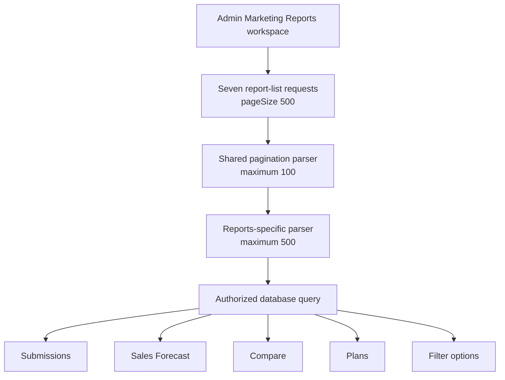

# Marketing Reporting Optimization Record

## Current Recommendation

Implemented: the reports endpoint now opts into the existing 500-row bounded snapshot contract used by the admin workspace. The shared pagination default stays at 100 for other endpoints. A later data-contract redesign should replace whole-snapshot client aggregation before the matching report cohort approaches 500 rows.

Implemented: weekly-plan items use a 1,000-character per-item limit enforced by both browser and server. This is generous enough for a detailed task while keeping each entry operational rather than turning the plan into an unbounded document.

Implemented: Marketing Reports uses the shared draft/Apply/Clear date-range filter instead of maintaining two page-local calendar implementations.

## Relevant Code Map

- [Marketing Reports page](<../../../apps/web/src/app/(app)/(admin)/admin/reports/page.tsx>), [Submissions](<../../../apps/web/src/app/(app)/(admin)/admin/reports/components/ReportsSubmissionsTab.tsx>), [Sales Forecast](<../../../apps/web/src/app/(app)/(admin)/admin/reports/components/ReportsAnalyticsTab.tsx>), [Compare](<../../../apps/web/src/app/(app)/(admin)/admin/reports/components/ReportsCompareTab.tsx>), and [Plans](<../../../apps/web/src/app/(app)/(admin)/admin/reports/components/ReportsPlansTab.tsx>) - seven requests currently ask for 500 rows and all depend on one list response for client-side aggregation or filtering.
- [Reports query hook](../../../apps/web/src/hooks/useReports.ts), [reports list endpoint](<../../../apps/web/src/app/api/reports/route.ts>), and [pagination parser](../../../apps/web/src/lib/api/pagination.ts) - request construction, generic error mapping, and the conflicting 100-row API maximum.
- [Reports pagination contract](<../../../apps/web/src/app/api/reports/_pagination.ts>), [focused contract test](../../../tests/api/reports-pagination.test.ts), and [browser regression](../../../e2e/marketing-reports-pagination.spec.ts) - reports-only 500-row bound plus all-tab desktop/mobile coverage.
- [Ad Spend period view](../../../apps/web/src/components/marketing/MarketingAdSpendDashboard.tsx), [shared period selector](../../../apps/web/src/components/data-display/MetricsPeriodSelect.tsx), [year options](../../../apps/web/src/lib/metrics-period.ts), and [request guard](../../../apps/web/src/hooks/usePeriodRequestGuard.ts) - year choice and latest-response safety.
- [Weekly-plan editor](../../../apps/web/src/components/reports/MarketingReportEditor.tsx) - multiline entry, disclosed limit, counter, and inline validation.
- [Report schema](../../../apps/web/src/lib/schemas/report.schema.ts) - authoritative item, metric, and notes limits.
- [API error adapter](../../../apps/web/src/lib/api-error.ts) - extracts the first actionable Zod field/form message.
- [Create-report hook](../../../apps/web/src/hooks/useCreateReport.ts) and [update-report hook](../../../apps/web/src/hooks/useUpdateReport.ts) - use the shared API error adapter.
- [Boundary tests](../../../tests/report-input-limits.test.ts) and [API error tests](../../../tests/api-error.test.ts) - exercise the request contract and error mapping.
- [Marketing Reports filters](<../../../apps/web/src/app/(app)/(admin)/admin/reports/page.tsx>), [shared date-range filter](../../../apps/web/src/components/data-display/DateRangeFilter.tsx), [shared calendar field](../../../apps/web/src/components/forms/DatePickerField.tsx), [range tests](../../../tests/components/DateRangeFilter.test.tsx), and [browser regression](../../../e2e/uhp-custom-date-range.spec.ts) - linked draft dates and explicit application shared with UHP.

## Findings

### Implemented - 2026-10-15: Restore the admin reporting data contract

- Problem/evidence: the page-level option query and every tab query send `pageSize: 500`. Since commit `d70fd939` (2026-10-12), `GET /api/reports` calls `parsePagination(searchParams, 10)`, whose default maximum is 100. The endpoint therefore returns `{ "error": "Invalid pagination" }` with HTTP 400 before any report or employee query runs. This is a confirmed client/API contract defect, not a Supabase data, RLS, date-filter, or empty-dataset issue.
- User impact: Submissions displays four zero summary cards calculated from `data?.data || []` beside a load error, implying confirmed zero activity when the counts are unknown. Its Retry button repeats the same invalid request. Sales Forecast, Compare, and Plans fail for the same reason; Compare and Sales Forecast offer no retry action. The independent option query also fails silently, so campaign and goal choices fall back to configured lists instead of reflecting submitted reports.
- Delivered solution: route the reports endpoint through a reports-specific pagination contract capped at 500, matching the existing bounded snapshot callers while leaving the shared helper's 100-row default intact. Focused tests prove 500 is accepted for reports, rejected by the shared default, and 501 is rejected by the reports contract. A browser regression exercises all four tabs and checks every observed report response and request bound.
- Reference review: IBM Carbon distinguishes no-data, user-action, permission, configuration, and system-error empty states and recommends specific corrective guidance; Atlassian reserves empty states for views with no data and recommends a contextual section message for errors within one section. Applied here, request failure must not reuse successful zero-value metrics or look like a legitimate empty result.
- Remaining risk: the workspace still aggregates one bounded client snapshot. Once the matching cohort exceeds 500, counts and analytics can truncate silently. The durable next step is server-side pagination with dedicated aggregate and filter-metadata responses, plus unavailable metric treatment during failures.
- Status: Implemented for the current 500-row contract. The larger data-contract redesign is Deferred in the task tracker.

#### Measurements

- Date/commit: 2026-10-15 at dirty commit `c2bbd7c9`; only the reports limit was toggled between runs to reproduce the pre-fix contract and then restore the implementation.
- Environment: local `next dev` at `http://localhost:3001`, local Supabase, Windows workstation, admin role; 30 samples and 3 warmups per target.
- Targets: affected `GET /api/reports?department=marketing&reportType=marketing&page=1&pageSize=500`; unaffected control `GET /api/notifications?limit=1`.
- Status evidence: before, the reports target returned HTTP 400 for 30/30 samples; after, it returned HTTP 200 for 30/30. The control returned HTTP 200 for every sample in both runs.

| Metric | Before p50 | After p50 | Delta p50 | Before p95 | After p95 | Delta p95 |
| --- | ---: | ---: | ---: | ---: | ---: | ---: |
| Reports request total | 142.8 ms | 130.6 ms | -12.3 ms | 218.8 ms | 181.9 ms | -36.9 ms |
| Reports request TTFB | 142.5 ms | 130.4 ms | -12.1 ms | 218.6 ms | 181.7 ms | -36.9 ms |
| Notifications control total | 147.4 ms | 130.8 ms | -16.5 ms | 195.5 ms | 198.5 ms | +3.0 ms |

Interpretation: the meaningful result is 400-to-200 reliability restoration. The before request exited before querying report data, and the control p50 moved by a similar amount, so these timings do not support a speed-improvement claim.

### Implemented - 2026-10-15: Shared custom date-range filtering

- Problem/evidence: Marketing Reports contained two page-local DayPicker popovers with duplicated styling and boundary logic. Each day selection immediately changed child-tab filters, so choosing the first boundary could transiently represent an incomplete range.
- Delivered solution: Move the established calendar to a shared form component and use one shared date-range control in Marketing Reports and UHP Outreach. The component owns draft validation, linked min/max dates, explicit Apply, and Clear. Marketing Reports now caps future dates and changes all report-tab range props only when a complete range is applied.
- Relevant paths: Marketing Reports and shared controls/tests in Relevant Code Map.
- Validation: 2 focused component tests, web TypeScript, focused Biome checks, and the full monorepo production build passed. Playwright verified `/admin/reports` as local admin at 1440x900 and 390x844: no overlap parameters were sent while drafting; Oct 5-12 appeared after Apply; Clear restored empty controls; the open calendar, dark-mode emulation, overflow, and success-path console/network checks passed. Screenshots were inspected.
- Measurement: Not measured. This removes duplicated source and changes client-side filter interaction, but makes no latency or bundle-size claim; server endpoints and query shapes after Apply are unchanged.

### Implemented - 2026-10-08: Ad Spend period response safety

- Problem/evidence: The year selector and option list were independently implemented, and paired ad-spend/revenue requests could render an old year's data after a rapid switch.
- Delivered solution: Reuse the controlled period selector and year options; accept both responses only for the latest selected period, hide old totals while switching, and offer retry after load failure.
- Relevant paths: Ad Spend period view and shared controls/guard in Relevant Code Map.
- Validation: Web typecheck, 20 focused cross-feature tests, local production build, and 30-sample local before/after API measurements passed. The API p50/p95 moved 64.5/90.7 to 59.3/73.9 ms, while an unaffected control also improved; this is not evidence of a causal server-speed gain. Full measurements are in [Metrics Period Consistency](../metrics-period-consistency/optimization.md).

### Implemented - Weekly-plan item length and error recovery

- Problem/evidence: the request schema rejected items above 300 characters, but the editor did not disclose that boundary and reduced detailed validation failures to `Invalid request body`.
- Delivered solution: one exported 1,000-character constant drives server validation and the client `maxLength`; the editor uses multiline fields, announces the boundary, shows a count near it, validates legacy/programmatic over-limit values inline, and maps nested API validation details to a useful message.
- Relevant paths: editor, report schema, create/update hooks, API error adapter, and focused tests.
- Validation: 13 focused Vitest tests passed; `pnpm --filter @hr-portal/web typecheck` passed.

## Visual Guide

## Change Log

- 2026-10-15: Implemented the reports-only 500-row contract, added focused and browser regressions, and recorded local before/after reliability and latency measurements.
- 2026-10-15: Audited the admin workspace failure, confirmed the 500-versus-100 pagination mismatch across all four tabs, documented misleading zero metrics and non-recovering retry behavior, and planned a bounded data-contract repair with regression coverage.
- 2026-10-15: Replaced the duplicated reporting calendars with the shared draft/Apply/Clear range control and verified desktop/mobile behavior in-browser.
- 2026-10-08: Shared the Ad Spend year control and added latest-period response safety, including stale-data hiding and retry. Recorded local comparison in the cross-feature optimization record.
- 2026-10-06: Implemented the shared weekly-plan limit, inline UX, and actionable API validation errors. No database schema change was needed.
