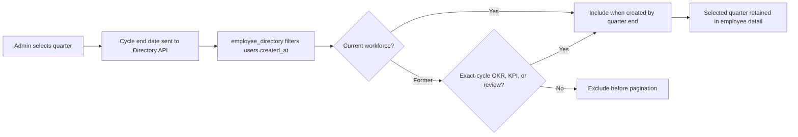

# OKR/KPI Cycle Roster Optimization Record

## Current Status

Correctness and user-flow behavior were implemented and audited. Latency measurement is deferred until local Supabase is available; no performance improvement is claimed.

## Relevant Code Map

- [Admin OKR/KPI roster](../../../apps/web/src/app/(app)/(admin)/admin/performance/page.tsx) - supplies the selected cycle cutoff and opts into former employees.
- [Directory hook](../../../apps/web/src/hooks/useDirectory.ts) - serializes historical-roster query parameters.
- [Directory API](../../../apps/web/src/app/api/directory/route.ts) - validates and applies the account-creation cutoff while preserving the default current-roster behavior.
- [Employee directory view migration](../../../supabase/migrations/20261015000001_add_user_created_at_to_employee_directory.sql) - exposes `users.created_at` for server-side filtering.
- [Former employee performance API](../../../apps/web/src/app/api/performance/individual/[employeeId]/route.ts) - permits authorized historical detail reads.
- [Performance detail page](../../../apps/web/src/app/(app)/(admin)/admin/performance/employee/[id]/page.tsx) - retains the selected quarter between roster and detail.
- [Performance realtime hook](../../../apps/web/src/hooks/usePerformanceRealtime.ts) - avoids opening a real Supabase websocket during mock-auth browser verification.
- [Directory API regression tests](../../../tests/api/directory-route.test.ts) - covers former inclusion, cutoff application, and invalid dates.
- [Historical roster browser test](../../../e2e/okr-kpi-historical-roster.spec.ts) - covers desktop and mobile/dark rendering with cycle-scoped fixtures.
- [Quarter workforce policy migration](../../../supabase/migrations/20261016000001_require_former_employee_quarter_data.sql) - centralizes active/former membership and exact-cycle evidence rules.
- [Quarter roster SQL assertions](../../../tests/sql/okr-kpi-former-quarter-roster-local.sql) - proves exclusion without data, inclusion with data, and isolation between quarters.

## Visual Guide



## Optimization Entries

### Implemented - Evidence-gated former employee roster

- Status: `Implemented`
- Problem/evidence: employment overlap alone exposed terminated employees in a selected quarter even when they had no saved performance data for that quarter.
- Solution: centralize quarter eligibility in a database function, require exact-cycle OKR, KPI, or performance-review evidence for terminated workforce accounts, and apply the resulting user IDs in the Directory API before count and pagination. Reviewer, test, and service identities remain ineligible through the workforce check.
- Code paths: quarter workforce policy migration, Directory API/hook, admin OKR/KPI roster, SQL assertions, API tests, and browser test in the Relevant Code Map.
- Validation: both migrations applied to local Supabase; rollback-only SQL assertions passed, including isolation between parallel cycles with identical dates; Directory API tests passed 8/8; web TypeScript passed; focused Chromium desktop and 390px mobile checks passed with screenshots reviewed. Production was not changed.

### Implemented - Cycle-scoped historical roster correctness

- Status: `Implemented`
- Problem/evidence: the performance roster reused the general Directory defaults, which excluded every `terminated` account and had no selected-cycle creation boundary. This removed former staff with historical objectives and allowed future-created accounts into old quarters.
- Solution: add explicit `include_terminated=true` and validated `created_through=YYYY-MM-DD` behavior for historical consumers; expose `users.created_at` on the directory view; enable the performance roster only after a cycle resolves; preserve the cycle when opening detail.
- Code paths: roster, hook, API, migration, detail API/page, and tests in the Relevant Code Map.
- Validation: focused Vitest suite (6/6), web TypeScript, and mocked-auth Playwright at desktop and mobile/dark passed. Local SQL application remains blocked as recorded in the task tracker.

### Audited - Comparable performance-cycle behavior

- Status: `Audited`
- Problem/evidence: historical results lose trust if account deactivation erases cycle participants or if a cycle roster is built from today’s workforce rather than the workforce eligible during that period.
- Proposed/delivered solution: retain former participants and their submitted cycle data while excluding accounts that did not exist by the selected period’s end. Culture Amp documents that deactivated participants remain in a performance cycle unless explicitly removed, and Leapsome documents that past feedback and reviews remain available after deactivation. These references support preservation of historical performance data; using the hub account-created date as the cutoff is the product-specific rule requested here.
- References: [Culture Amp: Managing Deactivated Participants](https://support.cultureamp.com/en/articles/9710499-managing-deactivated-participants-in-performance-review-cycles), [Leapsome: Deactivating, deleting and reactivating users](https://help.leapsome.com/hc/en-us/articles/360018691594-Deactivating-deleting-and-reactivating-users).
- Validation: observed in code and exercised with controlled browser fixtures; no live production review was performed.

### Deferred - Directory query latency measurement

- Status: `Deferred`
- Problem/evidence: the new `user_created_at` predicate changes database query work, but `supabase status` failed before editing because the Docker Desktop Linux engine named pipe was unavailable. Therefore p50/p95 before/after numbers do not exist and no speed claim is made.
- Proposed solution: compare the prior commit in a separate worktree with the changed build, using the same local Supabase data, admin role, machine, 30 samples, 3 warmups, and `/dashboard` as a control route.
- Code paths: Directory API and view migration in the Relevant Code Map.
- Resume condition: Docker Desktop and local Supabase are running.

## Measurements

Status: `Deferred` on 2026-10-15.

- Before commit: `bf6c3ad3` (baseline worktree required)
- After commit: working tree (dirty)
- Environment: intended `next start`, local Supabase, local admin; unavailable because Docker Desktop was not running
- Samples/warmups: planned 30/3
- Targets: `/admin/performance`, `/api/directory?include_terminated=true&created_through=2026-06-30`, and control `/dashboard`
- Resume commands:

```powershell
git worktree add ..\sn-connect-app-okr-baseline bf6c3ad3
# Start the baseline worktree on a separate port with the same local Supabase.
pnpm performance:latency --feature okr-kpi-cycle-roster --base-url http://localhost:3011 --targets "/admin/performance,/api/directory?include_terminated=true&created_through=2026-06-30,/dashboard" --label before
pnpm performance:latency --feature okr-kpi-cycle-roster --base-url http://localhost:3101 --targets "/admin/performance,/api/directory?include_terminated=true&created_through=2026-06-30,/dashboard" --label after
pnpm performance:latency --compare <before-json> <after-json>
```

## Change Log

- 2026-10-16: Replaced termination-overlap eligibility with exact-cycle evidence for former employees and validated the rule locally through SQL, API, type, and browser checks.
- 2026-10-15: Implemented cycle-aware historical roster filtering and former-employee access; audited comparable product behavior; completed focused automated UI/API checks; deferred SQL and latency validation because local Supabase was unavailable.
