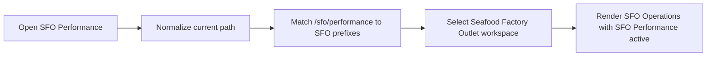

# SFO Performance Optimization Record

## Current Status

The route-to-workspace mapping now keeps SFO Performance inside the Seafood Factory Outlet navigation context. This is a correctness and user-flow reliability improvement; it does not claim a latency improvement.

## Entries

### Implemented

- **Status:** Implemented
- **Problem/evidence:** `/sfo/performance` appeared in the SFO navigation section but was absent from `getWorkspaceForPath`, so route changes fell through to `internal` and changed the visible workspace to Internal Management.
- **Solution:** Added `/sfo/performance` to the shared SFO route prefixes and added exact/nested-route regression coverage plus a focused browser navigation spec.
- **Relevant paths:** `packages/ui/src/layout/Sidebar.tsx`, `packages/ui/src/layout/Sidebar.test.tsx`, `e2e/sfo-workspace-navigation.spec.ts`
- **Validation:** 15 focused Vitest cases passed; UI package type-check passed; focused Chromium navigation test passed for desktop, 390x844 mobile, and dark mode. Local mock auth does not provide the server session required by the protected SFO page, so its API/page-content behavior was not part of this sidebar-focused validation.

## Relevant Code Map

- [Sidebar route classification and workspace rendering](../../../packages/ui/src/layout/Sidebar.tsx)
- [Sidebar workspace regression tests](../../../packages/ui/src/layout/Sidebar.test.tsx)
- [SFO workspace browser navigation test](../../../e2e/sfo-workspace-navigation.spec.ts)
- [SFO Performance route](../../../apps/web/src/app/(app)/sfo/performance/page.tsx)

## Visual Guide

## Measurements

No latency measurement was required because the change only corrects route classification and makes no performance claim.

## Change Log

- 2026-10-15: Implemented and validated the SFO Performance workspace-classification fix; recorded the local mock-auth limitation for protected page data.
