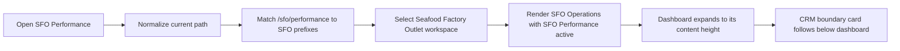

# SFO Performance Optimization Record

## Current Status

The route-to-workspace mapping keeps SFO Performance inside the Seafood Factory Outlet navigation context, and the page now lets the performance dashboard expand before rendering the CRM boundary card. These are correctness and user-flow reliability improvements; they do not claim a latency improvement.

## Entries

### Implemented

- **Status:** Implemented
- **Problem/evidence:** `/sfo/performance` appeared in the SFO navigation section but was absent from `getWorkspaceForPath`, so route changes fell through to `internal` and changed the visible workspace to Internal Management.
- **Solution:** Added `/sfo/performance` to the shared SFO route prefixes and added exact/nested-route regression coverage plus a focused browser navigation spec.
- **Relevant paths:** `packages/ui/src/layout/Sidebar.tsx`, `packages/ui/src/layout/Sidebar.test.tsx`, `e2e/sfo-workspace-navigation.spec.ts`
- **Validation:** 15 focused Vitest cases passed; UI package type-check passed; focused Chromium navigation test passed for desktop, 390x844 mobile, and dark mode. Local mock auth does not provide the server session required by the protected SFO page, so its API/page-content behavior was not part of this sidebar-focused validation.

- **Status:** Implemented
- **Problem/evidence:** The SFO page and embedded dashboard both forced `height: 100%`. The dashboard's longer chart content overflowed that fixed box, allowing the following CRM boundary card to occupy the same visual area.
- **Solution:** Replaced both fixed full-height wrappers with `min-height: 100%`, preserving viewport fill while allowing content height to expand and keep following sections in normal document flow.
- **Relevant paths:** `apps/web/src/components/marketing/MarketingAdSpendDashboard.tsx`, `apps/web/src/app/(app)/sfo/performance/page.tsx`, `tests/pages/sfo-performance-dashboard.test.tsx`, `tests/pages/sfo-performance-crm.test.tsx`, `e2e/sfo-workspace-navigation.spec.ts`
- **Validation:** 7 focused tests and the web type-check passed. Authenticated local Playwright passed for a super-admin at desktop and 390x844 mobile in light/dark mode; geometry assertions and screenshots confirmed the CRM section clears the chart card by at least the intended layout gap. Local page and API requests returned HTTP 200.

## Relevant Code Map

- [Sidebar route classification and workspace rendering](../../../packages/ui/src/layout/Sidebar.tsx)
- [Sidebar workspace regression tests](../../../packages/ui/src/layout/Sidebar.test.tsx)
- [SFO workspace browser navigation test](../../../e2e/sfo-workspace-navigation.spec.ts)
- [SFO Performance route](../../../apps/web/src/app/(app)/sfo/performance/page.tsx)
- [SFO performance dashboard](../../../apps/web/src/components/marketing/MarketingAdSpendDashboard.tsx)
- [SFO dashboard layout tests](../../../tests/pages/sfo-performance-dashboard.test.tsx)
- [SFO page boundary tests](../../../tests/pages/sfo-performance-crm.test.tsx)

## Visual Guide

## Measurements

No latency measurement was required because the change only corrects route classification and makes no performance claim.

## Change Log

- 2026-10-15: Implemented and validated the SFO Performance workspace-classification fix; recorded the local mock-auth limitation for protected page data.
- 2026-10-15: Replaced fixed-height dashboard/page wrappers with minimum-height wrappers and verified the chart-to-CRM boundary using authenticated local data on desktop and mobile.
