# Ultimate Health Project Optimization Record

## Relevant Code Map

- [Reminder schedule and history API](../../../apps/web/src/app/api/uhp/reminders/route.ts)
- [Authenticated n8n callback route](../../../apps/web/src/app/api/uhp/reminders/runs/route.ts)
- [Callback secret validation](../../../apps/web/src/app/api/uhp/_lib.ts)
- [Reminder workflow definition](../../../n8n/workflows/uhp-herbalife-portal-reminders.json)
- [Volume Points digest API](../../../apps/web/src/app/api/uhp/volume-points/digest/route.ts), [Volume Points digest workflow](../../../n8n/workflows/uhp-volume-points-daily-digest.json), and [Outreach summary workflow](../../../n8n/workflows/uhp-outreach-weekly-summary.json) - Telegram message data and layout.
- [Workflow regression tests](../../../n8n/workflows/uhp-workflows.test.ts)
- [Reminder-date calculation tests](../../../apps/web/src/lib/uhp-reminders.test.ts)
- [Outreach Tracker period selector](../../../apps/web/src/components/uhp/UhpClientTrackerPage.tsx)
- [Shared calendar field](../../../apps/web/src/components/forms/DatePickerField.tsx), [shared date-range filter](../../../apps/web/src/components/data-display/DateRangeFilter.tsx), [range interaction tests](../../../tests/components/DateRangeFilter.test.tsx), and [custom-range browser regression](../../../e2e/uhp-custom-date-range.spec.ts)
- [Outreach metrics endpoint](../../../apps/web/src/app/api/uhp/clients/metrics/route.ts)
- [Period-filtered outreach data](../../../apps/web/src/app/api/uhp/_lib.ts)
- [Outreach summary calculation](../../../apps/web/src/lib/uhp.ts)
- [Reply timestamp migration](../../../supabase/migrations/20261007000002_add_replied_at_to_uhp_clients.sql)
- [Call timestamp migration](../../../supabase/migrations/20261023000001_add_called_to_uhp_clients.sql), [Call toggle browser regression](../../../e2e/uhp-call-toggle.spec.ts), and [client PATCH timestamp tests](../../../tests/api/uhp-client-replied-route.test.ts) - period-aware manual call tracking and rollback.
- [Legacy reply timestamp backfill](../../../supabase/migrations/20261008000001_backfill_uhp_replied_at.sql)
- [Period query regression test](../../../tests/api/uhp-outreach-period.test.ts)
- [Optimistic reply-card unit tests](../../../tests/lib/uhp-outreach-summary.test.ts)
- [Application-wide dropdown regression test](../../../tests/components/uhp-modern-selects.test.ts)
- [Shared calendar bounds](../../../apps/web/src/lib/metrics-period.ts), [period request guard](../../../apps/web/src/hooks/usePeriodRequestGuard.ts), and [Volume Points page](../../../apps/web/src/components/uhp/UhpVolumePointsPage.tsx) - viewer-local period boundaries and latest-response safety.
- [Volume Points summary range API](../../../apps/web/src/app/api/uhp/volume-points/summary/route.ts), [entries range API](../../../apps/web/src/app/api/uhp/volume-points/entries/route.ts), [quarter browser regression](../../../e2e/uhp-volume-points-quarter.spec.ts), and [calendar-boundary tests](../../../tests/lib/metrics-period.test.ts) - monthly/quarterly KPI selection, aggregate targets, responsive controls, and table conventions.
- [Cohort metrics route](../../../apps/web/src/app/api/uhp/clients/metrics/route.ts), [cohort calculation](../../../apps/web/src/lib/uhp.ts), [cohort API test](../../../tests/api/uhp-outreach-cohort-route.test.ts), [calendar-boundary tests](../../../tests/lib/metrics-period.test.ts), and [cohort summary tests](../../../tests/lib/uhp-outreach-summary.test.ts) - late replies attributed to the selected outreach period.
- [WE form status activity query](../../../apps/web/src/app/api/uhp/_lib.ts), [deduplicated evaluation summary](../../../apps/web/src/lib/uhp.ts), [summary tests](../../../tests/lib/uhp-outreach-summary.test.ts), [period query test](../../../tests/api/uhp-outreach-period.test.ts), and [browser regression](../../../e2e/uhp-wellness-evaluation.spec.ts) - status milestone and appointment attribution.

## Records

### Implemented - 2026-10-23: Period-aware manual Call tracking

- Problem/evidence: Outreach could count calls only when a user logged a communication activity with appointment type `call`. The client also receives calls that need a simple row-level Yes/No field, and a permanent boolean alone would incorrectly leak across Week/Month/Quarter/custom ranges.
- Delivered solution: Add `called` plus `called_at` to each UHP client. The row toggle updates immediately and rolls back on PATCH failure; the Calls card then reconciles from the server because selected-period membership depends on the timestamp. Metrics and the Friday digest receive timestamp-filtered synthetic call rows and deduplicate by client when the same person also has a call activity.
- Code paths: Outreach Tracker, client create/update APIs and schema, period-filtered outreach loader, summary helper, database types/migration, focused tests, and browser regression in Relevant Code Map.
- Validation: `20261023000001_add_called_to_uhp_clients.sql` applied to local Supabase. Twenty-one focused API/summary tests and `pnpm --filter @hr-portal/web typecheck` passed. Playwright passed against the normal local server and local Supabase as super admin at 1440x900 and 390x844; it exercised No-to-Yes, server metric reconciliation to one call, page overflow, and console/network health. Desktop/mobile screenshots were inspected. On 2026-10-24, the production dry run listed only this migration; it was applied to project `tccdupkjmwwxcvpqnpeb`, and linked migration history verified it. The full monorepo production build and the 21 focused tests passed again in the delivery workflow. No performance or latency claim is made; this work improves data completeness and reporting consistency.

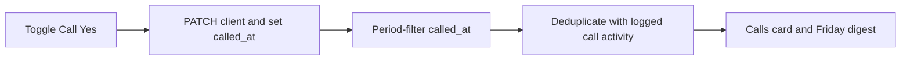

### Implemented - 2026-10-19: Complete monthly WHO ORDERED digest table

- Problem/evidence: The digest built `WHO ORDERED` only from entries updated after the previous successful run. On a no-change day, Telegram therefore said there were no orders even while the selected month's Control Hub Entries table contained member orders.
- Delivered solution: Return all non-deleted entries for the current reporting month from the authenticated digest API. Keep the prior-run delta solely for the independent change-status line. Aggregate monthly rows by member, sort names, and render a `NAME | VP` heading with each member's total VP; show “No orders for this month” only when the monthly table is actually empty. The formatter retains a `changedEntries` fallback so an n8n update remains compatible while the corresponding web deployment rolls out.
- Code paths: Volume Points digest API, Volume Points n8n workflow, and workflow regression tests in Relevant Code Map.
- Validation: the full `pnpm build` passed. `pnpm exec vitest run n8n/workflows/uhp-workflows.test.ts` passed 18 tests, including a no-change digest with populated monthly entries; `pnpm --filter @hr-portal/web typecheck` passed. This correction changes message completeness rather than latency, so no performance claim or measurement applies.

### Implemented - 2026-10-16: Quarterly Volume Points KPI and table consistency

- Problem/evidence: Volume Points could only show one month, its four header controls wrapped awkwardly at common widths, and its Entries Actions column interrupted the business data instead of following the Control Hub convention at the right edge. A repository audit also found three older action-column headers/cells without the dominant right alignment.
- Reference review: [Carbon Data Table guidance](https://www.carbondesignsystem.com/building-blocks/core/components/data-table/guidelines) places global table controls in a toolbar and permits fewer than three inline row actions. [Microsoft Fluent Toolbar guidance](https://learn.microsoft.com/en-us/fluent-ui/web-components/components/toolbar) groups related controls into one semantic control area. These patterns informed the separate labeled period toolbar, one visually primary Add entry action, and compact edit/delete actions in the final right-aligned column.
- Delivered solution: Add a Month/Quarter selector with five years of quarter choices; send explicit inclusive `fromMonth`/`toMonth` bounds; sum entries and the three monthly target/forecast rows for quarterly KPI cards; retain monthly target editing only in Month view; constrain entry dates to the selected range and derive their reporting month from the chosen order date. Move the period selector out of the crowded page-header actions, migrate both VP tables to the shared Control Hub table primitives, put Actions last/right, and align the three audited older table outliers without changing their behavior. Period selection remains server-confirmed; entry mutations retain their existing optimistic update, rollback, and reconciliation.
- Code paths: Volume Points page, summary/entries APIs, calendar helpers/tests, and browser regression in Relevant Code Map; Directory, AI Spending, and Marketing Ad Spend action columns.
- Validation: the full `pnpm build` passed. `pnpm exec vitest run tests/lib/metrics-period.test.ts tests/lib/uhp-volume-points.test.ts` passed 10 tests; `pnpm --filter @hr-portal/web typecheck` passed; focused Biome reported no errors and three complexity warnings in `UhpVolumePointsPage.tsx`. Playwright passed against the normal local server and local Supabase on `/uhp/volume-points` as super admin at 1440x900 and 390x844. It verified Q4 requests use October through December, totals update, Actions is the final header, controls remain visible, no page overflow occurs, and no console errors are introduced. A second focused Playwright check verified the right-aligned Actions header on Directory, AI Spending, and Marketing Ad Spend at 1440x900. Screenshots were inspected. No latency claim is made because this work targets reporting capability and layout consistency rather than response-time improvement.

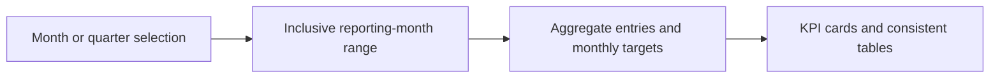

### Implemented - 2026-10-15: Custom Outreach metrics date range

- Problem/evidence: The tracker offered only This week, Last week, This month, and This quarter, while the client needed to report on arbitrary dates. The existing API already accepts exact `from`/`to` timestamps, but the page had no safe way to construct a viewer-local inclusive range.
- Reference review: [Google Analytics](https://support.google.com/analytics/answer/13412290?hl=en) keeps presets and a calendar-based custom range behind one date control with an explicit Apply action. [Power BI](https://learn.microsoft.com/en-us/power-bi/visuals/power-bi-visualization-slicer-visual) likewise combines relative choices with manual start/end date selection. The transferable pattern is to preserve fast presets, make both boundaries visible, and avoid changing the report while the range is incomplete.
- Delivered solution: Add Custom range to the established Metrics period Select; extract the onboarding calendar into a shared form component; compose it into one shared draft/Apply/Clear range filter used by both UHP and Marketing Reports; initialize UHP to the current month; constrain filter dates through today and start <= end; and treat both UHP endpoints as inclusive in the viewer's IANA timezone. The existing request guard prevents stale ranges from replacing the latest cards. This is a server-confirmed filter, not an optimistic mutation.
- Code paths: [Outreach Tracker](../../../apps/web/src/components/uhp/UhpClientTrackerPage.tsx), [Marketing Reports](<../../../apps/web/src/app/(app)/(admin)/admin/reports/page.tsx>), shared calendar/range controls and tests in Relevant Code Map, [timezone conversion](../../../apps/web/src/lib/metrics-period.ts), [calendar tests](../../../tests/lib/metrics-period.test.ts), and [browser regression](../../../e2e/uhp-custom-date-range.spec.ts).
- Validation: 11 focused tests, web TypeScript, focused Biome checks, and the full monorepo production build passed. Playwright passed against local Supabase on `/uhp/clients` and `/admin/reports` as admin at 1440x900 and 390x844. It exercised delayed loading and an intentional mocked 500 response, verified Oct 5-12 becomes `2026-10-04T16:00:00.000Z` through `2026-10-12T15:59:59.999Z`, confirmed reporting requests do not receive overlap dates until Apply, exercised Clear, checked open calendars and dark-mode emulation, and found no overflow or unexpected success-path page/console/network errors. Screenshots were inspected. The dark-mode emulation retains the screens' established light palette.

#### Measurements

- Status: Deferred. The initial pre-edit environment check could not reach Docker from the restricted process and appeared offline. Elevated access later showed local Supabase was healthy, but the custom-range source was already present in a dirty UHP worktree, so a valid isolated before measurement no longer exists. No latency or speed claim is made. Resume from a clean pre-change worktree with `pnpm performance:serve` and `pnpm performance:latency --feature ultimate-health-project --base-url http://localhost:3101 --targets "/uhp/clients,/api/uhp/clients/metrics?from=2026-01-01T00%3A00%3A00.000Z&to=2026-10-15T00%3A00%3A00.000Z,/api/notifications?limit=1" --label before`, then repeat identically with `--label after` and compare the saved results.

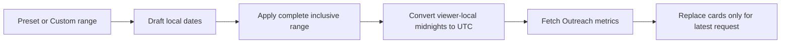

### Implemented - 2026-10-14: Early portal reminder delivery

- Problem/evidence: The client requested the 10-customer-form reminder on the 5th and checks-and-deposits reminder on the 16th at 05:30 PHT, with weekend deadlines sent on the preceding Friday. The date and weekend rules already matched, but the workflow evaluated them at 08:00 PHT.
- Delivered solution: Move the existing daily schedule trigger to `30 5 * * *` under the `Asia/Manila` workflow timezone. Keep the same Control Hub Telegram bot, destination configuration, callback credentials, due-date rules, and failure handling.
- Code paths: [Reminder workflow definition](../../../n8n/workflows/uhp-herbalife-portal-reminders.json), [workflow regression tests](../../../n8n/workflows/uhp-workflows.test.ts), and [reminder-date calculation tests](../../../apps/web/src/lib/uhp-reminders.test.ts).
- Validation: 21 focused tests passed. Live workflow `tGgNv4OB3vtADFZg` was updated and read back as active with cron `30 5 * * *` and timezone `Asia/Manila`; the destination and Telegram/callback credentials matched their pre-update values. This schedule-only change does not alter an API or user-flow latency path, so latency measurement is not applicable.

### Implemented - 2026-10-14: Digest feedback and schedule alignment

- Problem/evidence: Telegram feedback requested the weekly Outreach digest at 09:00 Friday, three distinct booking lines, member names under Volume Points orders, and removal of target VP. Both the repository and live n8n still used Friday 17:00, one combined booking line, and target-bearing VP rows without member names.
- Delivered solution: Schedule Outreach at `0 9 * * 5` in the existing `Asia/Manila` workflow timezone. Preserve the existing combined Wellness evaluations metric for the app while exposing separate form-milestone and wellness-call counts to the digest. Build the VP "WHO ORDERED" section from entries changed since the previous daily digest, grouped by member, and omit target values. The 2026-10-19 record supersedes the delta-only source so current digests show the complete reporting-month member table.
- Code paths: [Outreach summary calculation](../../../apps/web/src/lib/uhp.ts), [summary tests](../../../tests/lib/uhp-outreach-summary.test.ts), [VP workflow](../../../n8n/workflows/uhp-volume-points-daily-digest.json), [Outreach workflow](../../../n8n/workflows/uhp-outreach-weekly-summary.json), and [workflow tests](../../../n8n/workflows/uhp-workflows.test.ts).
- Validation: 31 focused tests and web TypeScript passed. The inactive live VP and Outreach workflows were synced and read back; Outreach is Friday 09:00 PHT, VP remains daily 12:00 PHT, and recipients, credentials, and inactive states were unchanged. The web app must be deployed before Outreach activation so production returns the new booking fields.

#### Measurements

- Status: Deferred. On 2026-10-14 the local Supabase Docker stack was unavailable, so the required pre-change API baseline could not be captured. No latency claim is made. Resume by running an isolated pre-change worktree and the changed worktree against local Supabase and `pnpm performance:serve`, then run `pnpm performance:latency --feature ultimate-health-project --base-url http://localhost:3101 --targets "/api/uhp/clients/digest,/api/notifications?limit=1" --label before` and the identical `--label after` command with at least 30 samples and 3 warmups.

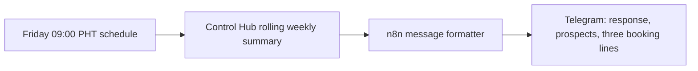

### Audited - 2026-10-12: Notification activation readiness

- Problem/evidence: A successful single-recipient test does not establish that the final audience receives all three workflows or that failure reporting survives Telegram or callback outages.
- Proposed solution: Before broader activation, confirm each intended Telegram destination and bot access, run a controlled delivery to the final audience, then enable the two inactive digest schedules. Follow up with an intentional failure-branch test and callback retry/idempotency policy.
- Code paths: The three n8n workflow definitions, callback routes, and workflow tests in Relevant Code Map.
- Validation/resume condition: Live success executions `544639`, `544641`, and `544654` reached Telegram and Control Hub callbacks with the personal test chat; 13 workflow tests passed. Final-audience delivery and negative-path resilience remain unverified. Resume activation after recipient IDs and rollout approval are confirmed.

### Implemented - 2026-10-12: Repeat VP digest callback reliability

- Problem/evidence: Post-layout live execution `544640` sent the VP Telegram message but its callback returned HTTP 400. After a prior successful run, Control Hub returned `intervalStartedAt` as `2026-10-12T02:41:00.41+00:00`; the callback schema requires UTC `Z` form.
- Delivered solution: Normalize the prior-run start timestamp to `toISOString()` in the VP builder before either callback branch consumes it. No message content, schedule, or recipient changed.
- Code paths: [VP digest workflow](../../../n8n/workflows/uhp-volume-points-daily-digest.json) and [workflow tests](../../../n8n/workflows/uhp-workflows.test.ts).
- Validation: 13 focused tests passed, including the offset-timestamp case. Live retest `544654` completed both `Send Telegram Digest` and `Record Digest Run` successfully. The workflow was restored to its inactive daily-noon schedule. The initial failed callback left no successful run record for `544640`, but the successful retry recorded the latest digest state.

### Implemented - 2026-10-12: Telegram notification readability

- Problem/evidence: The three live test messages arrived as dense, nearly uninterrupted Telegram text; totals, date context, and action items were difficult to scan in a chat bubble.
- Delivered solution: Give reminders a clear action and due date (including a weekend-advance explanation), put the VP total before its category breakdown, and group outreach statistics under response, prospects, and bookings. Use plain text with modest emoji and blank lines; no Telegram parse-mode dependency or metric/schedule change.
- Code paths: The three workflow definitions and formatter regression tests in Relevant Code Map.
- Validation: 13 focused workflow tests passed. Live post-format Telegram sends succeeded in reminder `544639`, outreach `544641`, and VP `544640`/`544654`; the latter required the callback fix documented above. Original schedules and active states were restored. Digest activation remains deferred until its audience is approved.

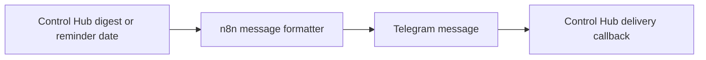

### Implemented - 2026-10-12: WE form milestone missing from Wellness evaluations

- Problem/evidence: Updating a client's status to `WE form Filled` writes a dated `uhp_client_activities` Task titled `Status changed to WE form Filled`, but the metric reads only rows with `appointment_type = wellness_evaluation`. The screenshot shows Colleen's status set while the card remains zero.
- Delivered solution: Include exact WE form status-change milestones in the existing period-filtered activity summary and count unique clients across milestone and appointment evidence. This avoids treating unrelated `updated_at` edits as evaluation dates and avoids counting the same client's appointment and completed form twice. No migration or client mutation change is needed.
- Code paths: WE form status query, summary, focused tests, and browser regression in Relevant Code Map.
- Validation: 15 focused tests, local production build, and two Playwright tests passed against the local production bundle and local Supabase. Admin and employee checked `/uhp/clients` at 1440px and 390px, including status update, long list, loading, empty/error state, and mobile overflow; screenshots were inspected. Dark-mode emulation did not change this screen's light palette. The temporary employee access grant was revoked and confirmed absent. Full web typecheck currently fails in untouched Marketing Ad Spend chart tooltip code; keep this distinct from UHP validation.

#### Measurements

- Before: 2026-10-12, commit `4bbee970` with dirty unrelated worktree; local Next.js production build on port 3101, local Supabase, admin role, 30 samples and 3 warmups per target. File `perf-results/uhp-wellness-evaluation/2026-10-12T02-44-39-635Z-before.json`. All targets HTTP 200. Total-response p50/p95: Outreach page 232.2/526.7 ms; metrics API 163.2/282.5 ms; unaffected notifications control 139.5/245.6 ms.
- After: 2026-10-12, same commit, local production build and Supabase, admin role, 30 samples and 3 warmups per target; file `perf-results/uhp-wellness-evaluation/2026-10-12T03-03-40-388Z-after.json`. All targets HTTP 200. Total-response p50/p95: Outreach page 151.9/636.3 ms; metrics API 152.8/757.3 ms; notifications control 167.7/429.7 ms.
- Delta (after minus before): Outreach page -80.3/+109.6 ms p50/p95; metrics API -10.4/+474.8 ms; control +28.2/+184.1 ms. The control and p95 drifted substantially, so these samples do not establish a performance improvement or regression attributable to the change.

### Implemented - 2026-10-12: UHP notification callback reliability

- Problem/evidence: The active reminder sent a Telegram message but its callback received HTTP 400 because `scheduledFor` and `sentAt` used `+08:00` timestamps while the Control Hub schema accepts UTC `Z` timestamps. The Volume Points and Outreach workflows also had their personal test destination nested one array too deep and were inactive.
- Delivered solution: Emit UTC timestamps from the reminder builder and each success callback; flatten the configured live destination in all three workflows. Preserve the original schedules and inactive state of the two digests after controlled tests.
- Code paths: [reminder workflow](../../../n8n/workflows/uhp-herbalife-portal-reminders.json), [Volume Points workflow](../../../n8n/workflows/uhp-volume-points-daily-digest.json), [Outreach workflow](../../../n8n/workflows/uhp-outreach-weekly-summary.json), and [workflow tests](../../../n8n/workflows/uhp-workflows.test.ts).
- Validation: `pnpm exec vitest run n8n/workflows/uhp-workflows.test.ts` passed (11 tests). Live n8n executions `544608`, `544609`, and `544610` each completed with one successful Telegram item and a Control Hub callback response containing a persisted `sent` record. Failure callback branches and callback retries remain untested end to end. Both digest workflows remain inactive pending the intended audience and activation decision.

### Implemented - 2026-10-08: Outreach-period response cohorts

- Problem/evidence: The former API filtered outreach and replies to the same window. A client contacted last week who replied this week could not improve last week's response rate, and the UI did not offer a Last week choice.
- Delivered solution: Add a viewer-local Last week selection. Outreach attempts and the denominator come from activity logged in the selected window; Replies and Response rate count clients in that outreach cohort who replied after contact, including later periods. A newer follow-up takes ownership of a reply so one event does not inflate both weeks. Other cards remain tied to activity in the selected window. The Updated column remains unrelated. Keep checkbox-derived cards optimistic with rollback; period selection remains server-confirmed. The scheduled digest retains its rolling-window semantics.
- Code paths: Cohort metrics route, calculation, UHP data helper and tracker, shared calendar bounds, and focused tests in Relevant Code Map.
- Validation: 23 focused tests, web typecheck, local production build, and 30-sample local before/after measurements passed. Existing data lacks an immutable history for every manual checkbox toggle; unchecking removes that flag's contribution unless a separate inbound/reply activity exists. Browser click-testing and measurement with representative outreach volume remain useful follow-ups.

#### Measurements

- Before: 2026-10-08, commit `a58925f4` with dirty worktree; local Next.js production build on port 3101, local Supabase, admin role, 30 samples and 3 warmups per target. Valid file: `perf-results/uhp-outreach-cohort/2026-10-08T01-13-08-559Z-before.json`; all three targets returned HTTP 200. Before total-response p50/p95: Outreach page 70.5/157.3 ms, historical-week metrics API 56.0/96.3 ms, unaffected notifications control 56.5/117.9 ms. An earlier attempt failed before sampling because local Supabase was stopped; starting the local stack without its unhealthy optional vector service produced this valid baseline.
- After: `perf-results/uhp-outreach-cohort/2026-10-08T01-23-55-820Z-after.json`; same commit, dirty worktree, local production-build mode, local Supabase, admin role, targets, sample count, and warmups. All targets returned HTTP 200. Total-response p50/p95 before → after (delta): Outreach page 70.5/157.3 → 164.2/231.2 ms (+93.7/+74.0); historical-week metrics API 56.0/96.3 → 86.7/137.8 ms (+30.7/+41.5); unaffected notifications control 56.5/117.9 → 83.0/139.4 ms (+26.6/+21.5). The control and one-off sign-in also slowed substantially, so this run cannot isolate the added query's cost; no speed claim is made. The local dataset may not represent production outreach volume.

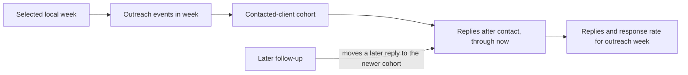

### Implemented - 2026-10-08: Viewer-local period boundaries and selected-month safety

- Problem/evidence: A hardcoded Asia/Manila period would give Italy and Australia users the wrong "this month" near a boundary; Volume Points could apply responses for a previously selected month.
- Delivered solution: Shared calendar bounds convert each viewer's IANA week/month/quarter to UTC instants for Outreach. Volume Points starts on the viewer's month but keeps its selected `YYYY-MM` as a canonical reporting key. Both UHP views reject stale period responses; Volume Points hides old-month totals while loading and provides retry after failure.
- Code paths: Shared calendar bounds, period request guard, Outreach selector/API, and Volume Points page in Relevant Code Map.
- Validation: 20 focused cross-feature tests, web typecheck, and local production build passed. Thirty local samples per target showed Outreach page p50/p95 60.2/78.6 → 66.4/84.1 ms, Outreach metrics API 55.3/73.2 → 52.0/66.4 ms, and Volume Points summary 53.2/75.1 → 47.6/62.4 ms. The unaffected notifications control also moved 55.4/79.5 → 51.8/71.9 ms, so no causal speed improvement is claimed. Full setup and run files are in [Metrics Period Consistency](../metrics-period-consistency/optimization.md); browser click-testing remains open.

### Audited — 2026-10-02: Delivery readiness and observability

- Problem/evidence: The live reminder workflow was inactive, had no configured Telegram destinations, and had no executions. Its Code node correctly returns no items when no reminder is due, which can look like a failed workflow unless understood.
- Solution: Keep the empty-output behavior (it prevents off-schedule messages), document the expected schedule, and require the first delivery to be verified through both Telegram and Control Hub history before activation.
- Code paths: reminder workflow and callback API listed above.
- Validation/resume condition: Live inspection confirmed 08:00 PHT scheduling, Header Auth on both callbacks, a connected failure branch, and zero destinations/executions. Resume when a chat ID is configured; validate a sent or failed delivery record after a due-date test.

### Implemented - 2026-10-12: Telegram failure recording and callback retries

- Problem/evidence: All three workflows had Telegram error branches, but none had been exercised live. Their six callback HTTP nodes made only one attempt, so a transient Control Hub outage could leave a delivery unrecorded.
- Delivered solution: Configure both sent and failed callbacks in each workflow for three total attempts, five seconds apart. Keep Telegram sends single-attempt because retrying an ambiguous send timeout could deliver duplicate messages. Keep callback failures visible as failed n8n executions after retries; the three Control Hub routes upsert on `idempotency_key`, making callback retries idempotent.
- Code paths: The three n8n workflow definitions and workflow tests in Relevant Code Map; [reminder callback](../../../apps/web/src/app/api/uhp/reminders/runs/route.ts), [VP callback](../../../apps/web/src/app/api/uhp/volume-points/digest/route.ts), and [outreach callback](../../../apps/web/src/app/api/uhp/clients/digest/route.ts).
- Validation: 16 focused workflow tests passed. Live executions `544744`, `544746`, and `544745` each took the Telegram error output and received a persisted `failed` callback response under an isolated test key. Live callback settings read back as `retryOnFail: true`, `maxTries: 3`, `waitBetweenTries: 5000`; original schedules, recipients, and activation states were restored. A transient 5xx-to-success recovery has not been induced; that remains deferred until a controlled endpoint or maintenance window is available.

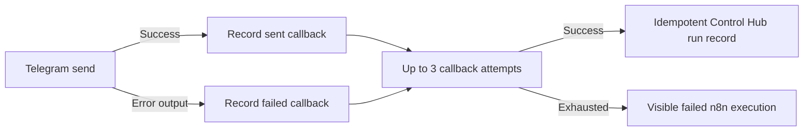

### Implemented — 2026-10-07: Strict metric-period filtering

- Problem/evidence: Activity-based cards already constrained `occurred_at`, but the manual Replied checkbox exposed only a durable boolean. Reading that current boolean from an outreach row could count an old reply in Week, Month, or Quarter, or miss a reply newly checked during the selected period when its outreach occurred earlier.
- Delivered solution: Store the time when Replied is switched on in `uhp_clients.replied_at`, clear it when switched off, and load timestamp-filtered manual replies alongside activity rows. The client now sends explicit `from` and `to` query bounds and bypasses the browser cache when the period changes.
- Code paths: Outreach Tracker selector, metrics endpoint/data helper, summary calculation, client create/update routes, migration, and focused tests listed above.
- Validation: 10 focused tests passed; web TypeScript passed; the migration applied to local Supabase; read-only local schema inspection confirmed `replied_at timestamptz` and `idx_uhp_clients_replied_at`. Production deployment and UI click-testing are deferred.

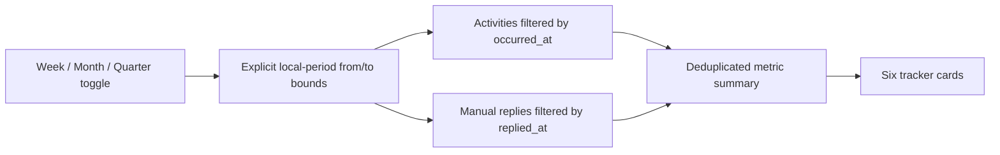

### Implemented — 2026-10-08: Legacy Replied checkbox reconciliation

- Problem/evidence: The table renders the durable `uhp_clients.replied` boolean, while the period-aware Replies card loads manual checks by `replied_at`. Rows checked before that timestamp column existed have `replied = true` and `replied_at = NULL`; the screenshot showed at least three checked rows while the card counted one timestamped reply.
- Delivered solution: A one-time migration fills missing timestamps for checked rows from `updated_at`, falling back to `created_at`. This preserves the Week / Month / Quarter contract while allowing legacy checked rows to enter the appropriate historical period. New checks still receive the exact toggle time from the PATCH route.
- Code paths: [legacy reply timestamp backfill](../../../supabase/migrations/20261008000001_backfill_uhp_replied_at.sql), [period-filtered outreach data](../../../apps/web/src/app/api/uhp/_lib.ts), and [reply toggle route](../../../apps/web/src/app/api/uhp/clients/[id]/route.ts).
- Validation: Applied to local Supabase; local migration history confirmed `20261008000001`; a transaction-scoped legacy fixture produced `timestamp_backfilled = true` and was rolled back; 10 focused UHP tests and web TypeScript passed. Production dry-run listed only `20261008000001`, then the approved push and migration history confirmed it on 2026-10-08.

#### Measurements

- Status: Deferred; no valid before/after delta is claimed.
- Attempted 2026-10-08 against local `next dev` on port 3011, local Supabase, admin role, 30 samples and 3 warmups. The run was rejected because concurrent dev servers corrupted the shared `.next` manifests: every target, including the unaffected control, returned 19 HTTP 500 responses and only 11 HTTP 200 responses. Rejected metrics API figures were p50 1057.1 ms / p95 3718.7 ms; control-route figures were p50 902.6 ms / p95 2619.4 ms. These numbers measure the broken dev environment, not query performance.
- The local database had zero checked clients, so the data-only backfill cannot produce a representative query-cost comparison there without fixture data. Resume with an isolated server and representative local data. After preparing an isolated baseline database/worktree, run:

```powershell
pnpm performance:latency --feature ultimate-health-project --base-url http://localhost:3101 --targets "/uhp/clients,/api/uhp/clients/metrics?from=2026-10-01T00%3A00%3A00.000Z&to=2026-10-08T23%3A59%3A59.999Z,/api/notifications?limit=1" --label before
# Apply the backfill to the isolated local database, then rerun with --label after and compare the two JSON files.
```

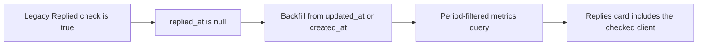

### Implemented — 2026-10-08: Optimistic reply cards and independent period refresh

- Problem/evidence: Replied row state was already optimistic, but Replies and Response rate waited for the PATCH plus a second metrics GET. The isolated baseline metrics request was p50 316.6 ms / p95 474.6 ms. Period changes also reused the debounced client-list loader, adding a fixed 250 ms delay and re-fetching unrelated rows.
- Delivered solution: Apply the deduplicated reply-card delta in the same render as the checkbox, restore it on PATCH failure, and reconcile with the server after success. The metrics response includes reached, replied, and activity-replied client IDs so a manual check cannot double-count an existing inbound/reply activity. Period selection remains server-confirmed because future totals are not knowable locally; it now starts a metrics-only request immediately, displays a card loading state, reports errors, and rejects stale out-of-order responses.
- Code paths: Outreach Tracker period selector, metrics endpoint/data helper, outreach summary helper, focused unit tests, and the optimistic-UI architecture record.
- Validation: 13 focused UHP tests passed; web TypeScript passed; Biome reported warnings only and no errors; the local production build completed. Browser click-testing remains outstanding.

#### Measurements

- Date: 2026-10-08. Local Next.js production build on port 3101 with local Supabase; admin role; commit `4daae26` with a dirty worktree; 30 samples and 3 warmups; every target returned 30/30 HTTP 200.
- Raw runs: `2026-10-07T22-37-41-805Z-optimistic-cards-before.json` and `2026-10-07T23-53-35-270Z-optimistic-cards-after-final.json` under the gitignored `perf-results/ultimate-health-project/` directory.

| Metric | Before p50 | After p50 | Δ p50 | Before p95 | After p95 | Δ p95 |
| --- | ---: | ---: | ---: | ---: | ---: | ---: |
| UHP clients page | 329.1 ms | 70.5 ms | -258.5 ms | 495.9 ms | 84.2 ms | -411.7 ms |
| Metrics API | 316.6 ms | 55.3 ms | -261.3 ms | 474.6 ms | 82.9 ms | -391.7 ms |
| Notifications control | 298.8 ms | 54.1 ms | -244.7 ms | 378.2 ms | 63.9 ms | -314.3 ms |

- Interpretation: The broad server-time improvement is environmental, not attributable to this change, because the unaffected control improved by roughly the same amount. The final reconciliation request is p50 55.3 ms / p95 82.9 ms in this run. The user-visible checkbox-to-card transition now requires zero network round trips, while period selection removes the prior fixed 250 ms client-search debounce but correctly retains the measured server wait.

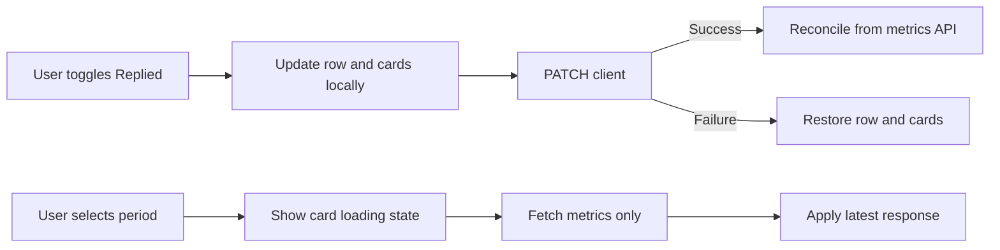

### Implemented — 2026-10-07: Consistent modern dropdown interactions

- Problem/evidence: Twelve UHP fields still used browser-native select menus while the application standard is the shared Radix Select, creating inconsistent visuals and interaction behavior in the Outreach Tracker, client dialog, Source picker, and Volume Points form.
- Delivered solution: Converted all UHP dropdowns to the shared Select family. Nullable options use explicit sentinels, and the communication form now preserves its appointment auto-suggestion through controlled state rather than direct DOM mutation.
- Code paths: UHP tracker, client detail, source selector, Volume Points page, and dropdown regression test.
- Validation: Web TypeScript and the focused dropdown regression test passed; Biome reported no errors. Browser click testing remains outstanding.

## Visual Guide

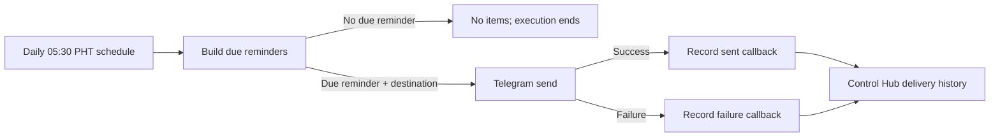

## Change Log

- 2026-10-24: Applied and verified the Call-column migration in production through the build-fix-commit-push migration gate.
- 2026-10-23: Added period-aware manual Call tracking to Outreach, with optimistic row rollback, server-reconciled Calls metrics, digest integration, local migration validation, focused tests, and desktop/mobile Playwright coverage.
- 2026-10-19: Corrected Volume Points `WHO ORDERED` to list all reporting-month members and aggregated VP under `NAME | VP`, even when no entries changed since the previous digest; 18 workflow tests and web TypeScript passed.
- 2026-10-16: Added quarterly Volume Points KPI ranges, reorganized responsive controls, adopted shared table primitives, and normalized action-column placement/alignment; the full build plus focused unit, type, lint, and browser checks passed.
- 2026-10-15: Extracted the calendar and draft/Apply/Clear range behavior into shared components, removed duplicate Marketing Reports DayPickers, and passed the final two-route desktop/mobile browser audit. No speed or bundle-size claim is made.
- 2026-10-15: Added an inclusive custom Outreach metrics range using the established calendar and server-confirmed Apply behavior; passed focused tests and the secured desktop/mobile browser audit. Latency comparison remains deferred without a valid pre-edit baseline.
- 2026-10-14: Moved the active portal reminder evaluation to 05:30 PHT while preserving the 5th/16th deadlines, weekend-to-Friday adjustment, destination, and credentials; 21 focused tests passed.
- 2026-10-12: Audited WE form status versus appointment-only metric, implemented milestone-aware deduplication, passed focused and local Playwright tests, and inspected desktop/mobile screenshots. Recorded before/after local latency samples; p95/control drift prevents attributing the delta.
- 2026-10-12: Fixed UTC timestamp contract and nested live test destinations; verified Telegram and saved Control Hub delivery records for all three workflows, then restored normal schedules and activation states.
- 2026-10-08: Added outreach-week cohorts and Last week selection, with late replies and later-follow-up attribution. Validated 23 focused tests and local build; recorded 30-sample before/after and control-route drift, with no causal speed claim.
- 2026-10-08: Made reply-derived cards optimistic with exact activity-aware deduplication and rollback; decoupled metrics-period refresh from the client-list debounce; recorded local production-build latency evidence.
- 2026-10-08: Reconciled legacy checked Replied rows with period metrics through a locally validated timestamp backfill; production dry-run listed only the backfill migration, then the approved push and migration history confirmed deployment. Recorded the invalid latency attempt and deferred a valid isolated comparison.
- 2026-10-07: Audited Outreach Tracker period behavior and implemented timestamped, bounded manual-reply metrics; validated locally and left production deployment deferred.
- 2026-10-07: Replaced all 12 native UHP selects with the shared modern dropdown and recorded the remaining cross-feature audit separately.
- 2026-10-02: Audited live workflow deployment state and documented the remaining recipient, activation, and first-delivery verification steps.
