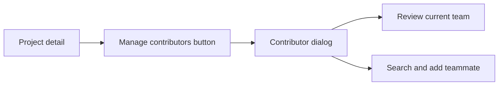
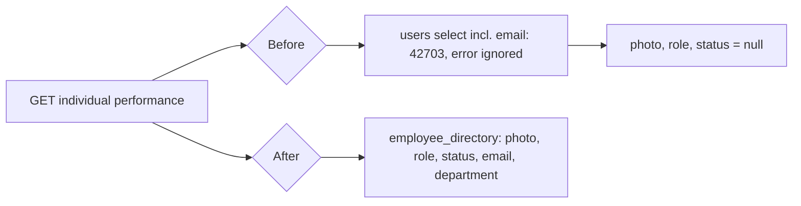

# User Identity and Contributor UI Optimization

## Relevant Code Map

- [Manage Contributors dialog](../../../apps/web/src/components/projects/ManageContributorsDialog.tsx): contributor list, candidate search, roles, and responsive dialog layout.
- [Project detail page](../../../apps/web/src/app/(app)/(employee)/projects/[id]/page.tsx): contributor-management entry point.
- [Contributor dialog browser test](../../../e2e/project-contributors-dialog.spec.ts): desktop/mobile containment, action prominence, and protected-lead behavior.
- [Individual performance API](../../../apps/web/src/app/api/performance/individual/[employeeId]/route.ts): employee identity for the OKRs & KPIs employee view.
- [Performance employee page](../../../apps/web/src/app/(app)/(admin)/admin/performance/employee/[id]/page.tsx): header avatar and role/status badges.

## Visual Guide

## Entries

### 2026-10-12: Contributor-management clarity — Implemented

- Problem/evidence: The management action looked like metadata rather than an action. The dialog used whole-panel scrolling, rigid horizontal controls, duplicated the lead label, and displayed a disabled delete icon for the protected project lead. A focused browser check also reproduced horizontal clipping at 390px because the inherited dialog width remained 512px.
- Delivered solution: Promoted the entry point to a bordered, tinted secondary action. Split the dialog into a fixed header and contained scrolling body; made search and role controls responsive; added count and lead badges; improved row spacing and destructive-action labeling; capped width to the viewport.
- Code paths: Manage Contributors dialog, project detail page, and focused Playwright specification linked above.
- Validation: `pnpm --filter @hr-portal/web typecheck`; focused Biome check; Playwright passed at 1280×720 and 390×844 with bounds and horizontal-overflow assertions. Desktop and mobile screenshots were visually inspected.

### 2026-10-16: Performance employee identity lookup — Implemented

- Problem/evidence: On the OKRs & KPIs employee view, the header always showed initials and two "—" badges. The route selected `avatar_url, role, email, department_id, status` from `public.users`, which has no `email` column. PostgREST rejected the whole query (42703, reproduced on local), the error was ignored, and photo, role and status came back null. The linked-department lookup was skipped for the same reason.
- Delivered solution: One `employee_directory` row (`avatar_url, role, status, email, department_name`) replaces the failing `users` query and the follow-up `departments` query. The view also falls back to the auth-metadata photo. The error is now logged instead of ignored. The page uses `UserAvatar` and hides the role/status badges when a value is missing, instead of showing "—".
- Code paths: individual performance API and performance employee page linked above.
- Validation: see Measurements and the task tracker.

## Measurements

- 2026-10-12 contributor dialog: no latency, load-time, API, or query behavior changed, so latency measurement was not applicable and no performance claim is made.
- 2026-10-16 performance employee identity lookup. Environment: local production build (`pnpm performance:serve`, port 3101), local Supabase, local sample admin, 30 samples / 3 warmups, one sign-in. Before = `HEAD` route file (commit `58d04a8b`) swapped in temporarily; after = this change (commit `7681814e` plus working tree; that commit didn't touch this route). Every request returned 200.

| Metric | Before p50 | After p50 | Δ p50 | Before p95 | After p95 | Δ p95 |
| --- | ---: | ---: | ---: | ---: | ---: | ---: |
| GET /api/performance/individual/[employeeId] total | 98.4 | 76.2 | -22.2 ms (-22.6%) | 135.6 | 124.0 | -11.6 ms (-8.6%) |
| GET /api/directory total (control) | 66.7 | 54.7 | -12.0 ms (-18.0%) | 105.4 | 77.8 | -27.7 ms (-26.2%) |

Interpretation: the control route also got faster (-12 ms p50), so most of the target delta is run-to-run drift. Net of the control, about -10 ms p50 and no p95 regression. Read this as "no regression", not a speed-up. An earlier `next dev` attempt was discarded: another session's `dev:web:e2e` deleted `apps/web/.next` mid-run, and every target returned 404/500.

## Change Log

- 2026-10-12: Implemented and browser-validated the contributor dialog and action hierarchy refresh. No production deployment.
- 2026-10-16: Fixed the performance employee identity lookup (failing `users.email` select). Measured on a local production build: no regression. Browser-validated. Not committed.
