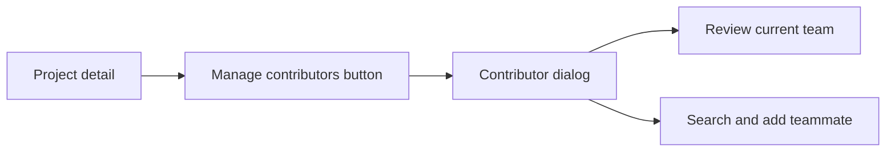

# User Identity and Contributor UI Optimization

## Relevant Code Map

- [Manage Contributors dialog](../../../apps/web/src/components/projects/ManageContributorsDialog.tsx): contributor list, candidate search, roles, and responsive dialog layout.
- [Project detail page](../../../apps/web/src/app/(app)/(employee)/projects/[id]/page.tsx): contributor-management entry point.
- [Contributor dialog browser test](../../../e2e/project-contributors-dialog.spec.ts): desktop/mobile containment, action prominence, and protected-lead behavior.

## Visual Guide

## Entries

### 2026-10-12: Contributor-management clarity — Implemented

- Problem/evidence: The management action looked like metadata rather than an action. The dialog used whole-panel scrolling, rigid horizontal controls, duplicated the lead label, and displayed a disabled delete icon for the protected project lead. A focused browser check also reproduced horizontal clipping at 390px because the inherited dialog width remained 512px.
- Delivered solution: Promoted the entry point to a bordered, tinted secondary action. Split the dialog into a fixed header and contained scrolling body; made search and role controls responsive; added count and lead badges; improved row spacing and destructive-action labeling; capped width to the viewport.
- Code paths: Manage Contributors dialog, project detail page, and focused Playwright specification linked above.
- Validation: `pnpm --filter @hr-portal/web typecheck`; focused Biome check; Playwright passed at 1280×720 and 390×844 with bounds and horizontal-overflow assertions. Desktop and mobile screenshots were visually inspected.

## Measurements

- No latency, load-time, API, or query behavior changed, so latency measurement was not applicable and no performance claim is made.

## Change Log

- 2026-10-12: Implemented and browser-validated the contributor dialog and action hierarchy refresh. No production deployment.
