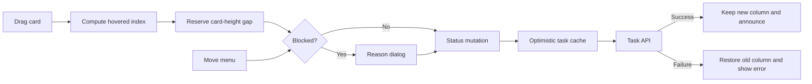

# Work Tracker Kanban Optimization

## Relevant Code Map

- [Shared Kanban board](../../../apps/web/src/components/tasks/TaskKanbanBoard.tsx): drag/drop, Move menu, blocker dialog, status feedback.
- [Work Tracker page](../../../apps/web/src/app/(app)/(employee)/work-tracker/page.tsx): board host and task-status mutation entry point.
- [Employee tasks page](../../../apps/web/src/app/(app)/(employee)/tasks/page.tsx): employee board mutation and error propagation.
- [Admin tasks page](../../../apps/web/src/app/(app)/(admin)/super-admin/tasks/page.tsx): admin board mutation and error propagation.
- [Task status hook](../../../apps/web/src/hooks/useUpdateTask.ts): optimistic cache update and rollback.
- [Task API](../../../apps/web/src/app/api/tasks/[id]/route.ts): status and blocker-reason persistence.
- [Browser tests](../../../e2e/work-tracker-kanban.spec.ts): drag, keyboard/blocker, and rollback coverage.
- [Playwright launcher](../../../scripts/playwright/start-playwright-web.js): respects isolated Next.js build directory and avoids resetting a custom cache.

## Visual Guide

## Entries

### 2026-10-12: Full-card drag target — Implemented

- Problem/evidence: Direct user feedback showed that requiring a precise grab on the small six-dot handle made the board feel as though cards were not draggable. [Trello](https://support.atlassian.com/trello/docs/moving-cards-or-lists/) and [Asana](https://help.asana.com/s/article/board-view?language=en_US) document board movement as dragging the card/task itself.
- Delivered solution: Move the native drag activator to the task-card wrapper, retain the grip as a visual affordance, prevent native link dragging so the card can start the gesture from its title area, and preserve the detail link plus keyboard/touch Move menu.
- Code paths: shared board and browser tests in the Relevant Code Map.
- Validation: Focused Biome check and web typecheck passed. Chromium Playwright passed 3/3 with `NEXT_DIST_DIR=.next-work-tracker-card-drag`, covering employee desktop whole-card drag, the 390px layout and Move menu, keyboard/blocker handling, failed-mutation rollback, console errors, and failed requests. Desktop and mobile screenshots were inspected; no clipping, overlap, or horizontal overflow was observed. This entry does not assert a latency improvement.

### 2026-10-12: Status-move interaction reliability — Implemented

- Problem/evidence: The entire task card was draggable, competing with its detail link; drag targets were subtle; the blocked reason used a browser prompt; there was no keyboard-accessible status move; and callers could swallow mutation errors, preventing board-level failure feedback.
- Delivered solution: Drag only from a visible handle, highlight destination columns, offer a keyboard/touch Move menu, collect a required blocker reason in a dialog, propagate mutation errors, and announce/show failed moves while the optimistic hook restores the card.
- Code paths: shared board, employee/admin task pages, status hook, and task API in the Relevant Code Map.
- Validation: Chromium Playwright tests for drag, keyboard/blocker payload, and failed PATCH rollback passed in the first complete run. After adding visible error feedback, drag and keyboard tests passed together and the final rollback test passed separately. Focused Biome and Node syntax checks passed. An earlier web typecheck passed, while a later whole-web run failed on unrelated concurrently changed marketing-dashboard unused declarations. This entry does not assert a latency improvement.

### 2026-10-12: Browser-test build isolation — Implemented

- Problem/evidence: The Playwright launcher always removed the shared `.next` directory, even when `NEXT_DIST_DIR` selected a different build; subsequent local runs encountered a Next.js webpack runtime error during page load.
- Delivered solution: Resolve the cache directory from a validated `NEXT_DIST_DIR`; preserve an isolated custom cache across reruns and leave the default `.next` cleanup behavior unchanged.
- Code paths: Playwright launcher and browser tests in the Relevant Code Map.
- Validation: `node --check` and focused Biome check passed; Chromium browser tests reached and exercised the board with `NEXT_DIST_DIR=.next-playwright-kanban`.

### 2026-10-12: Precise insertion and immediate repeated moves — Implemented

- Problem/evidence: The board displayed one generic drop banner at the top of a column and disabled all cards until a status request settled. Users could not see the exact insertion point and could not immediately move the same card again.
- Delivered solution: Calculate the destination index from the pointer and target-card midpoint, reserve a placeholder equal to the dragged card height so following cards move down, persist the visible order using the existing `tasks.position` column, and optimistically apply each move. Same-task PATCH requests are serialized in intent order; mutation versions prevent an older failure from rolling back a newer optimistic move.
- Code paths: shared board, task API/schema/hooks, three board hosts, focused hook tests, and browser tests in the Relevant Code Map.
- Validation: web typecheck passed; focused hook tests passed 4/4; the new Chromium scenario verified the insertion gap, downward displacement, persisted ID order payload, and a second drag before the first delayed PATCH completed. The existing basic drag, blocker, and rollback scenarios also passed across the focused browser runs.

## Measurements

- Status: Deferred. No p50/p95 values or delta are available, and no speed claim is made.
- Date: 2026-10-12; commit: `4bbee970`; environment: local Windows development; role: employee; intended sample count: 30 per target with 3 warmups.
- Before command: `pnpm performance:latency --feature work-tracker-kanban --targets "/work-tracker?view=execution,/api/tasks?page=1&pageSize=10,/dashboard" --label before` — failed with `fetch failed` because the local app was unavailable at `http://localhost:3001`.
- After command: `pnpm performance:latency --feature work-tracker-kanban --targets "/work-tracker?view=execution,/api/tasks?page=1&pageSize=10,/dashboard" --label after` — failed with the same connection error.
- Resume condition: Start local Supabase and the local web server on port 3001, rerun the identical before/after targets, then run `pnpm performance:latency --feature work-tracker-kanban --compare`. Use a pre-change checkout for a valid baseline.

## Change Log

- 2026-10-12: Added exact insertion-position feedback, persisted task order using the existing schema, and allowed immediate repeated moves with ordered request delivery and version-safe rollback. Browser and hook checks passed; latency sampling remained unavailable.
- 2026-10-12: Expanded the drag activator from the grip to the full card, kept interactive navigation and the Move fallback, and passed desktop/mobile browser verification.
- 2026-10-12: Audited Kanban interaction friction, implemented accessible status moves and failure feedback, isolated the Playwright build, passed focused browser validation, and deferred measurements and persisted intra-column ordering.
