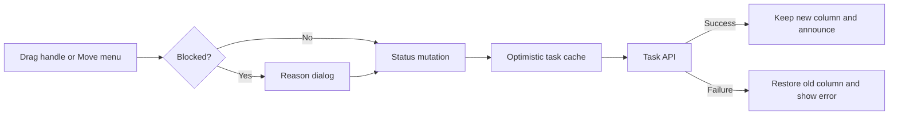

# Work Tracker Kanban Optimization

## Relevant Code Map

- [Shared Kanban board](../../../apps/web/src/components/tasks/TaskKanbanBoard.tsx): drag/drop, Move menu, blocker dialog, status feedback.
- [Work Tracker page](../../../apps/web/src/app/(app)/(employee)/work-tracker/page.tsx): board host and task-status mutation entry point.
- [Employee tasks page](../../../apps/web/src/app/(app)/(employee)/tasks/page.tsx): employee board mutation and error propagation.
- [Admin tasks page](../../../apps/web/src/app/(app)/(admin)/super-admin/tasks/page.tsx): admin board mutation and error propagation.
- [Task status hook](../../../apps/web/src/hooks/useUpdateTask.ts): optimistic cache update and rollback.
- [Task API](../../../apps/web/src/app/api/tasks/[id]/route.ts): status and blocker-reason persistence.
- [Browser tests](../../../e2e/work-tracker-kanban.spec.ts): drag, keyboard/blocker, and rollback coverage.
- [Playwright launcher](../../../scripts/playwright/start-playwright-web.js): respects isolated Next.js build directory and avoids resetting a custom cache.

## Visual Guide

## Entries

### 2026-10-12: Status-move interaction reliability — Implemented

- Problem/evidence: The entire task card was draggable, competing with its detail link; drag targets were subtle; the blocked reason used a browser prompt; there was no keyboard-accessible status move; and callers could swallow mutation errors, preventing board-level failure feedback.
- Delivered solution: Drag only from a visible handle, highlight destination columns, offer a keyboard/touch Move menu, collect a required blocker reason in a dialog, propagate mutation errors, and announce/show failed moves while the optimistic hook restores the card.
- Code paths: shared board, employee/admin task pages, status hook, and task API in the Relevant Code Map.
- Validation: Chromium Playwright tests for drag, keyboard/blocker payload, and failed PATCH rollback passed in the first complete run. After adding visible error feedback, drag and keyboard tests passed together and the final rollback test passed separately. Focused Biome and Node syntax checks passed. An earlier web typecheck passed, while a later whole-web run failed on unrelated concurrently changed marketing-dashboard unused declarations. This entry does not assert a latency improvement.

### 2026-10-12: Browser-test build isolation — Implemented

- Problem/evidence: The Playwright launcher always removed the shared `.next` directory, even when `NEXT_DIST_DIR` selected a different build; subsequent local runs encountered a Next.js webpack runtime error during page load.
- Delivered solution: Resolve the cache directory from a validated `NEXT_DIST_DIR`; preserve an isolated custom cache across reruns and leave the default `.next` cleanup behavior unchanged.
- Code paths: Playwright launcher and browser tests in the Relevant Code Map.
- Validation: `node --check` and focused Biome check passed; Chromium browser tests reached and exercised the board with `NEXT_DIST_DIR=.next-playwright-kanban`.

### 2026-10-12: In-column ordering — Deferred

- Problem/evidence: Reference Kanban boards support card ordering within a list, but the current status-move API does not accept a persisted order; a UI-only reorder would disappear on refresh and conflict between users.
- Proposed solution: Define persistent ordering and concurrency behavior first, then add same-column drag targets and an API update with browser tests.
- Code paths: shared board and task API in the Relevant Code Map.
- Resume condition: Product and data-model agreement on ordering semantics.

## Measurements

- Status: Deferred. No p50/p95 values or delta are available, and no speed claim is made.
- Date: 2026-10-12; commit: `4bbee970`; environment: local Windows development; role: employee; intended sample count: 30 per target with 3 warmups.
- Before command: `pnpm performance:latency --feature work-tracker-kanban --targets "/work-tracker?view=execution,/dashboard" --label before` — failed because local Supabase Auth at `127.0.0.1:55321` refused connections; `pnpm exec supabase status` reported a missing Docker Desktop Linux-engine pipe.
- After command: `pnpm performance:latency --feature work-tracker-kanban --targets "/work-tracker?view=execution,/dashboard" --label after` — failed with `fetch failed` because the required local services were unavailable.
- Resume condition: Start Docker Desktop, local Supabase, and the local web server, then rerun the identical before/after targets and `pnpm performance:latency --feature work-tracker-kanban --compare`. Since the baseline could not be captured before this edit, compare against a pre-change checkout if a true change delta is required.

## Change Log

- 2026-10-12: Audited Kanban interaction friction, implemented accessible status moves and failure feedback, isolated the Playwright build, passed focused browser validation, and deferred measurements and persisted intra-column ordering.
