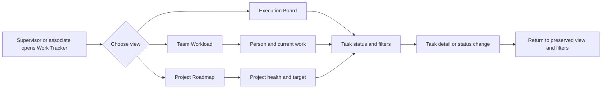

# Work Tracker UI/UX Optimization Review

## Relevant Code Map

- [Work Tracker page](../../../apps/web/src/app/(app)/(employee)/work-tracker/page.tsx): team summary, people drawer, roadmap, execution board, filters, creation, and errors.
- [Section navigation](../../../apps/web/src/components/work-tracker/WorkTrackerSectionNav.tsx): view URLs and active state.
- [Shared Kanban board](../../../apps/web/src/components/tasks/TaskKanbanBoard.tsx): status columns and page-local counts.
- [Work Tracker hook](../../../apps/web/src/hooks/useWorkTracker.ts): response fields and cache key.
- [Work Tracker API](../../../apps/web/src/app/api/work-tracker/route.ts): staff metrics, project summaries, ordering, and date-window semantics.
- [Tasks API](../../../apps/web/src/app/api/tasks/route.ts): global task pagination and filters.
- [Tasks hook](../../../apps/web/src/hooks/useTasks.ts): board query construction.
- [Tasks API tests](../../../tests/api/tasks-route.test.ts) and [Work Tracker API tests](../../../tests/api/work-tracker-route.test.ts): filtering, sorting, and completion-date checks.
- [Work Tracker browser tests](../../../e2e/work-tracker-experience.spec.ts): roadmap, navigation, board, mobile, empty, and retry states.
- [Prior Kanban task tracker](../work-tracker-kanban/task-tracker.md): completed drag, keyboard, blocker, and rollback work.

## Visual Guide

## Entries

### 2026-10-12: Complete and trustworthy board — Audited

- Problem/evidence: `ExecutionView` requests `pageSize: 10` for all statuses, then `TaskKanbanBoard` groups only those ten records and displays their per-column counts. The board hides the Cancelled column without excluding cancelled records at the API query. A page with cancelled records can therefore hide visible work; a zero in a column means zero on this page, not zero in the filtered workload.
- Proposed solution: Give the board a status-aware data contract: exclude cancelled by default, return authoritative total counts per status, and use per-column pagination or a clearly labelled bounded board. Keep list-mode pagination separate from board-mode pagination. Test >10 tasks, all-cancelled first pages, cross-column moves, and filtered counts.
- Code paths: Work Tracker page, shared Kanban board, Tasks API and hook.
- Validation/resume condition: Read-only code inspection completed; implement only after API/view contract is agreed. No latency claim; capture a local baseline before any query or load-time changes.
- Reference: [Linear display options](https://linear.app/docs/display-options) and [Jira board view settings](https://support.atlassian.com/jira-software-cloud/docs/customize-your-view-of-the-board-and-backlog/).

### 2026-10-12: Supervisor metric integrity — Audited

- Problem/evidence: The team list is sorted by `activeDays` and `sessionCount` even though its caption correctly says Control Hub activity is not employee productivity. The 7/30/90-day selector changes usage and a task-completion denominator based on due date or creation date, but open task and project counts remain all-time/current. A recently completed old task may not count in the selected period. This is especially sensitive if tracker activity informs rewards.
- Proposed solution: Separate "Current workload" from "Hub activity" and never rank people by sessions by default. Define task completion by `completed_at` for a selected period, show denominator and date window explicitly, and label current-state counts as current. Use workload, delivery, and blockers as distinct signals; do not present login frequency as a productivity score.
- Code paths: Work Tracker page and API.
- Validation/resume condition: Read-only code inspection completed; agree metric definitions with operations/COO before implementation and test boundary dates, missing due dates, and role visibility.
- Reference: [Linear project updates](https://linear.app/docs/initiative-and-project-updates) distinguish health commentary from task progress; [Asana portfolio reporting](https://help.asana.com/s/article/portfolio-progress-and-reporting) pairs status with contextual updates.

### 2026-10-12: Actionable roadmap and workload — Audited

- Problem/evidence: The roadmap response includes project target dates, but the table does not render them. It has no health, owner, or due-date sorting/filtering; a blocked or overdue project can be buried in an unsorted page. The person drawer lists items by last update, mixing parent projects with tasks rather than answering "what is this person doing now?" The response includes an unassigned-task count that the UI does not show.
- Proposed solution: Default roadmap sort to risk then target date, display target date and next milestone, and provide health/owner filters. Let a project row expand or open a compact detail panel with blocked tasks and next action. In Team Workload, surface blocked/overdue/active tasks first, with project grouping and an unassigned queue for managers; use a recent-update timestamp as secondary context, not as the primary work ordering.
- Code paths: Work Tracker page, Work Tracker API and hook.
- Validation/resume condition: Read-only code inspection completed; confirm that the project model exposes suitable milestone dates and define supervisor versus associate permissions before implementation.
- Reference: [Linear project overview](https://linear.app/docs/project-overview), [Linear project view options](https://linear.app/docs/display-options), and [Linear project updates](https://linear.app/docs/initiative-and-project-updates).

### 2026-10-12: Continuous context across views — Audited

- Problem/evidence: Top-level view links reset `scope`, `days`, project, assignee, and search context. Person/project/task links generally return to bare `/work-tracker`, not the originating view and filters. Execution's local search/project/assignee state is initialized from the URL only once, so browser Back or external URL changes can leave controls out of sync with the address. The header's "Execution board" button repeats an existing tab instead of offering a contextual action.
- Proposed solution: Make view, scope, range, filters, and selected person URL-backed. Preserve relevant context in cross-view links and `returnTo`; show removable filter chips and a one-click Clear all. Replace the duplicate header action with the primary action for the current view (for example, Create task on Execution).
- Code paths: Work Tracker page and section navigation.
- Validation/resume condition: Read-only code inspection completed; define which filters are shared versus view-specific and test deep links, refresh, Back/Forward, and detail return.
- Reference: [Linear filters](https://linear.app/docs/filters) document shareable URL filters; [Trello board filtering](https://support.atlassian.com/trello/docs/filtering-for-cards-on-a-board/) preserves filters across views until cleared.

### 2026-10-12: Lower-friction tasks and recovery — Audited

- Problem/evidence: Team Workload task cards still use `window.prompt` to collect a blocker reason, unlike the improved Kanban dialog. Search calls `router.replace` and updates the task query on every keystroke. Error panels only state that loading failed; empty filtered states have no clear-filters action. Employees leave the board for `/tasks` to create work, while admins can create in a dialog.
- Proposed solution: Reuse the Kanban blocker dialog pattern everywhere, with validation and explicit retry feedback. Debounce search input while keeping a responsive local field; measure request volume and latency before and after implementation. Add Retry and Clear filters actions, and make Create task available in context for authorized roles.
- Code paths: Work Tracker page, shared Kanban board, task hooks.
- Validation/resume condition: Read-only code inspection completed; define employee create permissions and capture local latency/request-count baseline before changes that affect load or query cost.
- Reference: [Jira quick filters](https://support.atlassian.com/jira-software-cloud/docs/show-or-hide-issues-on-your-board/) and [Trello table view](https://support.atlassian.com/trello/docs/single-board-table-view/) support focused, direct task actions.

## Measurements

- Status: The required local baseline was attempted before code edits with `pnpm performance:latency --feature work-tracker --targets "/work-tracker?view=execution,/api/tasks?page=1&pageSize=10,/dashboard" --label before`, but the runner waited on unavailable local services at `localhost:3001` and was interrupted. The identical `--label after` run failed with `[latency] fetch failed` at `http://localhost:3001` (3 targets, configured 30 samples, no completed samples). No p50/p95 or speed claim exists. Run those same before/after commands and `--compare` once local web and Supabase are healthy; record commit, local environment, role, sample count, p50/p95 and delta then.

## Implementation Update — 2026-10-12

- **Implemented — bounded board and honest counts.** The Execution Board excludes cancelled tasks by default and explicitly labels its 10-task page and page-local column counts. The task API supports `excludeCancelled` and `assigneeId=unassigned`; Team Workload links to that unassigned queue. Paths: Work Tracker page, Tasks API/hook/query keys. Validation: 9 focused API tests, typecheck, browser pagination/mobile and existing Kanban tests. This is not a complete-board count.
- **Implemented — clearer supervisor metrics.** The selected period counts tasks by `completed_at`, while open and blocked counts remain current-state. People are alphabetic instead of activity-ranked; copy distinguishes Hub use from productivity or reward eligibility. Paths: Work Tracker API/hook/page and API tests. Validation: focused API tests and typecheck. Reward rules remain a policy decision.
- **Implemented — risk-first roadmap and work ordering.** Roadmap displays target date and next non-approved milestone, sorts blocked/overdue first, and filters by health and owner. Person work prioritizes blockers, overdue work, and in-progress tasks. Paths: Work Tracker API/hook/page. Validation: typecheck and browser roadmap test. A project-level blocked-task detail panel remains deferred.
- **Implemented — context and recovery.** View links preserve URL parameters; task/project return links include the current Work Tracker URL; execution filters sync with browser navigation. Search API calls are debounced, errors offer Retry, filtered empty states offer Clear filters, and Team Workload uses an in-page blocker dialog. Paths: Work Tracker page, section navigation, browser tests. Validation: typecheck, browser navigation/empty/retry tests. Search address-bar replacement still occurs on each keystroke; request count and latency require local measurement.
- **Deferred — authoritative per-column counts and project drilldown.** The existing global task-page contract would need a larger API change and local query-cost measurement. Resume with agreed status-count/per-column pagination semantics and healthy local services.
- **Deferred — employee contextual creation and reward eligibility.** Creation permissions and an operations-approved assessment policy are needed before making employee creation broadly available or showing reward-eligible scores.

## Change Log

- 2026-10-12: Audited Work Tracker end to end, distinguished confirmed code behavior from proposed UX changes, researched official reference products, and prioritized completeness and metric integrity before visual polish. No product code was changed.
- 2026-10-12: Implemented local UI/API improvements and added focused API/browser coverage. No production deployment. Baseline measurement was unavailable because local services did not respond; no performance delta claimed. Remaining areas are listed above.
