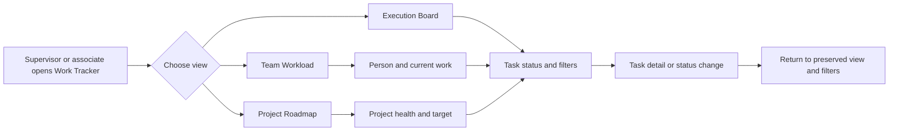
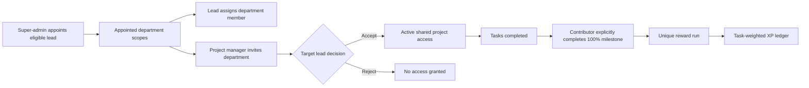
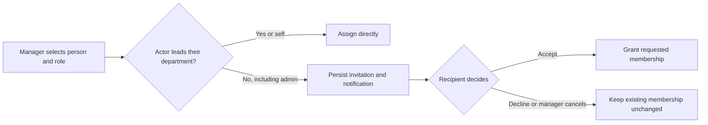
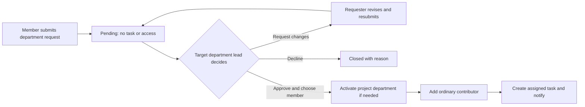

# Work Tracker UI/UX Optimization Review

## Relevant Code Map

- [Work Tracker page](../../../apps/web/src/app/(app)/(employee)/work-tracker/page.tsx): team summary, people drawer, roadmap, execution board, filters, creation, and errors.
- [Section navigation](../../../apps/web/src/components/work-tracker/WorkTrackerSectionNav.tsx): view URLs and active state.
- [Shared Kanban board](../../../apps/web/src/components/tasks/TaskKanbanBoard.tsx): status columns and page-local counts.
- [Work Tracker hook](../../../apps/web/src/hooks/useWorkTracker.ts): response fields and cache key.
- [Work Tracker API](../../../apps/web/src/app/api/work-tracker/route.ts): staff metrics, project summaries, ordering, and date-window semantics.
- [Tasks API](../../../apps/web/src/app/api/tasks/route.ts): global task pagination and filters.
- [Tasks hook](../../../apps/web/src/hooks/useTasks.ts): board query construction.
- [Tasks API tests](../../../tests/api/tasks-route.test.ts) and [Work Tracker API tests](../../../tests/api/work-tracker-route.test.ts): filtering, sorting, and completion-date checks.
- [Work Tracker browser tests](../../../e2e/work-tracker-experience.spec.ts): roadmap, navigation, board, mobile, empty, and retry states.
- [Prior Kanban task tracker](../work-tracker-kanban/task-tracker.md): completed drag, keyboard, blocker, and rollback work.
- [Work-management permissions](../../../apps/web/src/lib/work-management/permissions.ts): canonical department scope and project/assignee authorization.
- [Department leads API](../../../apps/web/src/app/api/departments/leads/route.ts): super-admin-only appointments and eligibility validation.
- [Project departments API](../../../apps/web/src/app/api/projects/[id]/departments/route.ts): invite, accept, reject, cancel, and detach workflow.
- [Department-lead migration](../../../supabase/migrations/20261020000001_department_leads_and_work_management.sql): governance tables, RLS, completion ledger, and XP allocation.
- [Department-lead browser test](../../../e2e/department-lead-work-tracker.spec.ts): privacy-safe department workload at desktop and mobile widths.
- [Lead management dialog](../../../apps/web/src/components/admin/ManageDepartmentLeadsDialog.tsx) and [shared people picker](../../../apps/web/src/components/people/PersonSearchSelect.tsx): searchable directory-wide appointments.
- [Appointment API tests](../../../tests/api/department-leads-route.test.ts), [scope tests](../../../tests/lib/work-management-permissions.test.ts), and [management browser tests](../../../e2e/leadership-account-classification.spec.ts): eligibility, multiple departments, removal, and failure recovery.
- [Project creation](../../../apps/web/src/app/(app)/(employee)/projects/new/page.tsx), [contributor management](../../../apps/web/src/components/projects/ManageContributorsDialog.tsx), and [invitation review](../../../apps/web/src/app/(app)/(employee)/projects/invitations/page.tsx): project-lead selection, pending states, and recipient decisions.
- [Project membership RPCs](../../../supabase/migrations/20261104000004_project_member_invitations.sql) and [co-lead permissions](../../../supabase/migrations/20261104000003_project_co_leads.sql): atomic assignments, notifications, response locking, and RLS protections.
- [Invitation API tests](../../../tests/api/project-member-invitations-route.test.ts), [local invitation SQL](../../../tests/sql/project-member-invitations-local.sql), [local co-lead SQL](../../../tests/sql/project-co-leads-local.sql), and [project browser journeys](../../../e2e/project-co-leads.spec.ts): consent, authorization, error recovery, and responsive workflows.
- [Department request migration](../../../supabase/migrations/20261113000001_cross_department_work_requests.sql), [request API](../../../apps/web/src/app/api/work-requests/route.ts), and [decision API](../../../apps/web/src/app/api/work-requests/[id]/route.ts): auditable request state, authorization, notification, and atomic approval.
- [Department request UI](../../../apps/web/src/components/work-tracker/CrossDepartmentWorkRequests.tsx), [request hooks](../../../apps/web/src/hooks/useCrossDepartmentWorkRequests.ts), and [browser journey](../../../e2e/cross-department-work-requests.spec.ts): requester/reviewer states, server-confirmed actions, and responsive verification.

## Visual Guide



## Entries

### 2026-10-12: Complete and trustworthy board — Audited

- Problem/evidence: `ExecutionView` requests `pageSize: 10` for all statuses, then `TaskKanbanBoard` groups only those ten records and displays their per-column counts. The board hides the Cancelled column without excluding cancelled records at the API query. A page with cancelled records can therefore hide visible work; a zero in a column means zero on this page, not zero in the filtered workload.
- Proposed solution: Give the board a status-aware data contract: exclude cancelled by default, return authoritative total counts per status, and use per-column pagination or a clearly labelled bounded board. Keep list-mode pagination separate from board-mode pagination. Test >10 tasks, all-cancelled first pages, cross-column moves, and filtered counts.
- Code paths: Work Tracker page, shared Kanban board, Tasks API and hook.
- Validation/resume condition: Read-only code inspection completed; implement only after API/view contract is agreed. No latency claim; capture a local baseline before any query or load-time changes.
- Reference: [Linear display options](https://linear.app/docs/display-options) and [Jira board view settings](https://support.atlassian.com/jira-software-cloud/docs/customize-your-view-of-the-board-and-backlog/).

### 2026-10-12: Supervisor metric integrity — Audited

- Problem/evidence: The team list is sorted by `activeDays` and `sessionCount` even though its caption correctly says Control Hub activity is not employee productivity. The 7/30/90-day selector changes usage and a task-completion denominator based on due date or creation date, but open task and project counts remain all-time/current. A recently completed old task may not count in the selected period. This is especially sensitive if tracker activity informs rewards.
- Proposed solution: Separate "Current workload" from "Hub activity" and never rank people by sessions by default. Define task completion by `completed_at` for a selected period, show denominator and date window explicitly, and label current-state counts as current. Use workload, delivery, and blockers as distinct signals; do not present login frequency as a productivity score.
- Code paths: Work Tracker page and API.
- Validation/resume condition: Read-only code inspection completed; agree metric definitions with operations/COO before implementation and test boundary dates, missing due dates, and role visibility.
- Reference: [Linear project updates](https://linear.app/docs/initiative-and-project-updates) distinguish health commentary from task progress; [Asana portfolio reporting](https://help.asana.com/s/article/portfolio-progress-and-reporting) pairs status with contextual updates.

### 2026-10-12: Actionable roadmap and workload — Audited

- Problem/evidence: The roadmap response includes project target dates, but the table does not render them. It has no health, owner, or due-date sorting/filtering; a blocked or overdue project can be buried in an unsorted page. The person drawer lists items by last update, mixing parent projects with tasks rather than answering "what is this person doing now?" The response includes an unassigned-task count that the UI does not show.
- Proposed solution: Default roadmap sort to risk then target date, display target date and next milestone, and provide health/owner filters. Let a project row expand or open a compact detail panel with blocked tasks and next action. In Team Workload, surface blocked/overdue/active tasks first, with project grouping and an unassigned queue for managers; use a recent-update timestamp as secondary context, not as the primary work ordering.
- Code paths: Work Tracker page, Work Tracker API and hook.
- Validation/resume condition: Read-only code inspection completed; confirm that the project model exposes suitable milestone dates and define supervisor versus associate permissions before implementation.
- Reference: [Linear project overview](https://linear.app/docs/project-overview), [Linear project view options](https://linear.app/docs/display-options), and [Linear project updates](https://linear.app/docs/initiative-and-project-updates).

### 2026-10-12: Continuous context across views — Audited

- Problem/evidence: Top-level view links reset `scope`, `days`, project, assignee, and search context. Person/project/task links generally return to bare `/work-tracker`, not the originating view and filters. Execution's local search/project/assignee state is initialized from the URL only once, so browser Back or external URL changes can leave controls out of sync with the address. The header's "Execution board" button repeats an existing tab instead of offering a contextual action.
- Proposed solution: Make view, scope, range, filters, and selected person URL-backed. Preserve relevant context in cross-view links and `returnTo`; show removable filter chips and a one-click Clear all. Replace the duplicate header action with the primary action for the current view (for example, Create task on Execution).
- Code paths: Work Tracker page and section navigation.
- Validation/resume condition: Read-only code inspection completed; define which filters are shared versus view-specific and test deep links, refresh, Back/Forward, and detail return.
- Reference: [Linear filters](https://linear.app/docs/filters) document shareable URL filters; [Trello board filtering](https://support.atlassian.com/trello/docs/filtering-for-cards-on-a-board/) preserves filters across views until cleared.

### 2026-10-12: Lower-friction tasks and recovery — Audited

- Problem/evidence: Team Workload task cards still use `window.prompt` to collect a blocker reason, unlike the improved Kanban dialog. Search calls `router.replace` and updates the task query on every keystroke. Error panels only state that loading failed; empty filtered states have no clear-filters action. Employees leave the board for `/tasks` to create work, while admins can create in a dialog.
- Proposed solution: Reuse the Kanban blocker dialog pattern everywhere, with validation and explicit retry feedback. Debounce search input while keeping a responsive local field; measure request volume and latency before and after implementation. Add Retry and Clear filters actions, and make Create task available in context for authorized roles.
- Code paths: Work Tracker page, shared Kanban board, task hooks.
- Validation/resume condition: Read-only code inspection completed; define employee create permissions and capture local latency/request-count baseline before changes that affect load or query cost.
- Reference: [Jira quick filters](https://support.atlassian.com/jira-software-cloud/docs/show-or-hide-issues-on-your-board/) and [Trello table view](https://support.atlassian.com/trello/docs/single-board-table-view/) support focused, direct task actions.

## Measurements

- Status: The required local baseline was attempted before code edits with `pnpm performance:latency --feature work-tracker --targets "/work-tracker?view=execution,/api/tasks?page=1&pageSize=10,/dashboard" --label before`, but the runner waited on unavailable local services at `localhost:3001` and was interrupted. The identical `--label after` run failed with `[latency] fetch failed` at `http://localhost:3001` (3 targets, configured 30 samples, no completed samples). No p50/p95 or speed claim exists. Run those same before/after commands and `--compare` once local web and Supabase are healthy; record commit, local environment, role, sample count, p50/p95 and delta then.

## Implementation Update — 2026-10-12

- **Implemented — bounded board and honest counts.** The Execution Board excludes cancelled tasks by default and explicitly labels its 10-task page and page-local column counts. The task API supports `excludeCancelled` and `assigneeId=unassigned`; Team Workload links to that unassigned queue. Paths: Work Tracker page, Tasks API/hook/query keys. Validation: 9 focused API tests, typecheck, browser pagination/mobile and existing Kanban tests. This is not a complete-board count.
- **Implemented — clearer supervisor metrics.** The selected period counts tasks by `completed_at`, while open and blocked counts remain current-state. People are alphabetic instead of activity-ranked; copy distinguishes Hub use from productivity or reward eligibility. Paths: Work Tracker API/hook/page and API tests. Validation: focused API tests and typecheck. Reward rules remain a policy decision.
- **Implemented — risk-first roadmap and work ordering.** Roadmap displays target date and next non-approved milestone, sorts blocked/overdue first, and filters by health and owner. Person work prioritizes blockers, overdue work, and in-progress tasks. Paths: Work Tracker API/hook/page. Validation: typecheck and browser roadmap test. A project-level blocked-task detail panel remains deferred.
- **Implemented — context and recovery.** View links preserve URL parameters; task/project return links include the current Work Tracker URL; execution filters sync with browser navigation. Search API calls are debounced, errors offer Retry, filtered empty states offer Clear filters, and Team Workload uses an in-page blocker dialog. Paths: Work Tracker page, section navigation, browser tests. Validation: typecheck, browser navigation/empty/retry tests. Search address-bar replacement still occurs on each keystroke; request count and latency require local measurement.
- **Deferred — authoritative per-column counts and project drilldown.** The existing global task-page contract would need a larger API change and local query-cost measurement. Resume with agreed status-count/per-column pagination semantics and healthy local services.
- **Deferred — employee contextual creation and reward eligibility.** Creation permissions and an operations-approved assessment policy are needed before making employee creation broadly available or showing reward-eligible scores.

## Change Log

- 2026-10-12: Audited Work Tracker end to end, distinguished confirmed code behavior from proposed UX changes, researched official reference products, and prioritized completeness and metric integrity before visual polish. No product code was changed.
- 2026-10-12: Implemented local UI/API improvements and added focused API/browser coverage. No production deployment. Baseline measurement was unavailable because local services did not respond; no performance delta claimed. Remaining areas are listed above.
- 2026-10-20: Implemented and validated department-lead governance, shared-project invitations, scoped assignment, privacy-safe department reporting, explicit milestone completion, and deterministic exactly-once XP distribution. The two owning migrations were applied and ledger-verified in local and production Supabase. No latency improvement was targeted or claimed.
- 2026-11-04: Implemented directory-wide lead search and independent multi-department appointment scope. Focused tests, desktop/mobile Chromium checks, typecheck and targeted lint passed. No database changes, deployment, or latency claim.

## Department Lead Governance Update — 2026-10-20

### Implemented — least-privilege department management

- Problem/evidence: assignment was global-admin-only, while granting ordinary project participation broad management rights would expose people and projects outside a lead's department.
- Delivered solution: super-admins can appoint multiple active leads only from active users in the same canonical department. Every management request revalidates the appointment against the user's current department, and assignee selection is limited to that department. Admins and super-admins retain global scope.
- Historical note: the home-department restriction is superseded by the 2026-11-04 multi-department update below.
- Validation: focused project/task/Work Tracker API tests passed 13/13; web typecheck passed. Local Supabase migration and lint ran; lint reported one unrelated pre-existing `get_knowledge_source_versions` error.
- References: [Linear member roles](https://linear.app/docs/members-roles), [Linear issue assignment](https://linear.app/docs/assigning-issues), and [Jira project roles](https://support.atlassian.com/jira/kb/grant-access-to-single-jira-project-that-uses-a-shared-permission-scheme/).

### Implemented — explicit shared-project consent

- Problem/evidence: a project may need contributors from multiple departments, but silently attaching a department would grant visibility and management scope without the target lead's consent.
- Delivered solution: project managers invite another department; a lead of that department accepts or rejects it before access activates. Invite cancellation and self-detachment are explicit, and at least one active department must remain. Global admins may directly attach or remove departments.
- Validation: project-department dialog and actions were exercised in Chromium at desktop and mobile widths. The dialog stayed contained and communicated pending/active states.
- Reference: [Asana permissions overview](https://help.asana.com/s/article/permissions-overview).

### Implemented — private team visibility and auditable rewards

- Problem/evidence: department leads need operational workload visibility, not employee login/session telemetry. Automatic milestone approval also made reward timing implicit and could not represent contribution fairly.
- Delivered solution: lead team scope returns department projects/tasks while omitting Hub usage data and columns. A 100% milestone requires an explicit Complete action. Its fixed XP pool is split by completed-task count using deterministic largest remainder, falls back to the project lead when needed, and is protected by a unique reward run.
- Validation: desktop 1440x900 and mobile 390x844 screenshots were inspected; the department scope and privacy notice rendered without Hub columns. A rolled-back local SQL transaction verified 100/50 XP for a 2:1 task split and no duplicate on a repeat completion.



## Multi-department Lead Search Update - 2026-11-04

### Implemented - searchable appointments independent of home department

- Problem/evidence: the management dialog filtered a capped directory page by home
  department, the appointment API rejected people from other departments and non-staff
  roles, and the shared permission resolver silently discarded appointments outside
  the lead's current home department. A picker-only fix would not grant working access.
- Solution: reuse the existing paginated `PersonSearchSelect` for name/email/position
  search across all directory-visible accounts, including admins and leadership.
  Validate the same directory population on the API. Derive lead scope from all active
  appointments without changing home-department membership. Exclude current leads only
  for the selected department; keep appointments/removals server-confirmed.
- Boundaries: missing, deleted, terminated, and non-directory candidates cannot be
  appointed; missing/deleted departments are rejected. Revoking one department does
  not revoke other appointments. Project membership and target-member eligibility
  checks remain in place; global admin permissions are unchanged. Terminated/deleted
  leads do not retain department scope; active appointments grant scope regardless of
  account kind (for example, leadership or privileged accounts).
- Validation: 35 focused API/scope/picker/Work Tracker tests passed, web typecheck and
  targeted Biome passed, and three Chromium tests passed against mocked APIs. Checked
  `/admin/directory` as super-admin at desktop 1440x960 and mobile 390x844: search,
  empty search, keyboard selection, duplicate exclusion, multi-department appointment,
  removal independent of other departments, pending confirmation and recoverable errors.
  Search/appointed-state screenshots were inspected; successful-flow console checks passed.
  No live database mutation, migration or production deployment was performed. No latency
  improvement is targeted or claimed.
- Reference patterns: [GitHub assignment](https://docs.github.com/en/issues/tracking-your-work-with-issues/using-issues/assigning-issues-and-pull-requests-to-other-github-users)
  documents typing a username then selecting a person; [Linear assignment](https://linear.app/docs/assigning-issues)
  separates workspace-wide assignment from private-team eligibility. Here, search
  spans the permitted directory population while department appointments determine
  work-management scope; competitor styling and unrelated permissions are not copied.
- Acceptance: a super-admin can find an account outside Operations, appoint them to
  both Operations and Marketing, remove only Operations, and retain Marketing access.
  Empty/error/pending states must be explicit, duplicate appointments excluded,
  and the search/selected states usable at desktop and mobile widths.

### Validation commands and limitations

- Passed: `pnpm exec vitest run tests\api\department-leads-route.test.ts tests\lib\work-management-permissions.test.ts tests\components\PersonSearchSelect.test.tsx tests\api\work-tracker-route.test.ts` (35 tests).
- Passed: `pnpm --filter @hr-portal/web typecheck`.
- Passed: `pnpm exec biome check --write apps\web\src\components\admin\ManageDepartmentLeadsDialog.tsx apps\web\src\app\api\departments\leads\route.ts apps\web\src\lib\work-management\permissions.ts tests\api\department-leads-route.test.ts tests\lib\work-management-permissions.test.ts e2e\leadership-account-classification.spec.ts`.
- Passed: the local browser command below (three tests). The original shared-cache run
  encountered an invalid Next chunk; the isolated cache passed and was removed afterward,
  together with its automatically generated tsconfig include. Playwright stopped its server.
- Additional consumer check: `pnpm exec vitest run tests\api\projects-route.test.ts tests\api\project-contributors-route.test.ts tests\api\tasks-route.test.ts tests\api\tasks-id-route.test.ts` yielded eight passing tests and two existing contributor-mock failures. The contributor mock omits `.is()`, already required by unchanged `canManageProject` at HEAD; unrelated test repair was not included.
- Intentionally skipped: full repository build/suite and live database checks; the change
  is covered by targeted API/scope tests and browser mocks and requires no schema migration.

```powershell
$env:PLAYWRIGHT_HTML_OPEN='never'
$env:NEXT_DIST_DIR='.next-department-leads-e2e'
$env:PLAYWRIGHT_WEB_PORT='3012'
pnpm exec playwright test --config playwright.local.config.ts leadership-account-classification.spec.ts --grep "department|same lead" --reporter=list --timeout=90000
```

## Multiple Project Leads and Individual Invitations - 2026-11-04

### Implemented - role clarity and consent before cross-department assignment

- Problem/evidence: project ownership previously exposed only one primary lead,
  while the contributor label `lead` did not consistently grant management rights.
  Adding a person outside the assigner's departments could grant project access
  without that person's agreement.
- Delivered solution: allow multiple leads, explain the difference from ordinary
  contributors, and present searchable candidates with an invitation-required
  indicator. Direct assignment is limited to the actor or people in departments
  the actor actively leads; administrators follow the same consent rule. A pending
  invite grants no new access, preserves any existing membership, and can be
  accepted, declined, or cancelled. A proposed primary becomes co-lead instead
  if a newer primary was chosen before acceptance.
- Reliability/security: project creation, membership changes and notification
  writes are transactional; recipient identity and active status are checked
  server-side. Project and invitation locks use a consistent order, and direct
  database and implicit task-assignment paths cannot bypass consent. Project
  membership and department activation remain separate.
- UX references: [GitHub organization invitations](https://docs.github.com/en/organizations/managing-membership-in-your-organization/inviting-users-to-join-your-organization)
  documents acceptance before membership and cancellation before acceptance;
  [Slack pending invitations](https://slack.com/help/articles/360060363633-Manage-pending-invitations-and-invite-links-for-your-workspace)
  documents visible pending invitations and manager cancellation. This app uses
  in-app notifications and explicit accept/decline; expiry is not implemented.
- Validation: 76 focused API/scope/hook tests, web/UI typechecks, and seven
  Chromium journeys passed using mocked APIs. Checked `/projects/new` (department
  lead and admin), `/projects/[id]` (co-lead and contributor), `/work-tracker`,
  `/admin/war-room`, `/notifications`, and `/projects/invitations` (invitee);
  covered 1440x960 desktop and 390x844 mobile, keyboard selection, pending/cancel,
  accept/decline, loading/error recovery and overflow. Inspected new-project,
  contributor-dialog, invitation-review and accepted-state mobile screenshots.
  The existing department-lead suite also passed three super-admin browser tests.
- Deployment/limitations: both migrations were applied locally and, with explicit
  approval, in production; the migration histories agree and the final production
  dry run reports up to date. Local SQL tests passed against the migrated schema,
  and database types were generated locally with the nullable supervisor argument
  restored to reflect its actual API contract. No real-API browser flow,
  simultaneous multi-session response test, or application rollout verification
  was performed. The broad lint run exposed an unchanged array-index-key error in
  the project detail page; focused new-file lint passed with warnings. No latency
  improvement is claimed.



### Focused validation commands

```powershell
pnpm exec vitest run tests\api\projects-route.test.ts tests\api\project-member-invitations-route.test.ts tests\api\project-lead-candidates-route.test.ts tests\api\project-contributors-route.test.ts tests\api\admin-projects-overview-route.test.ts tests\api\department-leads-route.test.ts tests\api\work-tracker-route.test.ts tests\lib\work-management-permissions.test.ts tests\hooks\useProjectLeadership.test.tsx
pnpm --filter @hr-portal/web typecheck
pnpm --filter @hr-portal/ui typecheck
$env:NEXT_DIST_DIR='.next-copilot-build'
pnpm build
$env:PLAYWRIGHT_BASE_URL='http://localhost:3003'
$env:PLAYWRIGHT_WEB_PORT='3003'
$env:NEXT_DIST_DIR='.next-copilot-co-leads'
pnpm exec playwright test --config playwright.local.config.ts 'project-co-leads.spec.ts' --reporter=list --timeout=90000
```

Both SQL suites were run locally by replacing each test file's migration marker
with the relevant migration contents and piping the combined script to
`docker exec -i supabase_db_sn-hr-portal psql -U postgres -d postgres -v ON_ERROR_STOP=1`.
Each suite ends with `ROLLBACK`. For the invitation suite, insert both co-lead and
invitation migrations in timestamp order when running against an unmigrated local
schema; after local migration, run the files without inserting migrations. The SQL
tests target local only. Production migrations were applied separately after approval.

### Change log

- 2026-11-04: Implemented multi-lead and consent flows; verified focused tests,
  rollback-only SQL and mocked desktop/mobile journeys.
- 2026-11-04: Applied and verified both local and approved production migrations,
  regenerated types, reran local SQL/76 focused tests, and passed the full build.
  Real-API browser validation, concurrent-response testing, and application rollout
  verification remain open in the [task tracker](task-tracker.md).

## Cross-Department Staffing Requests - 2026-11-13

### Implemented - capacity approval before assignment

- Problem/evidence: people could create their own work, but asking another department for help had no single auditable intake. Direct assignment bypassed the target lead’s workload context, while adding someone during project creation could make the role appear to be project leadership.
- Delivered solution: add a Department Requests view with requester and reviewer inboxes. Any active user may submit a request to another department. A target-department lead can approve with a named assignee, request changes with guidance, or decline with a reason. Approved project work activates the department and adds the assignee as an ordinary contributor before creating the task. Project creation now exposes separate leadership and contributor pickers; the same person cannot be selected in both roles.
- Reliability/security: create, revise, and decision mutations are server-confirmed. Database functions lock the request, reject self-review/repeated decisions, re-check lead authority and assignee department membership, and create task/membership/notifications in the same transaction. Requesters do not receive target-department candidate lists. Pending requests grant no task or project access.
- Reference patterns: [Linear Triage](https://linear.app/docs/triage) uses an explicit intake state before work enters a team’s active workflow; [Asana approvals](https://help.asana.com/s/article/approvals) separates approve, request changes, and reject decisions; [Jira approvals](https://support.atlassian.com/jira-service-management-cloud/docs/what-are-approvals/) keeps approver decisions visible on the work item. The Control Hub implementation maps those patterns to department capacity and uses existing department-lead authority rather than copying another product’s permissions.
- Validation: migration `20261113000001` applied to local Supabase and production project `tccdupkjmwwxcvpqnpeb`; both ledgers agree and the final linked dry run is clean. Generated database types were refreshed. The rollback-only SQL suite proved pending isolation, self-review and repeated-decision rejection, atomic task ownership, revoked authenticated function execution, and contributor-role preservation. Twelve focused Vitest tests, web/database typechecks, targeted Biome with warnings only, and the full web production build passed. The focused Playwright journey passed at 1440x900 and 390x844, exercised review and assignee selection, inspected both screenshots, and asserted no console errors or failed requests.


